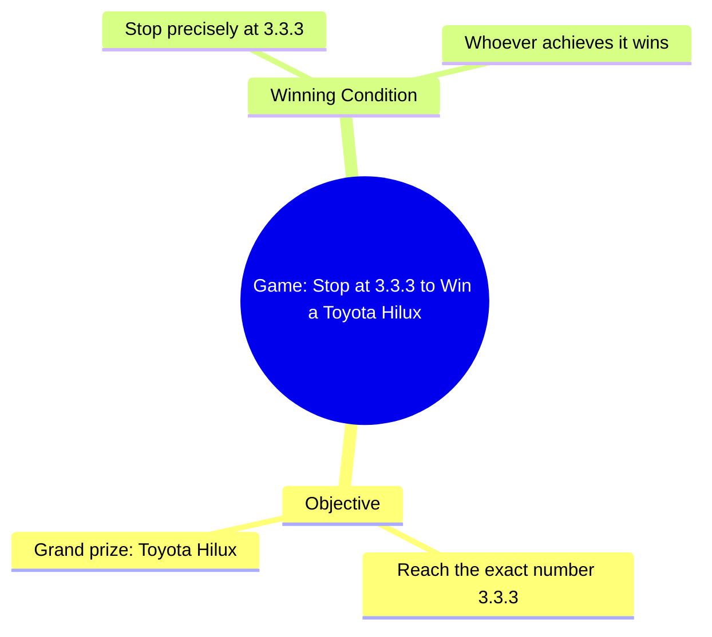

# Toyota Hilux Grand Prize Contest at Dealership Opening

> 🌐 **Read this in:** **English** · [中文](../../zh-CN/2026-10/tiktok-transcript-1-6m-views-27k-reactions-toyota-toyotadealership-toyotaafric-7676.md)

> **Creator:** [@ꓔ𝚘𝚢𝚘𝚝𝚊 𝙳𝚎𝚊𝚕𝚕𝚎𝚛 𝙵𝚊𝚗𝚜](https://www.tiktok.com/@ꓔ𝚘𝚢𝚘𝚝𝚊 𝙳𝚎𝚊𝚕𝚕𝚎𝚛 𝙵𝚊𝚗𝚜) · **Views:** 517.3K · **Posted:** 2026-10-17 · **Niche:** entertainment
>
> **TL;DR:** It presents a clear, difficult challenge with a valuable reward, creating immediate curiosity and suspense.

[Watch original video →](https://www.facebook.com/share/r/1DUAFfTKHs/)

## Why This Went Viral

## Hook (first 3 seconds)
- **Verbatim opening line:** "Whoever manages to stop at the number 3.3.3 will win the grand prize, a Toyota Hilux."
- **Hook pattern:** Challenge + prize stakes (a "contest invitation" hook), with a specific number and a high-value reward.
- **Why it stops the scroll:** It instantly reframes the viewer from passive watcher to potential contestant. A concrete, desirable prize (Toyota Hilux) plus a simple-sounding task ("just stop at 3.3.3") creates an immediate "I could do that" reflex — and the specificity of "3.3.3" makes it feel like a real, winnable game rather than vague clickbait.

## Emotional Rhythm
- **Curiosity (0–3s):** The prize + rule setup — "what's the catch?"
- **Anticipation/tension (early-mid):** Viewers mentally rehearse the task and start predicting who will win or how it'll go wrong.
- **Suspense peak (the attempt):** The moment of stopping at/near 3.3.3 — will they nail it or overshoot? This is where the viewer's own "I would've…" commentary kicks in.
- **Twist/reveal (climax):** The outcome — success, near-miss, or failure. The climax is the instant the number lands (or doesn't), because it resolves the entire premise set up in the hook.
- **Relief/frustration resonance (aftermath):** Reaction to the result — satisfaction if won, secondhand frustration if lost. Either emotion drives comments.

## Keyword Density
- **"3.3.3"** — the anchor; drives rewatches and comments ("so close!").
- **"win" / "grand prize"** — stakes and reward framing.
- **"Toyota Hilux"** — concrete, high-value object; strong emotional pull and shareability.
- **"stop"** — the action verb of the challenge.
- **"whoever"** — inclusivity; invites every viewer into the game.
- **"manages to"** — implies difficulty, raising tension.
- **Algorithmic drivers:** "win," "grand prize," "Toyota Hilux" — high-intent, high-search/save terms that signal value and reward.
- **Emotional drivers:** "3.3.3," "stop," "whoever" — create the participatory, replay-worthy tension that fuels comments and rewatches.

## Why It Spreads
- **Built-in participation:** "Whoever manages to stop at 3.3.3" turns every viewer into an imaginary contestant — people comment their own strategy or "I would've stopped at 3.2."
- **High-value, recognizable prize:** Naming "a Toyota Hilux" makes the stakes tangible and shareable; viewers tag friends who'd want it.
- **Precision tension:** The exact "3.3.3" target creates a near-miss dynamic — the closer the attempt, the stronger the replay and comment impulse ("so close!").
- **Simple rule, unpredictable outcome:** One sentence explains the whole game, so anyone can follow instantly — low cognitive load, high retention.
- **Outcome-driven loop:** The hook promises a resolution (who wins), and the payoff moment invites rewatch to catch the exact instant — boosting watch time and completion rate.

## What You Can Steal
1. **Open with a challenge + a named prize.** State the rule and the reward in one sentence (like "stop at 3.3.3 → win a Hilux") so viewers instantly become participants.
2. **Use a hyper-specific target number or detail.** Precision ("3.3.3") creates near-miss tension and gives commenters something exact to argue about.
3. **Design for the replay moment.** Build toward one clear climax (the instant the number lands) so viewers rewatch to catch it — and comment their own "I would've…" take.

## Mind Map

## Full Transcript (Generated by [TokTranscript.com](https://toktranscript.com/?utm_source=github&utm_medium=breakdown&utm_campaign=tool_attribution))

> 📝 Transcripts on this page are auto-generated and show the first 60%. Want to transcribe any TikTok in 30 seconds and get the full version? [Try TokTranscript free →](https://toktranscript.com/?utm_source=github&utm_medium=breakdown&utm_campaign=transcript_cta)

Whoever manages to stop at the number 3.3.

*[Read the full transcript on TokTranscript →](https://toktranscript.com/plaza/tiktok-transcript-1-6m-views-27k-reactions-toyota-toyotadealership-toyotaafric-7676?utm_source=github&utm_medium=breakdown&utm_campaign=transcript_full)*

## Browse More

- All [entertainment](../../by-niche/en/entertainment.md) breakdowns
- All [Challenge with Prize](../../by-pattern/en/hook-challenge-with-prize.md) examples

## Video Info

| | |
|---|---|
| Creator | [@ꓔ𝚘𝚢𝚘𝚝𝚊 𝙳𝚎𝚊𝚕𝚕𝚎𝚛 𝙵𝚊𝚗𝚜](https://www.tiktok.com/@ꓔ𝚘𝚢𝚘𝚝𝚊 𝙳𝚎𝚊𝚕𝚕𝚎𝚛 𝙵𝚊𝚗𝚜) |
| Original video | [https://www.facebook.com/share/r/1DUAFfTKHs/](https://www.facebook.com/share/r/1DUAFfTKHs/) |
| Original title | 1.6M views · 27K reactions | #Toyota #toyotadealership #ToyotaAfrica #GrandOpening #ToyotaSouthAfrica🇿🇦 #ToyotaBotswana🇧🇼 #ToyotaNigeria🇳🇬 #ToyotaGhana🇬🇭 #ToyotaKenya🇰🇪 #ToyotaUganda🇺🇬 #ToyotaTanzania🇹🇿 #NigeriaCars #GhanaCars #KenyaCars #AfricanCars #CarsAfrica #AfricaReels #CarReels #AmericanCars #USACars🇺🇸 #UKCars🇬🇧 #CanadaCars🇨🇦 #AustraliaCars🇦🇺 #NewZealandCars🇳🇿 #FYP #ViralVideos #ForyouPage #FypReels #ViralReels #ReelsAfrica #ToyotaLovers #ViralVideos #ForyouPage #FypAfrica #ViralReels | ꓔ𝚘𝚢𝚘𝚝𝚊 𝙳𝚎𝚊𝚕𝚕𝚎𝚛 𝙵𝚊𝚗𝚜 |
| Views | 517.3K (517269) |
| Posted | 2026-10-17 |
| Duration | 0s |
| Niche | `entertainment` |
| Hook pattern | `Challenge with Prize` |
| Original language | `en` |
| Available languages | en, zh-CN |
| Generated | 2026-10-19 by [TokTranscript](https://toktranscript.com/) |

---

*This breakdown is for educational analysis under fair use. Original video © [@ꓔ𝚘𝚢𝚘𝚝𝚊 𝙳𝚎𝚊𝚕𝚕𝚎𝚛 𝙵𝚊𝚗𝚜](https://www.tiktok.com/@ꓔ𝚘𝚢𝚘𝚝𝚊 𝙳𝚎𝚊𝚕𝚕𝚎𝚛 𝙵𝚊𝚗𝚜). All transcripts are auto-generated and may contain errors.*

*Want to analyze your own TikToks like this? [free TikTok transcript generator →](https://toktranscript.com/viral-breakdown?utm_source=github&utm_medium=breakdown&utm_campaign=footer_cta)*