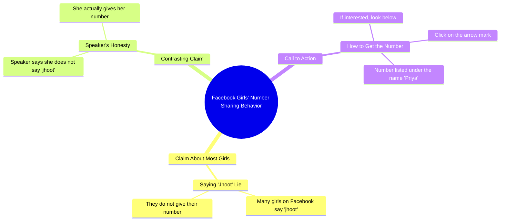

# Bank Auction Fortuner and Scorpio Cars Cheap

> 🌐 **Read this in:** **English** · [中文](../../zh-CN/2026-10/tiktok-transcript-11m-views-143k-reactions-fortuner-auction-roamingbird-auctio-c14f.md)

> **Creator:** [@प्रिया कुमारी ](https://www.tiktok.com/@प्रिया कुमारी ) · **Views:** 4.1M · **Posted:** 2026-10-09 · **Niche:** entertainment
>
> **TL;DR:** The hook sets up a clear contrast between other girls who lie and the speaker who genuinely gives her number, creating curiosity and trust.

[Watch original video →](https://www.facebook.com/share/r/18Dvaaz8Xk/)

## Why This Went Viral

## Hook (first 3 seconds)
- **Verbatim opening:** "फेस्बुक पे बहुत सी लड़कियां जूट बोलती है, अपना नंबर नहीं देती, लेकिन मैं जूट नहीं बोलती, मैं सही में अपना नंबर देती हूँ" ("Many girls on Facebook lie/pretend, they don't give their number, but I don't lie, I actually give my number")
- **Hook pattern:** Contrast + bold claim ("other girls do X, but I do the opposite") stacked with a forbidden/curiosity trigger (a woman offering her phone number publicly).
- **Why it stops the scroll:** It weaponizes social comparison and taboo. The viewer's brain instantly asks "is this real?" and "who is this girl?" — two unresolved questions in one sentence. The self-positioning as "different from other girls" also baits both male attention and female engagement (agreement or outrage).

## Emotional Rhythm
- **0–3s — Curiosity + mild shock:** The contrast claim ("others lie, I don't") creates instant cognitive tension.
- **3–6s — Validation/trust beat:** "मैं सही में अपना नंबर देती हूँ" ("I really give my number") reinforces sincerity, pulling the viewer deeper.
- **6–9s — Reward/CTA spike:** "अगर चाहिए तो नीचे देखो तीर वाला निशान पर क्लिक करें" ("if you want it, look below and click the arrow") converts curiosity into an action impulse.
- **Climax moment:** The reveal "मेरा नंबर प्रिया के नाम" ("my number is under the name Priya") — the payoff that makes the promise feel concrete and actionable.
- **Twist/resonance:** The whole video is a soft bait — the "number" is framed as a real offer, which is exactly what keeps comments and DMs firing.

## Keyword Density
- **फेस्बुक (Facebook)** — platform keyword, drives algorithmic reach and context.
- **लड़कियां (girls)** — audience-targeting keyword, triggers both male curiosity and female reaction.
- **नंबर (number)** — the core emotional/curiosity keyword, repeated 3x.
- **जूट / झूठ (lie)** — moral-contrast keyword, creates the "us vs. them" frame.
- **सही में (really/actually)** — authenticity marker, boosts trust perception.
- **नीचे देखो (look below)** — engagement/CTA keyword, drives clicks and comments.
- **तीर वाला निशान (arrow mark)** — directional cue, engineered for UI-driven action.
- **प्रिया (Priya)** — personalization keyword, makes the offer feel human and specific.

**Algorithmic drivers:** Facebook, number, नीचे देखो, तीर वाला निशान (platform + action words).
**Emotional pull:** लड़कियां, जूट, सही में, प्रिया (identity, morality, authenticity, personal name).

## Why It Spreads
- **Forbidden-offer bait:** "मैं सही में अपना नंबर देती हूँ" promises something socially rare — a woman publicly sharing contact info — which triggers shares, saves, and DMs.
- **Us-vs-them framing:** "बहुत सी लड़कियां जूट बोलती है... लेकिन मैं जूट नहीं बोलती" positions the speaker as the exception, which invites both defenders and critics to comment.
- **Explicit CTA loop:** "नीचे देखो तीर वाला निशान पर क्लिक करें" forces a UI interaction, inflating watch time and click-through signals the algorithm rewards.
- **Name-drop personalization:** "मेरा नंबर प्रिया के नाम" makes the promise feel verifiable and personal, which increases comment volume ("did anyone find it?").
- **Short, single-idea script:** Zero filler — the entire video is one promise + one CTA, making it easy to rewatch and share without context.

## What You Can Steal
- **Open with a contrast claim.** "Everyone does X, but I do Y" is a one-line hook that creates instant tension and positions you as the exception.
- **Bury the payoff, then CTA it.** Promise something specific, then direct viewers to a concrete action ("click the arrow below") — this converts curiosity into measurable engagement.
- **Use one emotional keyword repeated 2–3x.** Pick a word tied to identity or taboo (number, truth, lie) and repeat it to anchor both the algorithm and the viewer's memory.

## Mind Map

## Full Transcript (Generated by [TokTranscript](https://toktranscript.com/?utm_source=github&utm_medium=breakdown&utm_campaign=tool_attribution))

> 📝 Transcripts on this page are auto-generated and show the first 60%. Want to transcribe any TikTok in 30 seconds and get the full version? [Try TokTranscript free →](https://toktranscript.com/?utm_source=github&utm_medium=breakdown&utm_campaign=transcript_cta)

फेस्बुक पे बहुत सी लड़कियां जूट बोलती है, अपना नंबर नहीं देती, लेकिन मैं जूट नहीं बोलती, मैं सही में अपना नंबर देती हू

*[Read the full transcript on TokTranscript →](https://toktranscript.com/plaza/tiktok-transcript-11m-views-143k-reactions-fortuner-auction-roamingbird-auctio-c14f?utm_source=github&utm_medium=breakdown&utm_campaign=transcript_full)*

## Browse More

- All [entertainment](../../by-niche/en/entertainment.md) breakdowns
- All [Contrast Hook: 'Others do X, but I do Y'](../../by-pattern/en/hook-contrast-hook-others-do-x-but-i-do-y.md) examples

## Video Info

| | |
|---|---|
| Creator | [@प्रिया कुमारी ](https://www.tiktok.com/@प्रिया कुमारी ) |
| Original video | [https://www.facebook.com/share/r/18Dvaaz8Xk/](https://www.facebook.com/share/r/18Dvaaz8Xk/) |
| Original title | 11M views · 143K reactions | बैंक के द्वारा खींचा हुआ Fortuner, स्कॉर्पियो सबसे सस्ता #auction #roamingbird #auction2025 #scorpiosellToday #viral #reelsvideo #viralreels | प्रिया कुमारी |
| Views | 4.1M (4148839) |
| Posted | 2026-10-09 |
| Duration | 0s |
| Niche | `entertainment` |
| Hook pattern | `Contrast Hook: 'Others do X, but I do Y'` |
| Original language | `en` |
| Available languages | en, zh-CN |
| Generated | 2026-10-11 by [TokTranscript](https://toktranscript.com/) |

---

*This breakdown is for educational analysis under fair use. Original video © [@प्रिया कुमारी ](https://www.tiktok.com/@प्रिया कुमारी ). All transcripts are auto-generated and may contain errors.*

*Want to analyze your own TikToks like this? [try this transcription tool →](https://toktranscript.com/viral-breakdown?utm_source=github&utm_medium=breakdown&utm_campaign=footer_cta)*