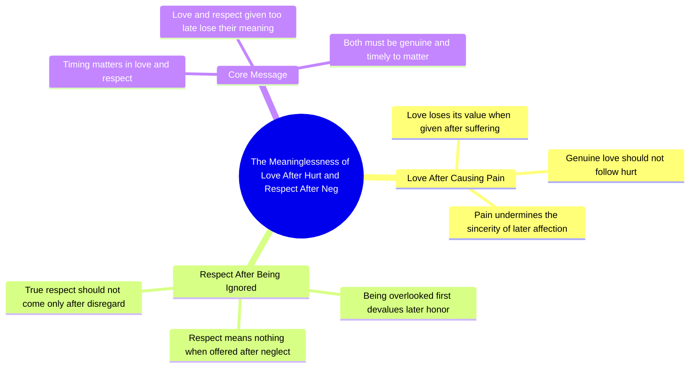

# Respect After Neglect Loses Its Meaning

> 🌐 **Read this in:** **English** · [中文](../../zh-CN/2026-10/tiktok-transcript-1m-views-35k-reactions-sadreels-sadvideo-trendingreels-nidha-e4e7.md)

> **Creator:** [@Nidha Bapan](https://www.tiktok.com/@Nidha Bapan) · **Views:** 428.5K · **Posted:** 2026-10-18 · **Niche:** entertainment
>
> **TL;DR:** It sets up a sharp emotional contradiction between hurt and love that viewers instantly recognize from their own relationships.

[Watch original video →](https://www.facebook.com/share/r/1BnEwx4TAx/)

## Why This Went Viral

## Hook (first 3 seconds)
- **Verbatim opening line:** "कश्ट देने के बाद दिया गया प्यार और नजर अंदास करने के बाद दी गई इज़त के कोई माइने नहीं रहते" — "Love given after causing pain, and respect given after ignoring someone — neither has any meaning."
- **Hook pattern:** **Contrast + bold claim.** Two parallel clauses, each pairing a wound ("pain," "being ignored") with a delayed gesture ("love," "respect"), then a blunt verdict ("no meaning").
- **Why it stops the scroll:** It opens mid-thought with a moral judgment, not a setup. The viewer is dropped straight into a conclusion they either agree with or want to argue with — and the parallel structure (X after Y, X after Y) is rhythmically satisfying enough to hold attention for the full line.

## Emotional Rhythm
- **Beat 1 — Recognition (0–2s):** "कश्ट देने के बाद" / "नजर अंदास करने के बाद" — the viewer instantly maps it to a personal memory of being hurt, then placated too late.
- **Beat 2 — Tension (2–5s):** The second clause builds the same wound from a different angle (respect instead of love), escalating from emotional to social injury.
- **Beat 3 — Verdict / relief (5–8s):** "कोई माइने नहीं रहते" — the release. The viewer's private grievance is validated out loud.
- **Climax:** The final phrase "कोई माइने नहीं रहते" — the whole video is engineered to land on this verdict. Everything before it is setup.
- **Resonance point:** The word "इज़त" (respect/dignity) — it converts a private heartbreak into a public, shareable grievance, which is what makes people tag others.

## Keyword Density
- **कश्ट** (pain) — emotional pull
- **प्यार** (love) — emotional pull + high search volume
- **नजर अंदास** (ignoring / looking away) — emotional pull, highly relatable
- **इज़त** (respect/dignity) — emotional pull, strong share trigger
- **माइने नहीं रहते** (has no meaning) — the verdict phrase; drives algorithmic reach through comment arguments ("but sometimes it does…")
- **बाद** (after) — the structural keyword; repeated twice, it's the engine of the contrast
- **Drivers of reach vs. pull:** "प्यार" and "इज़त" are the *emotional* keywords — they make people feel seen. "माइने नहीं रहते" is the *algorithmic* keyword — it's an absolute claim, and absolutes generate comments, duets, and stitches from people who disagree.

## Why It Spreads
- **It names a specific, universal wound.** "कश्ट देने के बाद दिया गया प्यार" describes a precise betrayal dynamic (hurt-then-apologize) that millions have lived through but rarely see articulated — recognition drives saves and shares.
- **The parallel structure is quotable.** "X के बाद दिया गया Y" repeated twice makes the line function like a proverb — easy to screenshot, caption, or repost as text.
- **It's an absolute verdict, which invites debate.** "कोई माइने नहीं रहते" leaves no room for nuance, so viewers comment to add exceptions — and comment volume is the strongest distribution signal.
- **It gives the viewer a weapon.** Sharing it is a way to say something to someone without saying it directly — "इज़त" in particular turns the video into a subtweet-style message, which drives DM and story shares.
- **Zero setup, pure payoff.** The entire video is the punchline. There's no context to lose, so it works equally well as a 6-second clip, a text-on-screen post, or a voiceover — maximizing repost surface area.

## What You Can Steal
- **Open on the verdict, not the story.** Start your first line with the conclusion ("X has no meaning," "Nobody tells you this about Y") and let the viewer's own memory supply the context.
- **Build with parallel clauses.** Repeat one grammatical frame twice ("after A… after B…") so the line feels authored and quotable — parallel structure is what makes a sentence screenshot-able.
- **End on an absolute.** Close with a phrase that refuses nuance ("no meaning," "never," "always"). Absolutes convert passive viewers into commenters defending the exception — and comments are free distribution.

## Mind Map

## Full Transcript (Generated by [analyze your own TikToks](https://toktranscript.com/?utm_source=github&utm_medium=breakdown&utm_campaign=tool_attribution))

> 📝 Transcripts on this page are auto-generated and show the first 60%. Want to transcribe any TikTok in 30 seconds and get the full version? [Try TokTranscript free →](https://toktranscript.com/?utm_source=github&utm_medium=breakdown&utm_campaign=transcript_cta)

कश्ट देने के बाद दिया गया प्यार और नजर अंदास करने के ब

*[Read the full transcript on TokTranscript →](https://toktranscript.com/plaza/tiktok-transcript-1m-views-35k-reactions-sadreels-sadvideo-trendingreels-nidha-e4e7?utm_source=github&utm_medium=breakdown&utm_campaign=transcript_full)*

## Browse More

- All [entertainment](../../by-niche/en/entertainment.md) breakdowns
- All [Pain-then-Love Paradox Statement](../../by-pattern/en/hook-pain-then-love-paradox-statement.md) examples

## Video Info

| | |
|---|---|
| Creator | [@Nidha Bapan](https://www.tiktok.com/@Nidha Bapan) |
| Original video | [https://www.facebook.com/share/r/1BnEwx4TAx/](https://www.facebook.com/share/r/1BnEwx4TAx/) |
| Original title | 1M views · 35K reactions | नजर अंदाज करने के बाद दी गई इज्जत की कोई मायने नहीं रहा रहता#SadReels💔🥀😔 #SadVideo💔😭🖤 #TrendingReels🥀💔😢 | Nidha Bapan |
| Views | 428.5K (428465) |
| Posted | 2026-10-18 |
| Duration | 0s |
| Niche | `entertainment` |
| Hook pattern | `Pain-then-Love Paradox Statement` |
| Original language | `en` |
| Available languages | en, zh-CN |
| Generated | 2026-10-19 by [TokTranscript](https://toktranscript.com/) |

---

*This breakdown is for educational analysis under fair use. Original video © [@Nidha Bapan](https://www.tiktok.com/@Nidha Bapan). All transcripts are auto-generated and may contain errors.*

*Want to analyze your own TikToks like this? [free TikTok transcript generator →](https://toktranscript.com/viral-breakdown?utm_source=github&utm_medium=breakdown&utm_campaign=footer_cta)*