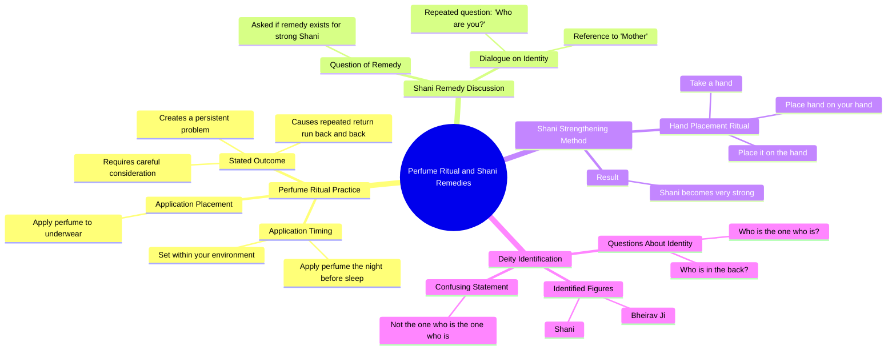

# Apply Perfume to Underwear Before Sleep Remedy

> 🌐 **Read this in:** **English** · [中文](../../zh-CN/2026-10/tiktok-transcript-1m-views-62k-reactions-under-garments-perfume-remedy-explore-dda5.md)

> **Creator:** [@Third Degree Podcast](https://www.tiktok.com/@Third Degree Podcast) · **Views:** 1.9M · **Posted:** 2026-10-11 · **Niche:** entertainment
>
> **TL;DR:** The speaker immediately promises to reveal a new method, creating anticipation and curiosity.

[Watch original video →](https://www.facebook.com/share/r/18VmKnCxGA/)

## Why This Went Viral

## Hook (first 3 seconds)
- **Verbatim opening:** "I will show you another one. Put perfume in the night before you sleep in your environment."
- **Hook pattern:** Bold instructional claim + forbidden/secret knowledge ("another one" implies a series of hidden remedies).
- **Why it stops the scroll:** It opens mid-action with authority ("I will show you"), promises a concrete ritual (perfume before sleep), and the phrasing is just strange enough ("in your environment," "in your underwear") to trigger confusion-curiosity. Viewers stay to find out what this is actually about.

## Emotional Rhythm
- **0–3s — Curiosity:** A confident figure issues an odd instruction. No context given.
- **3–8s — Confusion/tension:** "This is a problem. You will run back and back." Vague threat creates unease without resolution.
- **8–15s — Plea/desperation:** "Do you have a remedy for shani to strong? Mother?" The speaker shifts from authority to begging — a tonal whiplash that reads as either ritual, distress, or parody.
- **15–25s — Repetition loop:** "Who are you? Mother? Shani is a good one." Names (Shani, Bheirav Ji) get stacked without explanation — sustained mystery.
- **Climax:** The line "Take a hand and put a hand on your hand. Put it on the hand. Shani will become so strong." — the "remedy" finally lands, but it's nonsensical, which is the payoff.
- **Resolution:** None. The video ends on unresolved repetition ("This is not the one who is the one who is"), which loops viewers back to the start.

## Keyword Density
- **Shani** (repeated ~5x) — the anchor keyword; drives search/discovery among audiences familiar with astrological/religious context.
- **Hand** (repeated ~5x) — physical, visceral; makes the ritual feel tangible.
- **Mother** (repeated 3x) — emotional pull; triggers protective/ familial affect.
- **"Who are you / who is the one"** — repetition pattern that creates a hypnotic, chant-like rhythm.
- **Perfume / underwear / sleep** — sensory, intimate keywords that boost retention because they're unexpected in this context.
- **Remedy** — algorithmic magnet; "remedy" + named deity = high-intent search traffic.
- **Bheirav Ji** — niche religious keyword; pulls a specific devotee community.

**Algorithmic drivers:** *Shani, remedy, Bheirav Ji* (search + topical clustering).
**Emotional drivers:** *Mother, hand, who are you* (intimacy, confusion, chant rhythm).

## Why It Spreads
- **Unresolved mystery loops the video.** The transcript never resolves "who are you?" or what the perfume ritual actually does — so viewers rewatch to decode it, spiking watch-time and rewatches.
- **Tonal ambiguity fuels comment wars.** Is this a genuine remedy, a sermon, a parody, or a distressed elder? Lines like "Put it in your underwear. This is a problem" are absurd enough to invite both mockery and sincere interpretation — comments explode either way.
- **Repetition acts as a chant.** "Who is the one who is the one who is" mimics mantra structure, making the audio sticky and easy to duet, stitch, or remix.
- **Cultural specificity creates in-group sharing.** Shani and Bheirav Ji are recognizable to Hindu/astrological audiences, who share it as "you won't believe this" within their communities.
- **Quotable absurdity.** "Put perfume in the night before you sleep in your environment" and "Put it on the hand" are instantly memeable caption/comment fodder — the video spreads as text as much as video.

## What You Can Steal
1. **Open mid-instruction, not mid-introduction.** Start with "I will show you another one" energy — no setup, no greeting. Drop the viewer into an action already in progress.
2. **Build a chant, not a script.** Repeat one short phrase 3–5 times ("who are you," "put it on the hand") to create rhythm. Repetition is what makes audio remixable and memorable.
3. **End unresolved.** Don't answer the question you raised. If viewers have to rewatch or comment to figure out what happened, the algorithm rewards you with watch-time and engagement.

## Mind Map

## Full Transcript (Generated by [try this transcription tool](https://toktranscript.com/?utm_source=github&utm_medium=breakdown&utm_campaign=tool_attribution))

> 📝 Transcripts on this page are auto-generated and show the first 60%. Want to transcribe any TikTok in 30 seconds and get the full version? [Try TokTranscript free →](https://toktranscript.com/?utm_source=github&utm_medium=breakdown&utm_campaign=transcript_cta)

I will show you another one. Put perfume in the night before you sleep in your environment. And put it in your underwear. This is a problem. You will run back and back. You should think about it. Do you have a remedy for shani to strong? Mother? Who are you? Mother? Shani is a good one.

*[Read the full transcript on TokTranscript →](https://toktranscript.com/plaza/tiktok-transcript-1m-views-62k-reactions-under-garments-perfume-remedy-explore-dda5?utm_source=github&utm_medium=breakdown&utm_campaign=transcript_full)*

## Browse More

- All [entertainment](../../by-niche/en/entertainment.md) breakdowns
- All [Direct Promise of Demonstration](../../by-pattern/en/hook-direct-promise-of-demonstration.md) examples

## Video Info

| | |
|---|---|
| Creator | [@Third Degree Podcast](https://www.tiktok.com/@Third Degree Podcast) |
| Original video | [https://www.facebook.com/share/r/18VmKnCxGA/](https://www.facebook.com/share/r/18VmKnCxGA/) |
| Original title | 1M views · 62K reactions | Under Garments पर perfume लगाओ! . . . . . . #remedy #explore #viralreels #reelitfeelit #astrology | Third Degree Podcast |
| Views | 1.9M (1869105) |
| Posted | 2026-10-11 |
| Duration | 0s |
| Niche | `entertainment` |
| Hook pattern | `Direct Promise of Demonstration` |
| Original language | `en` |
| Available languages | en, zh-CN |
| Generated | 2026-10-12 by [TokTranscript](https://toktranscript.com/) |

---

*This breakdown is for educational analysis under fair use. Original video © [@Third Degree Podcast](https://www.tiktok.com/@Third Degree Podcast). All transcripts are auto-generated and may contain errors.*

*Want to analyze your own TikToks like this? [free TikTok transcript generator →](https://toktranscript.com/viral-breakdown?utm_source=github&utm_medium=breakdown&utm_campaign=footer_cta)*