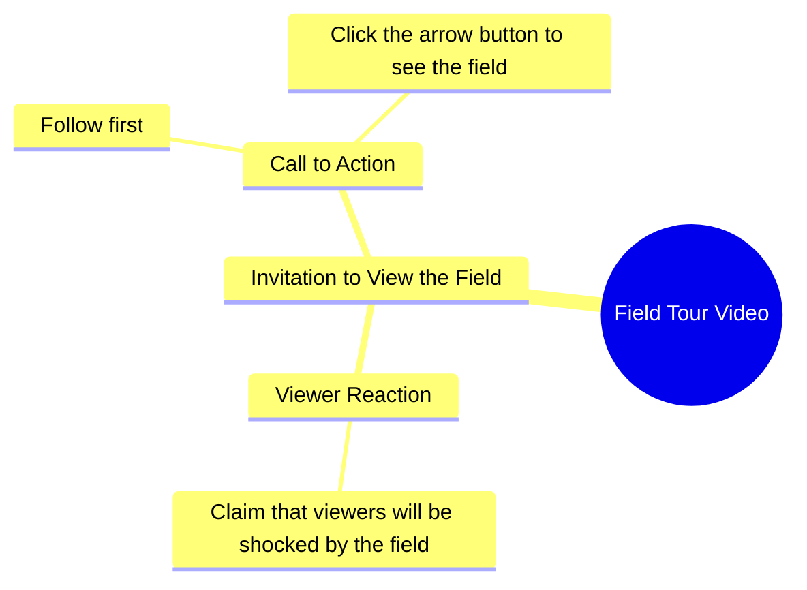

# Farmer Shows Off Her Field in Urdu Video

> 🌐 **Read this in:** **English** · [中文](../../zh-CN/2026-10/tiktok-transcript-20m-views-254k-reactions-wafa-world-facebookreelsviral-reels-9e68.md)

> **Creator:** [@Sujata ](https://www.tiktok.com/@Sujata ) · **Views:** 7.0M · **Posted:** 2026-10-11 · **Niche:** other
>
> **TL;DR:** The hook uses a bold shock statement followed by a direct challenge to follow and watch, creating immediate curiosity and engagement.

[Watch original video →](https://www.facebook.com/share/r/19LZJJzYoU/)

## Why This Went Viral

## Hook (first 3 seconds)
- **Verbatim opening line:** "जो खेत में आपको दिखाने वाली हूँ, आप मेरा खेत देखकर शायद आपके होश उड़ जाएंगे." ("What I'm about to show you in my field — seeing my field, your senses might just fly away.")
- **Hook pattern:** Bold claim + withheld reveal ("you won't believe this" / shock-promise), stacked with a direct challenge.
- **Why it stops the scroll:** It front-loads an extreme emotional promise ("होश उड़ जाएंगे" = you'll be stunned) without showing anything. The gap between the claim and the unseen payoff creates an open loop the brain wants closed. The follow-up line ("हिम्मत है तो पहले फॉलो करो" — "if you have the guts, follow first") converts curiosity into a dare, which triggers ego + compliance in one beat.

## Emotional Rhythm
- **Beat 1 — Curiosity (0–2s):** "जो खेत में आपको दिखाने वाली हूँ" sets up an unspecified reveal. Withholding = tension.
- **Beat 2 — Escalation / hype (2–4s):** "आपके होश उड़ जाएंगे" spikes the emotional stakes with an exaggerated consequence.
- **Beat 3 — Challenge / dare (4–6s):** "हिम्मत है तो पहले फॉलो करो" flips the viewer from passive watcher to challenged participant.
- **Beat 4 — Micro-commitment + CTA (6–8s):** "तीर के बटन पे क्लिक करके खुद खेत देख लो" — the "arrow button" (like/share) instruction lands as the payoff gate.
- **Climax moment:** The dare line — "हिम्मत है तो पहले फॉलो करो." It's the emotional peak because it weaponizes pride. The actual field reveal is deliberately *after* the climax, so the video's tension is resolved by engagement, not by content.
- **Suspense lands** on the withheld field; **resonance lands** on the rural/agrarian identity ("मेरा खेत") which makes the audience feel personally invited into someone's world.

## Keyword Density
- **खेत (field)** — repeated 3x; anchors the topic and the niche (agri/rural content).
- **देखना / दिखाना / देख लो (see / show / go see)** — repeated 3x; drives the "watch this" imperative.
- **आप / आपके (you / your)** — repeated 4x; direct-address keeps the viewer as the subject.
- **होश उड़ जाएंगे (you'll be stunned)** — high-arousal emotional phrase; the retention hook.
- **हिम्मत (guts/courage)** — the dare keyword; triggers ego response.
- **फॉलो (follow)** — the primary algorithmic CTA.
- **तीर के बटन (arrow button / like)** — secondary engagement CTA.
- **Algorithmic reach drivers:** फॉलो, तीर के बटन, देख लो — these are explicit engagement commands that feed watch-time and interaction signals.
- **Emotional pull drivers:** होश उड़ जाएंगे, हिम्मत, मेरा खेत — these create the felt stakes that make someone *want* to comply rather than just being told to.

## Why It Spreads
- **Open loop with no early payoff.** "जो खेत में आपको दिखाने वाली हूँ" promises a reveal that is never shown in this clip — viewers rewatch or comment asking to see it, both of which boost the algorithm.
- **Ego-bait CTA.** "हिम्मत है तो पहले फॉलो करो" reframes following as a test of courage. People follow to prove the creator wrong, not because they were asked politely — a far stronger conversion trigger.
- **Direct second-person address throughout.** "आपको," "आपके," "आप मेरा खेत देखकर" — the viewer is spoken *to*, not at. This personalization is what makes a generic field feel like *their* field.
- **Niche identity signaling.** "मेरा खेत" taps into a huge Hindi-belt agrarian audience that rarely sees itself centered in short-form content — high relatability = high share-within-community.
- **Stacked CTAs in one breath.** Follow + like ("तीर के बटन") are issued back-to-back before any content is delivered, so engagement happens before the viewer has time to decide against it.

## What You Can Steal
1. **Open with a withheld shock-promise, not the payoff.** Say what they're about to see and what it will do to them ("your mind will blow"), then delay the reveal. The gap is the retention.
2. **Turn the CTA into a dare.** Replace "please follow" with a challenge ("if you've got the guts, follow first"). Ego converts better than politeness.
3. **Speak in second person the entire time.** Every line should contain "you/your" so the viewer feels personally addressed — this is what makes a generic topic feel like their story.

## Mind Map

## Full Transcript (Generated by [free TikTok transcript generator](https://toktranscript.com/?utm_source=github&utm_medium=breakdown&utm_campaign=tool_attribution))

> 📝 Transcripts on this page are auto-generated and show the first 60%. Want to transcribe any TikTok in 30 seconds and get the full version? [Try TokTranscript free →](https://toktranscript.com/?utm_source=github&utm_medium=breakdown&utm_campaign=transcript_cta)

जो खेत में आपको दिखाने वाली हूँ, आप मेरा खेत देखकर शायद आपके होश उड़ जाएंगे.

*[Read the full transcript on TokTranscript →](https://toktranscript.com/plaza/tiktok-transcript-20m-views-254k-reactions-wafa-world-facebookreelsviral-reels-9e68?utm_source=github&utm_medium=breakdown&utm_campaign=transcript_full)*

## Browse More

- All [other](../../by-niche/en/other.md) breakdowns
- All [Shock + Challenge Hook](../../by-pattern/en/hook-shock-challenge-hook.md) examples

## Video Info

| | |
|---|---|
| Creator | [@Sujata ](https://www.tiktok.com/@Sujata ) |
| Original video | [https://www.facebook.com/share/r/19LZJJzYoU/](https://www.facebook.com/share/r/19LZJJzYoU/) |
| Original title | 20M views · 254K reactions | Wafa World 🥀 #facebookreelsviral #reelsfb #trendingreelsvideo #reelsvideo #shortvideofbreels #viralvideo #explore #dosti #friendshipgoals #OnlineDosti #DesiVibe #urdupostdaily #followformore | Sujata |
| Views | 7.0M (6966839) |
| Posted | 2026-10-11 |
| Duration | 0s |
| Niche | `other` |
| Hook pattern | `Shock + Challenge Hook` |
| Original language | `en` |
| Available languages | en, zh-CN |
| Generated | 2026-10-11 by [TokTranscript](https://toktranscript.com/) |

---

*This breakdown is for educational analysis under fair use. Original video © [@Sujata ](https://www.tiktok.com/@Sujata ). All transcripts are auto-generated and may contain errors.*

*Want to analyze your own TikToks like this? [TokTranscript →](https://toktranscript.com/viral-breakdown?utm_source=github&utm_medium=breakdown&utm_campaign=footer_cta)*