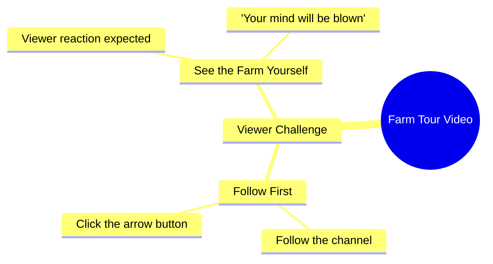

# Woman Shows Her Field and Challenges Viewers to Follow

> 🌐 **Read this in:** **English** · [中文](../../zh-CN/2026-10/tiktok-transcript-21m-views-264k-reactions-wafa-world-facebookreelsviral-reels-12b6.md)

> **Creator:** [@Sujata ](https://www.tiktok.com/@Sujata ) · **Views:** 7.3M · **Posted:** 2026-10-17 · **Niche:** other
>
> **TL;DR:** It pairs an extreme shock promise with a dare ('हिम्मत है तो') that forces viewers to follow and watch to prove themselves.

[Watch original video →](https://www.facebook.com/share/r/1E3rFfnEK3/)

## Why This Went Viral

## Hook (first 3 seconds)
- **Verbatim opening:** "जो खेत में आपको दिखाने वाली हूँ, आप मेरा खेत देखकर शायद आपके होश उड़ जाएंगे." ("What I'm about to show you in my field — seeing my field will probably blow your mind.")
- **Hook pattern:** **Bold claim + withheld reveal** ("you won't believe what's in my field") fused with a **dare/challenge** ("हिम्मत है तो" — "if you have the courage").
- **Why it stops the scroll:** It promises an extreme, unspecified payoff ("होश उड़ जाएंगे") without showing it — an open curiosity loop. The dare ("if you have the courage") flips the viewer from passive scroller to challenged participant, and the immediate follow + tap command ("पहले फॉलो करो, फिर तीर के बटन पे क्लिक करकर") converts that spike of curiosity into an action before the viewer can second-guess.

## Emotional Rhythm
- **Beat 1 — Curiosity spike (0–2s):** "जो खेत में आपको दिखाने वाली हूँ" — an unnamed reveal is promised. Open loop.
- **Beat 2 — Escalation / mild shock (2–5s):** "आपके होश उड़ जाएंगे" — stakes are raised to maximum hyperbole. Tension without any visual payoff yet.
- **Beat 3 — Challenge / defiance (5–7s):** "हिम्मत है तो" — dares the viewer; creates ego-involvement and micro-tension ("do I dare?").
- **Beat 4 — Command / payoff gate (7–10s):** "पहले फॉलो करो, फिर तीर के बटन पे क्लिक करके खुद खेत देख लो" — the reveal is explicitly gated behind follow + tap.
- **Suspense lands:** at the dare ("हिम्मत है तो") — the viewer is now personally implicated.
- **Climax moment:** the instruction "खुद खेत देख लो" ("see the field for yourself") — the transcript ends *before* the reveal, making the withheld field itself the climax the viewer must chase into the next frame/comment.

## Keyword Density
- **खेत (field)** — repeated 3×; the anchor noun. Drives topical/algorithmic relevance (agriculture, rural content) and searchability.
- **दिखाने / देखो / देख (to show / to see)** — the reveal-verbs; power the curiosity engine.
- **होश उड़ जाएंगे (mind-blown)** — the emotional hyperbole keyword; highest emotional pull.
- **हिम्मत (courage)** — the challenge keyword; converts passive viewers into engaged ones.
- **फॉलो (follow)** — direct algorithmic CTA; drives follower-conversion signal.
- **तीर के बटन (arrow button / next)** — retention/next-video CTA; drives session-watch signal.
- **आप / आपके (you/your)** — second-person address; personalizes and sustains emotional pull.

*Algorithmic reach:* खेत, फॉलो, तीर के बटन (topic + engagement signals). *Emotional pull:* होश उड़ जाएंगे, हिम्मत, दिखाने/देखो (curiosity + challenge).

## Why It Spreads
- **Open curiosity loop with a named-but-unshown payoff:** "जो खेत में आपको दिखाने वाली हूँ… होश उड़ जाएंगे" promises a specific reveal (the field) but never delivers it in the transcript — viewers must watch/rewatch/comment to resolve the gap.
- **Dare mechanics create ego-involvement:** "हिम्मत है तो" dares the viewer; people share challenges they "passed" and comment to prove they weren't scared off — fueling comment-section velocity.
- **Hard-gated CTA stack:** "पहले फॉलो करो, फिर तीर के बटन पे क्लिक करके" turns the curiosity spike directly into follow + next-video taps — the two signals platforms reward most.
- **Hyperbole as shareable language:** "आपके होश उड़ जाएंगे" is a quotable, meme-able phrase viewers repeat in comments and duets, extending reach beyond the original audience.
- **Second-person intimacy:** repeated "आप/आपके" makes it feel personally addressed, raising completion and DM/share behavior ("you have to see this").

## What You Can Steal
- **Open with a named-but-withheld payoff + hyperbole:** State *what* you'll show and *how extreme* the reaction will be, but don't show it in the first 3 seconds — e.g., "The one thing in my [X] that will blow your mind."
- **Use a dare to convert scrollers into commenters:** A short challenge line ("if you dare…", "bet you can't watch this without…") creates ego-involvement and drives comment velocity.
- **Gate the reveal behind one clear action:** Stack a single follow + one tap instruction right at peak curiosity — don't bury CTAs at the end; place them where the tension is highest.

## Mind Map

## Full Transcript (Generated by [try this transcription tool](https://toktranscript.com/?utm_source=github&utm_medium=breakdown&utm_campaign=tool_attribution))

> 📝 Transcripts on this page are auto-generated and show the first 60%. Want to transcribe any TikTok in 30 seconds and get the full version? [Try TokTranscript free →](https://toktranscript.com/?utm_source=github&utm_medium=breakdown&utm_campaign=transcript_cta)

जो खेत में आपको दिखाने वाली हूँ, आप मेरा खेत देखकर शायद आपके होश उड़ जाएंगे.

*[Read the full transcript on TokTranscript →](https://toktranscript.com/plaza/tiktok-transcript-21m-views-264k-reactions-wafa-world-facebookreelsviral-reels-12b6?utm_source=github&utm_medium=breakdown&utm_campaign=transcript_full)*

## Browse More

- All [other](../../by-niche/en/other.md) breakdowns
- All [Shock Promise + Dare-to-Watch Challenge](../../by-pattern/en/hook-shock-promise-dare-to-watch-challenge.md) examples

## Video Info

| | |
|---|---|
| Creator | [@Sujata ](https://www.tiktok.com/@Sujata ) |
| Original video | [https://www.facebook.com/share/r/1E3rFfnEK3/](https://www.facebook.com/share/r/1E3rFfnEK3/) |
| Original title | 21M views · 264K reactions | Wafa World 🥀 #facebookreelsviral #reelsfb #trendingreelsvideo #reelsvideo #shortvideofbreels #viralvideo #explore #dosti #friendshipgoals #OnlineDosti #DesiVibe #urdupostdaily #followformore | Sujata |
| Views | 7.3M (7286626) |
| Posted | 2026-10-17 |
| Duration | 0s |
| Niche | `other` |
| Hook pattern | `Shock Promise + Dare-to-Watch Challenge` |
| Original language | `en` |
| Available languages | en, zh-CN |
| Generated | 2026-10-18 by [TokTranscript](https://toktranscript.com/) |

---

*This breakdown is for educational analysis under fair use. Original video © [@Sujata ](https://www.tiktok.com/@Sujata ). All transcripts are auto-generated and may contain errors.*

*Want to analyze your own TikToks like this? [TokTranscript →](https://toktranscript.com/viral-breakdown?utm_source=github&utm_medium=breakdown&utm_campaign=footer_cta)*