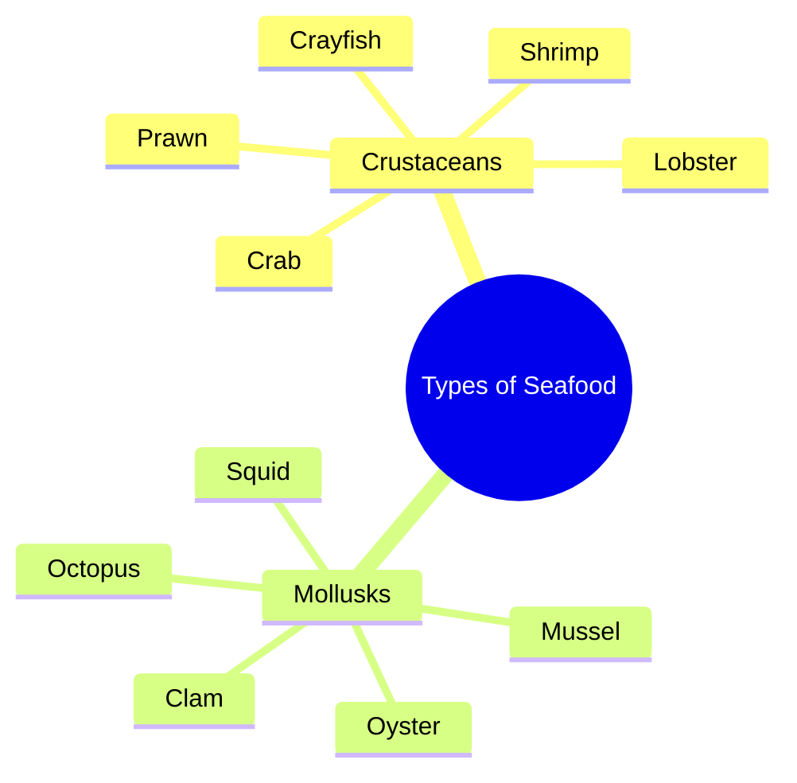

# Name These 10 Seafood in English Vocabulary Quiz

> 🌐 **Read this in:** **English** · [中文](../../zh-CN/2026-10/tiktok-transcript-3-9m-views-41k-reactions-can-you-name-all-these-seafood-corr-14a7.md)

> **Creator:** [@learnwithashmeet](https://www.tiktok.com/@learnwithashmeet) · **Views:** 1.6M · **Posted:** 2026-10-10 · **Niche:** food
>
> **TL;DR:** The hook immediately lists popular seafood items, triggering curiosity about the purpose of the list and appealing to food enthusiasts.

[Watch original video →](https://www.facebook.com/share/r/19v8TSRA7m/)

## Why This Went Viral

## Hook (first 3 seconds)
- Verbatim opening: "Shrimp, lobster, crab, oyster, squid, octopus, prawn, muscle, clam, crayfish."
- Hook pattern: **Rapid-fire list / pattern interrupt** (a machine-gun enumeration with no preamble).
- Why it stops the scroll: The brain is pattern-seeking. A list of familiar seafood words delivered with zero context creates an immediate "what is this and where is it going?" gap. The speed and rhythm feel like a challenge or a memory test, which triggers completionist instinct — viewers stay to see if they can keep up or if a punchline is coming.

## Emotional Rhythm
- Beat 1 (0–2s): **Curiosity / mild confusion** — "Why is he just naming seafood?"
- Beat 2 (2–6s): **Recognition & rhythm lock-in** — viewers start predicting the next word, entering a trance-like cadence.
- Beat 3 (6–9s): **Tension spike** — the list keeps going past expectation; "muscle" (misspelled "mussel") lands as a subtle error or oddity, creating a micro-jolt.
- Beat 4 (9–11s): **Anticlimax / absurdist relief** — "crayfish" ends abruptly with no payoff, twist, or explanation. The lack of resolution *is* the punchline.
- Climax moment: The final word "crayfish" — not because it's dramatic, but because it confirms there is no twist. The subversion of expected payoff is the peak.

## Keyword Density
- Strongest repeated/loaded terms: **shrimp, lobster, crab, oyster, squid, octopus, prawn, muscle/mussel, clam, crayfish**
- Algorithmic reach drivers: "shrimp," "lobster," "crab," "octopus" — high-search-volume seafood terms that pull in food, cooking, and ocean-content audiences.
- Emotional pull drivers: "muscle" (the misspelling/ambiguity) and "crayfish" (the unexpected closer) — these create comment-section debate and rewatches.
- Note: The density is 100% nouns, zero verbs or connective tissue. This is deliberate — it reads like a caption, a quiz answer key, or a fever dream, which fuels both confusion and memorability.

## Why It Spreads
- **Zero-context absurdism**: The transcript is just a list. There is no setup, no punchline, no face, no explanation. That vacuum forces viewers to project meaning — "Is this a bot? A stroke? A coded message?" — and projection drives comments.
- **Comment-bait via the "muscle" error**: "muscle" instead of "mussel" is the single most shareable detail. It's a tiny, defensible mistake that invites correction, mockery, and duet/stitch responses. Every correction is a comment; every comment is a signal boost.
- **Completionist trap**: Lists trigger a psychological need to finish. Viewers watch to the end to "complete" the sequence, which inflates watch time and loop potential — especially if the video is short enough to autoplay twice.
- **Meme template potential**: The format is infinitely remixable. Anyone can swap in their own list (car parts, exes, Pokémon, vegetables) and ride the same structural joke. This turns one video into a trend.
- **Ambiguity of intent**: Is it a joke? A test? A glitch? The transcript gives no answer. Ambiguous content gets shared because people share it *with a question* — "what is this?" — which is the highest-value share trigger.

## What You Can Steal
- **Open with a list, not a sentence.** Skip "Hey guys, today I want to talk about…" and start mid-stream with rapid nouns or phrases. The missing context is the hook.
- **Plant one small, debatable flaw.** A misspelling, a questionable inclusion, or an odd ordering gives viewers something to correct in the comments. Correction = engagement.
- **End without resolving.** Resist the urge to explain, summarize, or land a moral. An abrupt stop after a list forces rewatches and "wait, that's it?" shares — and the algorithm counts both.

## Mind Map

## Full Transcript (Generated by [try this transcription tool](https://toktranscript.com/?utm_source=github&utm_medium=breakdown&utm_campaign=tool_attribution))

> 📝 Transcripts on this page are auto-generated and show the first 60%. Want to transcribe any TikTok in 30 seconds and get the full version? [Try TokTranscript free →](https://toktranscript.com/?utm_source=github&utm_medium=breakdown&utm_campaign=transcript_cta)

Shrimp, lobster, crab, oyster, squid, octopus,

*[Read the full transcript on TokTranscript →](https://toktranscript.com/plaza/tiktok-transcript-3-9m-views-41k-reactions-can-you-name-all-these-seafood-corr-14a7?utm_source=github&utm_medium=breakdown&utm_campaign=transcript_full)*

## Browse More

- All [food](../../by-niche/en/food.md) breakdowns
- All [Rapid-fire Seafood Enumeration](../../by-pattern/en/hook-rapid-fire-seafood-enumeration.md) examples

## Video Info

| | |
|---|---|
| Creator | [@learnwithashmeet](https://www.tiktok.com/@learnwithashmeet) |
| Original video | [https://www.facebook.com/share/r/19v8TSRA7m/](https://www.facebook.com/share/r/19v8TSRA7m/) |
| Original title | 3.9M views · 41K reactions | Can you name all these seafood correctly? 🦞🦀 Most people know only 2 or 3! Test your vocabulary before checking the answers. #LearnEnglish #EnglishVocabulary #SpokenEnglish #EnglishTips #LearnWithAshmeet | learnwithashmeet |
| Views | 1.6M (1580501) |
| Posted | 2026-10-10 |
| Duration | 0s |
| Niche | `food` |
| Hook pattern | `Rapid-fire Seafood Enumeration` |
| Original language | `en` |
| Available languages | en, zh-CN |
| Generated | 2026-10-12 by [TokTranscript](https://toktranscript.com/) |

---

*This breakdown is for educational analysis under fair use. Original video © [@learnwithashmeet](https://www.tiktok.com/@learnwithashmeet). All transcripts are auto-generated and may contain errors.*

*Want to analyze your own TikToks like this? [free TikTok transcript generator →](https://toktranscript.com/viral-breakdown?utm_source=github&utm_medium=breakdown&utm_campaign=footer_cta)*