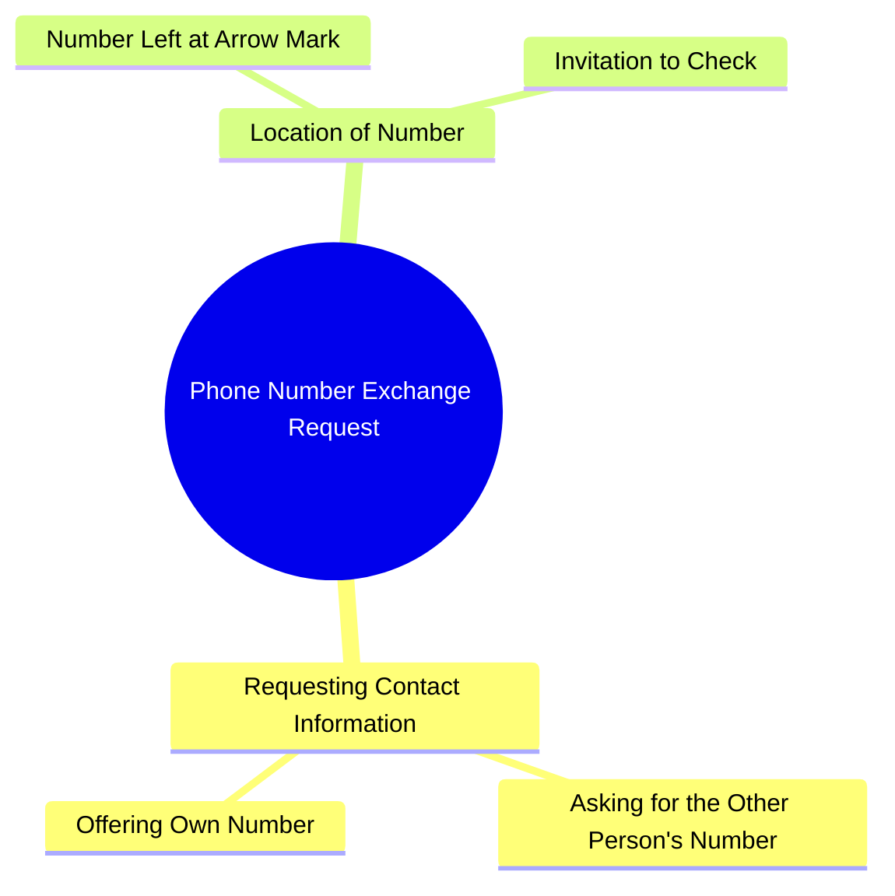

# Saumal Sharma Asks for Number in Comedy Skit

> 🌐 **Read this in:** **English** · [中文](../../zh-CN/2026-10/tiktok-transcript-4m-views-156k-reactions-83c3.md)

> **Creator:** [@صومل شرما ](https://www.tiktok.com/@صومل شرما ) · **Views:** 1.2M · **Posted:** 2026-10-12 · **Niche:** entertainment
>
> **TL;DR:** The hook directly asks for the viewer's number or offers his own, creating immediate engagement and curiosity.

[Watch original video →](https://www.facebook.com/share/r/1A12meRwR1/)

## Why This Went Viral

## Hook (first 3 seconds)
- **Verbatim:** "अपना नंबर दे दीजिए या तो मेरा नंबर ले लीजिए" ("Give me your number, or take mine")
- **Hook pattern:** Direct demand + instant reciprocity flip (bold claim/command). A pickup line delivered as a transaction.
- **Why it stops the scroll:** It's a *confident, slightly absurd proposition* dropped with zero setup. The brain registers "someone is being hit on right now" — a social moment with stakes — and the "या तो" (or else) structure creates a micro-cliffhanger: which one will it be?

## Emotional Rhythm
- **Beat 1 — Curiosity/Intrigue (0–2s):** The blunt number request. Viewer asks "who is this, and why so direct?"
- **Beat 2 — Tension (2–4s):** "या तो मेरा नंबर ले लीजिए" — the offer flips the power dynamic. Will she take it? Is this real?
- **Beat 3 — Twist/Reveal (4–6s):** "मैंने तीर वाले निशान पे अपना नंबर छोड़ रखा है" — the number isn't given, it's *hidden*. The request becomes a scavenger hunt.
- **Climax:** "देख लीजिए" ("go look") — the invitation to chase. This is the payoff line; the entire video collapses into one dare.
- **Resolution:** None. The video ends on an open loop (the viewer never sees the number), which is exactly why rewatches and comments spike.

## Keyword Density
- **नंबर (number)** — repeated 3x. The anchor word; drives both comprehension and replay (viewers re-listen to confirm).
- **दीजिए / लीजिए (give / take)** — the reciprocity pair. Creates the transactional rhythm.
- **तीर वाले निशान (arrow mark)** — the specificity hook. This is the "unexpected detail" that makes the line quotable.
- **छोड़ रखा है (left it there)** — implies premeditation. Suggests a story behind the line.
- **देख लीजिए (go see)** — the CTA. Drives comments like "kahan hai number?" and "kya ye sach hai?"

**Algorithmic vs. emotional:** "नंबर" and "देख लीजिए" pull algorithmic reach (high-frequency, searchable, comment-triggering). "तीर वाले निशान" and "छोड़ रखा है" carry the emotional pull — they turn a pickup line into a mystery.

## Why It Spreads
- **1. It's a complete story in one sentence.** The line contains setup (request), conflict (or take mine), and twist (it's hidden at the arrow mark). No context needed — perfect for silent-scroll viewing.
- **2. The reciprocity flip is a shareable format.** "Give me yours or take mine" is instantly remixable — creators can swap the object (number → Instagram, number → address) and reuse the structure.
- **3. The open loop forces engagement.** "देख लीजिए" never resolves on screen. Viewers comment "number kahan hai?" — comments are the algorithm's favorite signal.
- **4. The "arrow mark" detail is oddly specific.** Specificity reads as truth. Viewers debate whether it's real, a joke, or a location — all three interpretations generate replies.
- **5. It's short enough to loop.** Under ~7 seconds means the replay rate is near 100%, and replays are weighted heavily in short-form ranking.

## What You Can Steal
- **1. Use the "X or Y" reciprocity structure.** Frame your ask as a two-way trade ("Give me your email or I'll drop mine in the comments"). It makes the viewer feel in control while you still get the action.
- **2. Hide the payoff in a physical detail.** Instead of stating the answer, point to a *place* ("I left it at the arrow mark," "check the third slide," "look behind the sign"). Specific, locatable details drive comments and rewatches.
- **3. End on "देख लीजिए" — an unresolved dare.** Never close the loop in the video. Let the comment section become the second act.

## Mind Map

## Full Transcript (Generated by [TokTranscript](https://toktranscript.com/?utm_source=github&utm_medium=breakdown&utm_campaign=tool_attribution))

> 📝 Transcripts on this page are auto-generated and show the first 60%. Want to transcribe any TikTok in 30 seconds and get the full version? [Try TokTranscript free →](https://toktranscript.com/?utm_source=github&utm_medium=breakdown&utm_campaign=transcript_cta)

अपना नंबर दे दीजिए या तो मेरा नंबर ले लीजिए मैंने तीर वाले 

*[Read the full transcript on TokTranscript →](https://toktranscript.com/plaza/tiktok-transcript-4m-views-156k-reactions-83c3?utm_source=github&utm_medium=breakdown&utm_campaign=transcript_full)*

## Browse More

- All [entertainment](../../by-niche/en/entertainment.md) breakdowns
- All [Direct Request with Alternative](../../by-pattern/en/hook-direct-request-with-alternative.md) examples

## Video Info

| | |
|---|---|
| Creator | [@صومل شرما ](https://www.tiktok.com/@صومل شرما ) |
| Original video | [https://www.facebook.com/share/r/1A12meRwR1/](https://www.facebook.com/share/r/1A12meRwR1/) |
| Original title | 4M views · 156K reactions | اپنا نمبر دیجیے یا میرا | صومل شرما |
| Views | 1.2M (1228673) |
| Posted | 2026-10-12 |
| Duration | 0s |
| Niche | `entertainment` |
| Hook pattern | `Direct Request with Alternative` |
| Original language | `en` |
| Available languages | en, zh-CN |
| Generated | 2026-10-13 by [TokTranscript](https://toktranscript.com/) |

---

*This breakdown is for educational analysis under fair use. Original video © [@صومل شرما ](https://www.tiktok.com/@صومل شرما ). All transcripts are auto-generated and may contain errors.*

*Want to analyze your own TikToks like this? [free TikTok transcript generator →](https://toktranscript.com/viral-breakdown?utm_source=github&utm_medium=breakdown&utm_campaign=footer_cta)*