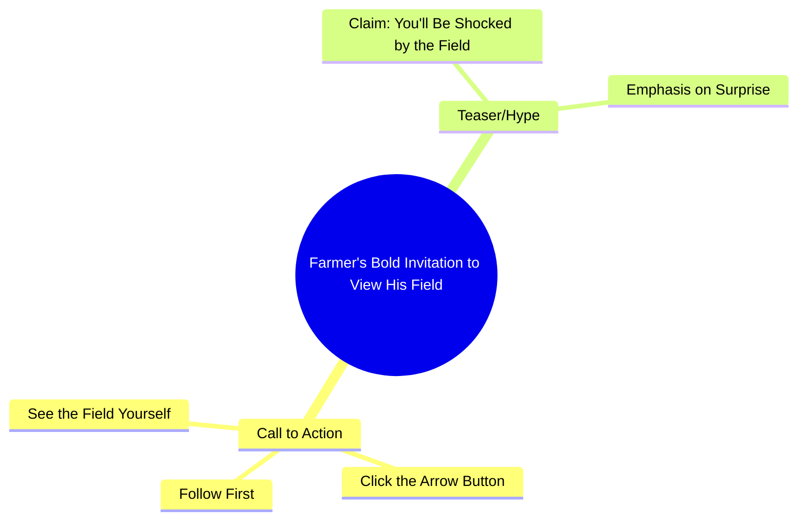

# Farmer Shows Off Field in Urdu Video

> 🌐 **Read this in:** **English** · [中文](../../zh-CN/2026-10/tiktok-transcript-5-1m-views-82k-reactions-wafa-world-facebookreels-reels-tren-9e8c.md)

> **Creator:** [@rani ji ](https://www.tiktok.com/@rani ji ) · **Views:** 2.0M · **Posted:** 2026-10-12 · **Niche:** other
>
> **TL;DR:** The hook uses a bold shock claim and a direct challenge to compel viewers to watch and engage.

[Watch original video →](https://www.facebook.com/share/r/1DSFr1dqYY/)

## Why This Went Viral

## Hook (first 3 seconds)
- **Verbatim opening:** "जो खत में आपको दिखाने वाली हूँ आप मेरा खेत देखके शायद आपके होश उड़ जाएंगे" ("The field I'm about to show you — seeing my field, your senses will probably fly away").
- **Hook pattern:** Bold claim + shock-preview ("your mind will be blown") fused with a challenge/command ("if you have the guts, follow first").
- **Why it stops the scroll:** It front-loads an extreme emotional promise (होश उड़ जाएंगे) before showing anything, creating an open information gap the viewer must close. The aggressive "हिम्मत है तो" (if you dare) dares the viewer, and the follow-gate turns curiosity into a micro-commitment action.

## Emotional Rhythm
- **0–2s — Shock promise:** "आपके होश उड़ जाएंगे" spikes curiosity and mild disbelief.
- **2–4s — Challenge/tension:** "हिम्मत है तो पहले फॉलो करो" flips curiosity into a dare — ego is now engaged.
- **4–6s — Instruction/relief valve:** "तीर के बटन पे क्लिक करके" gives a concrete action, releasing tension into compliance.
- **6s+ — Payoff setup:** "खुद खेत देख लो" hands agency to the viewer ("see it yourself"), which is the **climax moment** — the reveal is deferred to the viewer's own click, so the emotional peak is self-generated.
- **Suspense lands** at the dare ("हिम्मत है तो"); **resonance** lands at "खुद खेत देख लो" because it feels like a personal invitation rather than an ad.

## Keyword Density
- **खेत (field)** — repeated 3x; core topical keyword, drives niche/algorithmic reach.
- **देखना / देख लो / दिखाने (see/show)** — repeated 4x; action keyword that pulls the viewer toward the reveal.
- **होश उड़ जाएंगे (mind blown)** — emotional hyperbole; pure retention bait.
- **हिम्मत (guts/dare)** — ego trigger; boosts comment/reply engagement.
- **फॉलो (follow)** — direct CTA; drives the metric the algorithm rewards most.
- **तीर के बटन / क्लिक (click button)** — micro-instruction; increases watch-through to the payoff.
- **Algorithmic reach drivers:** खेत, देखना, फॉलो — these match search/discovery intent and platform CTA signals.
- **Emotional pull drivers:** होश उड़ जाएंगे, हिम्मत — these create the felt stakes that keep a viewer from swiping.

## Why It Spreads
- **Curiosity gap held open to the last second:** The promise ("आपके होश उड़ जाएंगे") is never resolved in the spoken lines — the viewer must click to see, forcing a completion action.
- **Ego dare drives comments and re-shares:** "हिम्मत है तो" (if you have the guts) invites viewers to prove themselves, and dares reliably generate reply-bait and duets/stitches.
- **Explicit follow-gate converts curiosity into a subscription:** "पहले फॉलो करो फिर तीर के बटन पे क्लिक करके" sequences the CTA so the follow happens before the payoff, capturing the viewer at peak motivation.
- **Second-person, high-intimacy address:** "आपको," "आपका," "खुद" make it feel like a personal challenge, not a broadcast — personal address raises completion rate.
- **Self-reveal framing ("खुद खेत देख लो"):** By handing the reveal to the viewer, the creator makes the payoff feel earned and shareable — people forward things they "discovered" themselves.

## What You Can Steal
- **Open with a hyperbolic promise, not a description.** Replace "Here's my field" with "This will blow your mind" — lead with the emotional stake, then deliver the subject.
- **Use a dare to convert passive viewers into engaged ones.** A line like "if you have the guts, follow first" turns a scroll into an ego-driven action and feeds the comment section.
- **Delay the payoff and hand it to the viewer.** Instead of showing everything in the video, tell them exactly where to click to see it themselves — this raises watch-through and click-through simultaneously.

## Mind Map

## Full Transcript (Generated by [try this transcription tool](https://toktranscript.com/?utm_source=github&utm_medium=breakdown&utm_campaign=tool_attribution))

> 📝 Transcripts on this page are auto-generated and show the first 60%. Want to transcribe any TikTok in 30 seconds and get the full version? [Try TokTranscript free →](https://toktranscript.com/?utm_source=github&utm_medium=breakdown&utm_campaign=transcript_cta)

जो खत में आपको दिखाने वाली हूँ आप मेरा खेत देखके शायद आपके होश उड़ जाएंगे हिम्मत है तो

*[Read the full transcript on TokTranscript →](https://toktranscript.com/plaza/tiktok-transcript-5-1m-views-82k-reactions-wafa-world-facebookreels-reels-tren-9e8c?utm_source=github&utm_medium=breakdown&utm_campaign=transcript_full)*

## Browse More

- All [other](../../by-niche/en/other.md) breakdowns
- All [Shock + Challenge](../../by-pattern/en/hook-shock-challenge.md) examples

## Video Info

| | |
|---|---|
| Creator | [@rani ji ](https://www.tiktok.com/@rani ji ) |
| Original video | [https://www.facebook.com/share/r/1DSFr1dqYY/](https://www.facebook.com/share/r/1DSFr1dqYY/) |
| Original title | 5.1M views · 82K reactions | Wafa World 🥀 #FacebookReels #Reels #TrendingReels #ReelsVideo #ShortVideo #ViralVideo #Explore #ForYou #Dosti #Friendship #OnlineDosti #DesiVibes #UrduPosts #FollowForMore | rani ji |
| Views | 2.0M (1974100) |
| Posted | 2026-10-12 |
| Duration | 0s |
| Niche | `other` |
| Hook pattern | `Shock + Challenge` |
| Original language | `en` |
| Available languages | en, zh-CN |
| Generated | 2026-10-13 by [TokTranscript](https://toktranscript.com/) |

---

*This breakdown is for educational analysis under fair use. Original video © [@rani ji ](https://www.tiktok.com/@rani ji ). All transcripts are auto-generated and may contain errors.*

*Want to analyze your own TikToks like this? [TokTranscript.com →](https://toktranscript.com/viral-breakdown?utm_source=github&utm_medium=breakdown&utm_campaign=footer_cta)*