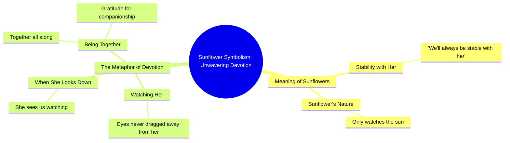

# Sunflower Head Shaker DIY Car Decor

> 🌐 **Read this in:** **English** · [中文](../../zh-CN/2026-10/tiktok-transcript-5-diy-55d6.md)

> **Creator:** [@xing_1338](https://www.tiktok.com/@xing_1338) · **Views:** 907.0K · **Posted:** 2026-10-17 · **Niche:** entertainment
>
> **TL;DR:** Opens with a direct question about a familiar symbol, creating an instant curiosity gap that the rest of the video promises to resolve.

[Watch original video →](https://www.tiktok.com/@xing_1338/video/7446644430016236801?is_from_webapp=1&sender_device=pc&web_id=7695616896544015903)

## Why This Went Viral

## Hook (first 3 seconds)
- **Verbatim opening:** "Do you know the meaning of sunflowers?"
- **Hook pattern:** Question hook (curiosity gap) fused with a symbolic-object reveal ("meaning of sunflowers").
- **Why it stops the scroll:** It asks a question the viewer can't instantly answer but *feels* they should know. The word "meaning" promises a payoff, and "sunflowers" is a high-recognition, high-warmth image. The brain opens a loop ("what does it mean?") that only closes if you keep watching.

## Emotional Rhythm
- **Beat 1 — Curiosity (0–2s):** "Do you know the meaning of sunflowers?" opens the loop.
- **Beat 2 — Promise/comfort (2–6s):** "It means we'll always be stable with her" delivers a soft, reassuring answer — relief that resolves the question fast.
- **Beat 3 — Tension via metaphor (6–12s):** "Like a sunflower that only watches the sun" introduces devotion and one-directional gaze; subtle ache builds.
- **Beat 4 — Twist/resonance (12–18s):** "And when she looked down, she would see us who never dragged our eyes away from her" — the gaze reverses. The watcher becomes the watched. This is the emotional pivot.
- **Beat 5 — Resolution (final line):** "thanks to being together all along" lands on togetherness — relief and warmth.
- **Climax:** The reversal in "when she looked down, she would see us" — the moment the metaphor turns from longing into mutual recognition. That's the line people screenshot and re-share.

## Keyword Density
- **Strongest repeated/loaded terms:** *sunflowers, sun, her, always, stable, together, eyes / never dragged our eyes away, meaning.*
- **Algorithmic-reach keywords:** "sunflowers" (high-search, high-save aesthetic term), "meaning" (question-intent, drives comments), "always/together" (relationship-tag bait that triggers shares to a partner).
- **Emotional-pull keywords:** "stable," "never dragged our eyes away," "together all along" — these carry the loyalty/devotion payload and drive saves and DMs rather than raw reach.
- **Net effect:** Reach words get it *served*; emotional words get it *shared*. The overlap on "sunflowers" and "her" bridges both.

## Why It Spreads
- **Universal relationship proxy:** "we'll always be stable with her" lets any viewer map the line onto their own partner — the video becomes a *message they can send*, not just content they watch.
- **The gaze reversal is a quotable twist:** "when she looked down, she would see us who never dragged our eyes away from her" is the screenshot line — a self-contained, poetic sentence that survives being clipped out of context.
- **Low-effort high-meaning format:** The whole transcript is ~50 words. Short, slow, symbol-driven scripts are easy to re-record, duet, and caption-translate — fueling remix and stitch volume.
- **Comment-bait question:** Opening with "Do you know the meaning of…" invites corrections, additions, and "sending this to my gf" comments — engagement signals that push further distribution.
- **Tag-a-partner mechanic:** "together all along" gives viewers an explicit social action (share to their person), converting passive viewers into distribution nodes.

## What You Can Steal
1. **Open with a "meaning" question about a familiar object.** "Do you know what [flower/color/song] actually means?" — instant curiosity gap with zero setup cost.
2. **Build one metaphor, then reverse it at the end.** Set up a gaze/direction (sunflower → sun), then flip who's looking at whom in the final third. The reversal is your shareable line.
3. **Write one screenshot-ready sentence.** Craft a single line poetic enough to stand alone out of context ("never dragged our eyes away from her") — that's the unit people save, quote, and send.

## Mind Map

## Full Transcript (Generated by [free TikTok transcript generator](https://toktranscript.com/?utm_source=github&utm_medium=breakdown&utm_campaign=tool_attribution))

> 📝 Transcripts on this page are auto-generated and show the first 60%. Want to transcribe any TikTok in 30 seconds and get the full version? [Try TokTranscript free →](https://toktranscript.com/?utm_source=github&utm_medium=breakdown&utm_campaign=transcript_cta)

Do you know the meaning of sunflowers? It means we'll always be stable with her.

*[Read the full transcript on TokTranscript →](https://toktranscript.com/plaza/tiktok-transcript-5-diy-55d6?utm_source=github&utm_medium=breakdown&utm_campaign=transcript_full)*

## Browse More

- All [entertainment](../../by-niche/en/entertainment.md) breakdowns
- All [Symbolism Reveal Question](../../by-pattern/en/hook-symbolism-reveal-question.md) examples

## Video Info

| | |
|---|---|
| Creator | [@xing_1338](https://www.tiktok.com/@xing_1338) |
| Original video | [https://www.tiktok.com/@xing_1338/video/7446644430016236801?is_from_webapp=1&sender_device=pc&web_id=7695616896544015903](https://www.tiktok.com/@xing_1338/video/7446644430016236801?is_from_webapp=1&sender_device=pc&web_id=7695616896544015903) |
| Original title | ดอกทานตะวันเขย่าหัว 5 ชิ้น 🌻สร้างสรรค์ DIY ตกแต่งรถยนต์🚘 กระจายการรัก... |
| Views | 907.0K (907000) |
| Posted | 2026-10-17 |
| Duration | 0s |
| Niche | `entertainment` |
| Hook pattern | `Symbolism Reveal Question` |
| Original language | `en` |
| Available languages | en, zh-CN |
| Generated | 2026-10-18 by [TokTranscript](https://toktranscript.com/) |

---

*This breakdown is for educational analysis under fair use. Original video © [@xing_1338](https://www.tiktok.com/@xing_1338). All transcripts are auto-generated and may contain errors.*

*Want to analyze your own TikToks like this? [TokTranscript →](https://toktranscript.com/viral-breakdown?utm_source=github&utm_medium=breakdown&utm_campaign=footer_cta)*