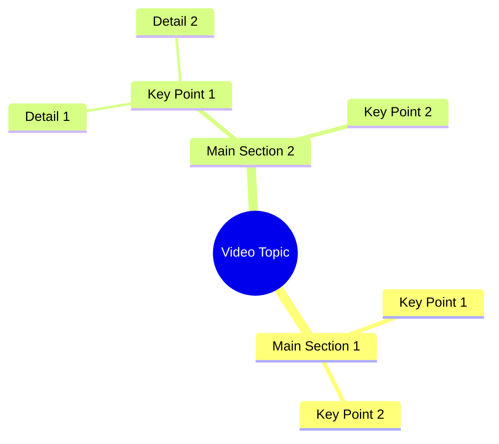

# Woman Seeks Facebook Friend to Message on WhatsApp

> 🌐 **Read this in:** **English** · [中文](../../zh-CN/2026-10/tiktok-transcript-6-1m-views-201k-reactions-wafa-world-facebookreelsviral-reel-96e4.md)

> **Creator:** [@Sujata ](https://www.tiktok.com/@Sujata ) · **Views:** 2.3M · **Posted:** 2026-10-12 · **Niche:** entertainment
>
> **TL;DR:** The hook directly challenges the audience's courage, provoking a response.

[Watch original video →](https://www.facebook.com/share/r/184uUnkMtg/)

## Why This Went Viral

## Hook (first 3 seconds)
- **Verbatim opening line:** "लगता है किसी मा के लाल में दम नहीं है।" ("It seems no mother's son has any guts.")
- **Hook pattern:** Direct challenge / insult-bait ("no one has the courage") — a provocation hook.
- **Why it stops the scroll:** It's a dare aimed at the viewer personally. The taunt triggers ego and the need to prove the speaker wrong. Combined with a female speaker challenging "mothers' sons," it creates instant gender/ego friction that's hard to scroll past without reacting.

## Emotional Rhythm
- **Beat 1 — Provocation (0–2s):** "No mother's son has guts" → triggers defensiveness/curiosity ("who is she talking to?").
- **Beat 2 — Confession of failure (2–5s):** "I've been looking for a friend on Facebook for four days, nobody follows or messages." → vulnerability, relatability, a small humiliation.
- **Beat 3 — Pivot / offer (5–8s):** "If you're going to be [the one], click the arrow and come on WhatsApp." → reframes the taunt as an invitation; suspense resolves into a clear CTA.
- **Climax moment:** The opening taunt. The whole video is a reverse-engineered setup so that the challenge lands first and the ask lands last.
- **Suspense/resonance:** The gap between the aggressive opener and the needy middle beat is the tension engine — viewers stay to see how the insult connects to the request.

## Keyword Density
- **"मा के लाल"** (mother's son) — emotional pull; culturally loaded phrase for bravery/masculinity.
- **"दम नहीं"** (no guts) — emotional pull; the insult that drives comments.
- **"फेस्बुक"** (Facebook) — algorithmic reach; platform keyword.
- **"दोस्ट"** (friend) — emotional pull; signals loneliness/connection.
- **"चार दिन"** (four days) — numbers; adds specificity and credibility to the complaint.
- **"फॉलो"** (follow) — algorithmic reach; platform action verb.
- **"मेसेज"** (message) — algorithmic reach + CTA-adjacent.
- **"तीर"** (arrow) — platform UI cue, drives the click behavior.
- **"वाट्साप"** (WhatsApp) — algorithmic reach; off-platform funnel keyword.

**Split:** Facebook / follow / message / arrow / WhatsApp drive reach and platform signals. "मा के लाल," "दम नहीं," "दोस्ट" drive the emotional reaction and comment-section engagement.

## Why It Spreads
- **Insult-bait forces comments.** "किसी मा के लाल में दम नहीं है" is engineered so men reply to defend themselves — and every reply is a ranking signal.
- **Vulnerability after aggression creates whiplash.** The jump from "no one has guts" to "I've been searching for four days, nobody messages me" makes the speaker sympathetic, so viewers share it out of pity or amusement.
- **A concrete, low-friction CTA.** "तीर वाले पे क्लिक करके वाट्साप पे आओ" tells the viewer exactly what to do — click the arrow, move to WhatsApp — converting passive viewers into direct contacts.
- **Platform-native keywords.** Facebook, follow, message, WhatsApp are all algorithmically weighted terms that push the video into more feeds.
- **Short + repeatable.** Under 10 seconds, so it loops easily and gets rewatched to catch the exact wording — boosting watch time.

## What You Can Steal
- **Open with a dare, close with an ask.** Front-load a challenge that targets the viewer's identity, then resolve it into a single clear action.
- **Use the aggression → vulnerability → CTA three-beat structure.** It keeps viewers emotionally off-balance and makes the ask feel earned rather than salesy.
- **Say the platform and the action out loud.** Naming Facebook, follow, message, arrow, and WhatsApp cues both the algorithm and the viewer's next tap.

## Mind Map

## Full Transcript (Generated by [TokTranscript](https://toktranscript.com/?utm_source=github&utm_medium=breakdown&utm_campaign=tool_attribution))

> 📝 Transcripts on this page are auto-generated and show the first 60%. Want to transcribe any TikTok in 30 seconds and get the full version? [Try TokTranscript free →](https://toktranscript.com/?utm_source=github&utm_medium=breakdown&utm_campaign=transcript_cta)

लगता है किसी मा के लाल में दम नहीं है। चार दिन से फेस्बुक पे दोस्ट ढून रही हूं, कोई फॉलो करके मेसेज ही 

*[Read the full transcript on TokTranscript →](https://toktranscript.com/plaza/tiktok-transcript-6-1m-views-201k-reactions-wafa-world-facebookreelsviral-reel-96e4?utm_source=github&utm_medium=breakdown&utm_campaign=transcript_full)*

## Browse More

- All [entertainment](../../by-niche/en/entertainment.md) breakdowns
- All [Challenge + Call to Action](../../by-pattern/en/hook-challenge-call-to-action.md) examples

## Video Info

| | |
|---|---|
| Creator | [@Sujata ](https://www.tiktok.com/@Sujata ) |
| Original video | [https://www.facebook.com/share/r/184uUnkMtg/](https://www.facebook.com/share/r/184uUnkMtg/) |
| Original title | 6.1M views · 201K reactions | Wafa World 🥀 #facebookreelsviral #reelsfb #trendingreelsvideo #reelsvideo #shortvideofbreels #viralvideo #explore #dosti #friendshipgoals #OnlineDosti #DesiVibe #urdupostdaily #followformore | Sujata |
| Views | 2.3M (2257671) |
| Posted | 2026-10-12 |
| Duration | 0s |
| Niche | `entertainment` |
| Hook pattern | `Challenge + Call to Action` |
| Original language | `en` |
| Available languages | en, zh-CN |
| Generated | 2026-10-13 by [TokTranscript](https://toktranscript.com/) |

---

*This breakdown is for educational analysis under fair use. Original video © [@Sujata ](https://www.tiktok.com/@Sujata ). All transcripts are auto-generated and may contain errors.*

*Want to analyze your own TikToks like this? [TokTranscript →](https://toktranscript.com/viral-breakdown?utm_source=github&utm_medium=breakdown&utm_campaign=footer_cta)*