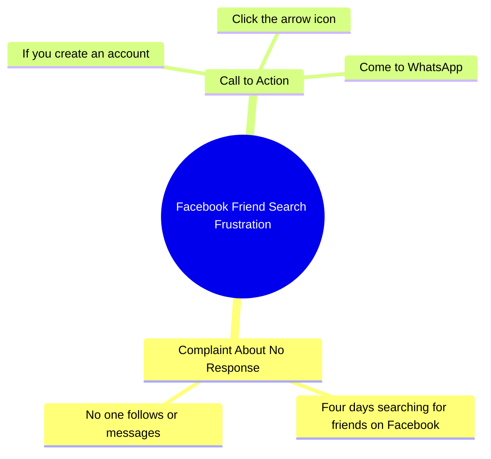

# Woman Seeking Facebook Friends in Urdu Video

> 🌐 **Read this in:** **English** · [中文](../../zh-CN/2026-10/tiktok-transcript-6-4m-views-206k-reactions-wafa-world-facebookreelsviral-reel-e5e4.md)

> **Creator:** [@Sujata ](https://www.tiktok.com/@Sujata ) · **Views:** 2.3M · **Posted:** 2026-10-17 · **Niche:** entertainment
>
> **TL;DR:** The taunt 'no son of a mother has guts' dares viewers while framing a relatable social-media frustration, pulling them in to prove themselves.

[Watch original video →](https://www.facebook.com/share/r/1DeVhxjQ1C/)

## Why This Went Viral

## Hook (first 3 seconds)
- **Verbatim opening line:** "लगता है किसी मा के लाल में दम नहीं है।" ("It seems no mother's son has any guts.")
- **Hook pattern:** **Taunt / challenge + insult-bait** — a direct provocation aimed at the viewer's ego, wrapped in a culturally loaded idiom ("मा के लाल" = "mother's son," a classic dare).
- **Why it stops the scroll:** It's a personal challenge. The brain reflexively answers "who, me?" and the viewer waits to hear what the dare is. The Hindi idiom signals a relatable, regional, colloquial register — instantly "this is for people like me," which filters for a high-engagement native audience.

## Emotional Rhythm
- **Beat 1 — Provocation (0–2s):** The taunt creates mild indignation + curiosity ("what's the challenge?").
- **Beat 2 — Confession / vulnerability (2–6s):** "चार दिन से फेस्बुक पे दोस्ट ढून रही हूं" — the tone flips from aggressive to needy. The contrast (tough talk → lonely plea) is the engine.
- **Beat 3 — Tension / rejection (6–9s):** "कोई फॉलो करके मेसेज ही नहीं कर रहा है" — social rejection, a universally resonant sting.
- **Beat 4 — Call to action / resolution offer (9–12s):** "तीर वाले पे क्लिक करके वाट्साप पे आओ" — a clear, specific instruction that converts emotion into action.
- **Climax:** The pivot line — the moment the taunt collapses into "no one is messaging me." That's where the emotional whiplash lands and where commenters feel compelled to respond.
- **Twist:** The aggressive opening is revealed to be a *mask for loneliness* — a bait-and-switch that makes the viewer feel chosen/needed.

## Keyword Density
- **मा के लाल** (mother's son) — emotional pull + cultural recognition
- **दम नहीं** (no guts) — challenge framing, drives comment-section defiance
- **फेस्बुक** (Facebook) — platform keyword, algorithmic reach
- **दोस्ट** (friend) — emotional pull, relatability
- **फॉलो** (follow) — platform/engagement keyword, algorithmic reach
- **मेसेज** (message) — engagement keyword
- **तीर** (arrow / click arrow) — CTA keyword, drives off-platform conversion
- **वाट्साप** (WhatsApp) — conversion keyword, funnel signal

**Reach drivers:** फेस्बुक, फॉलो, मेसेज, वाट्साप — platform + action words that the algorithm and comment-section behavior reward.
**Emotional drivers:** मा के लाल, दम नहीं, दोस्ट — these create the human sting and the reason people reply.

## Why It Spreads
- **Ego-bait forces a reply.** "किसी मा के लाल में दम नहीं है" is a dare. Viewers comment to prove they *do* have guts — the comment section becomes the product, and comments are the strongest distribution signal.
- **Aggression-to-vulnerability whiplash is shareable.** The line "चार दिन से... कोई फॉलो करके मेसेज ही नहीं कर रहा है" reframes the tough opener as loneliness. People share things that make them feel seen, not just entertained.
- **It's a status transaction, not an ad.** "तीर वाले पे क्लिक करके वाट्साप पे आओ" frames the CTA as *the viewer doing the creator a favor* — low-pressure, high-compliance, and it moves traffic off-platform where it can be re-marketed.
- **Cultural idiom = tribal filter.** "मा के लाल" signals the exact demographic and language community, so the algorithm finds a tight, high-affinity cluster that over-indexes on engagement.
- **Short, loopable, rewatchable.** Under ~12 seconds with a clean three-beat arc (taunt → plea → CTA) — viewers rewatch to catch the pivot, boosting watch-time completion.

## What You Can Steal
1. **Open with a dare, not a description.** Lead with a line that makes the viewer's ego twitch ("no one here has the guts to…") — provocation in the first 2 seconds beats any setup.
2. **Flip the tone mid-video.** Pair a bold/aggressive opening with a vulnerable confession. The whiplash is what gets shared and commented, not the joke itself.
3. **Make the CTA feel like a favor, and name the exact action.** "Click the arrow and come to WhatsApp" — one verb, one destination, framed as helping *you*. Specificity converts; vagueness dies.

## Mind Map

## Full Transcript (Generated by [free TikTok transcript generator](https://toktranscript.com/?utm_source=github&utm_medium=breakdown&utm_campaign=tool_attribution))

> 📝 Transcripts on this page are auto-generated and show the first 60%. Want to transcribe any TikTok in 30 seconds and get the full version? [Try TokTranscript free →](https://toktranscript.com/?utm_source=github&utm_medium=breakdown&utm_campaign=transcript_cta)

लगता है किसी मा के लाल में दम नहीं है। चार दिन से फेस्बुक पे दोस्ट ढून रही हूं, कोई फॉलो करके मेसेज ही 

*[Read the full transcript on TokTranscript →](https://toktranscript.com/plaza/tiktok-transcript-6-4m-views-206k-reactions-wafa-world-facebookreelsviral-reel-e5e4?utm_source=github&utm_medium=breakdown&utm_campaign=transcript_full)*

## Browse More

- All [entertainment](../../by-niche/en/entertainment.md) breakdowns
- All [Provocative Taunt + Complaint](../../by-pattern/en/hook-provocative-taunt-complaint.md) examples

## Video Info

| | |
|---|---|
| Creator | [@Sujata ](https://www.tiktok.com/@Sujata ) |
| Original video | [https://www.facebook.com/share/r/1DeVhxjQ1C/](https://www.facebook.com/share/r/1DeVhxjQ1C/) |
| Original title | 6.4M views · 206K reactions | Wafa World 🥀 #facebookreelsviral #reelsfb #trendingreelsvideo #reelsvideo #shortvideofbreels #viralvideo #explore #dosti #friendshipgoals #OnlineDosti #DesiVibe #urdupostdaily #followformore | Sujata |
| Views | 2.3M (2346635) |
| Posted | 2026-10-17 |
| Duration | 0s |
| Niche | `entertainment` |
| Hook pattern | `Provocative Taunt + Complaint` |
| Original language | `en` |
| Available languages | en, zh-CN |
| Generated | 2026-10-18 by [TokTranscript](https://toktranscript.com/) |

---

*This breakdown is for educational analysis under fair use. Original video © [@Sujata ](https://www.tiktok.com/@Sujata ). All transcripts are auto-generated and may contain errors.*

*Want to analyze your own TikToks like this? [TokTranscript.com →](https://toktranscript.com/viral-breakdown?utm_source=github&utm_medium=breakdown&utm_campaign=footer_cta)*