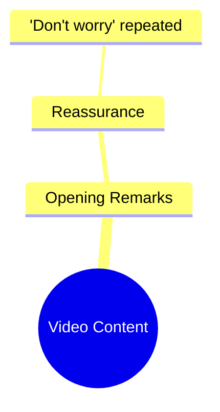

# Ramez Galal Explains His New Show Idea

> 🌐 **Read this in:** **English** · [中文](../../zh-CN/2026-10/tiktok-transcript-6-5m-views-80k-reactions-ramez-galal-b69a.md)

> **Creator:** [@Ramez Galal](https://www.tiktok.com/@Ramez Galal) · **Views:** 3.3M · **Posted:** 2026-10-10 · **Niche:** entertainment
>
> **TL;DR:** The hook offers immediate emotional comfort through repetition, creating a soothing effect that resonates with stressed viewers.

[Watch original video →](https://www.facebook.com/share/r/19NEVVbjVk/)

## Why This Went Viral

## Hook (first 3 seconds)
- The entire opening is a single repeated phrase: "No te preocupes, no te preocupes" ("Don't worry, don't worry"), delivered twice with no setup, no context, and no visual description in the transcript.
- It's a **reassurance / comfort hook** — a sub-type of the "emotional promise" pattern, where the creator leads with soothing language instead of a claim or question.
- It stops the scroll because it's the opposite of the usual loud, high-energy short-form opener. The repetition signals intimacy and calm, which reads as a "safe" video — and viewers who are anxious, tired, or doomscrolling are pulled in by the implicit promise that something reassuring is coming.

## Emotional Rhythm
- **Beat 1 — Curiosity + instant comfort:** The doubled "no te preocupes" creates a small paradox — why are you telling me not to worry before I know what I'd be worried about?
- **Beat 2 — Anticipated tension:** Because the phrase is repeated, the viewer waits for the "but" or the reveal. The repetition itself builds a low-grade suspense.
- **Beat 3 — Resonance:** The line lands as universal. Anyone watching projects their own worry onto it, which converts a generic phrase into a personal message.
- **Climax:** The second "no te preocupes" — the repetition is the climax. There is no twist, no punchline; the emotional peak is the insistence of the reassurance.
- **Resolution:** Relief / catharsis, delivered by tone and repetition rather than by new information.

## Keyword Density
- "No te preocupes" (dominant, repeated)
- "preocupes" (root word, high salience)
- "no" (negation, carries the comfort)
- "te" (second-person, makes it direct and personal)
- Implicit: worry / calm / reassurance (the semantic field, even if not literally repeated)

- **Algorithmic reach drivers:** "No te preocupes" is a high-search, high-save phrase in Spanish-language wellness and motivational content. It's short, quotable, and caption-friendly, which boosts shares and saves.
- **Emotional pull drivers:** "te" and "no" — the direct address plus the negation — do the emotional work. They make the viewer feel personally spoken to, which drives comments like "lo necesitaba."

## Why It Spreads
- **It's a universal emotional trigger compressed into one line.** "No te preocupes" works for anyone, in any context, which maximizes the addressable audience — the opposite of niche content.
- **Repetition creates memorability and shareability.** The doubled phrase is easy to quote, caption, or stitch, which lowers the friction for remix and duet formats.
- **It functions as a "save and send" video.** People don't just like it — they send it to a friend who is stressed, which is one of the strongest distribution signals on short-form platforms.
- **The lack of context is the feature, not the bug.** Because there's no specific story, every viewer supplies their own reason to worry, which makes the reassurance feel tailored.
- **It fits the "comfort content" wave.** Short, soft, low-production reassurance videos outperform high-energy content in certain emotional niches because they match the viewer's actual mood at 1 a.m.

## What You Can Steal
- **Open with the emotional payoff, not the setup.** Lead with the line you'd normally save for the end — "No te preocupes" — and let the rest of the video justify it.
- **Use direct address + negation.** "You don't have to…", "No te…", "You're not…" — second-person plus a negative creates instant intimacy and feels like a personal message.
- **Repeat your core line once.** A single repetition turns a sentence into a mantra, which makes it quotable, saveable, and sendable — the three behaviors that drive short-form spread.

## Mind Map

## Full Transcript (Generated by [free TikTok transcript generator](https://toktranscript.com/?utm_source=github&utm_medium=breakdown&utm_campaign=tool_attribution))

> 📝 Transcripts on this page are auto-generated and show the first 60%. Want to transcribe any TikTok in 30 seconds and get the full version? [Try TokTranscript free →](https://toktranscript.com/?utm_source=github&utm_medium=breakdown&utm_campaign=transcript_cta)

No te preocupes, no

*[Read the full transcript on TokTranscript →](https://toktranscript.com/plaza/tiktok-transcript-6-5m-views-80k-reactions-ramez-galal-b69a?utm_source=github&utm_medium=breakdown&utm_campaign=transcript_full)*

## Browse More

- All [entertainment](../../by-niche/en/entertainment.md) breakdowns
- All [Reassurance Repetition](../../by-pattern/en/hook-reassurance-repetition.md) examples

## Video Info

| | |
|---|---|
| Creator | [@Ramez Galal](https://www.tiktok.com/@Ramez Galal) |
| Original video | [https://www.facebook.com/share/r/19NEVVbjVk/](https://www.facebook.com/share/r/19NEVVbjVk/) |
| Original title | 6.5M views · 80K reactions | لكل الي عايز يعرف فكرة برنامجي الجديد 👀 اديني شرحتها اهو 😂.. ابقوا قابلوني لو فهمتوا 😂😂 | Ramez Galal |
| Views | 3.3M (3321932) |
| Posted | 2026-10-10 |
| Duration | 0s |
| Niche | `entertainment` |
| Hook pattern | `Reassurance Repetition` |
| Original language | `en` |
| Available languages | en, zh-CN |
| Generated | 2026-10-11 by [TokTranscript](https://toktranscript.com/) |

---

*This breakdown is for educational analysis under fair use. Original video © [@Ramez Galal](https://www.tiktok.com/@Ramez Galal). All transcripts are auto-generated and may contain errors.*

*Want to analyze your own TikToks like this? [TokTranscript.com →](https://toktranscript.com/viral-breakdown?utm_source=github&utm_medium=breakdown&utm_campaign=footer_cta)*