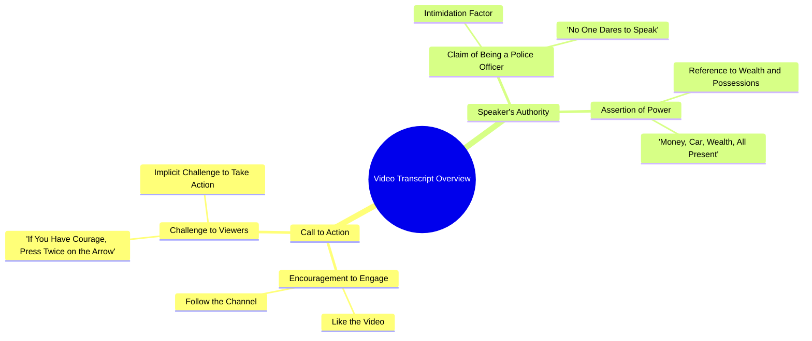

# Woman Police Officer Challenges Viewers to Follow

> 🌐 **Read this in:** **English** · [中文](../../zh-CN/2026-10/tiktok-transcript-6-8m-views-237k-reactions-wafa-world-facebookreelsviral-reel-3db9.md)

> **Creator:** [@Saloni Yadav](https://www.tiktok.com/@Saloni Yadav) · **Views:** 2.4M · **Posted:** 2026-10-11 · **Niche:** entertainment
>
> **TL;DR:** The hook leverages the speaker's police identity to assert dominance and challenge viewers, creating immediate intrigue and fear.

[Watch original video →](https://www.facebook.com/share/r/19w73eWKgm/)

## Why This Went Viral

## Hook (first 3 seconds)
- Verbatim opening line: "करना तो सब चाहते हैं, पुलिस वाली हूँ इसलिए किसी की हिम्मत नहीं होती बोलने की"
- Hook pattern: **Bold claim + taboo tease + authority flex** (a "forbidden confession" setup)
- Why it stops the scroll: It implies a secret everyone wants but is too scared to say — and the speaker claims the power (police) that silences them. Curiosity + authority + mild scandal in one breath.

## Emotional Rhythm
- **Beat 1 – Curiosity/intrigue:** "Everyone wants to do it" — opens a loop, viewer asks *what is "it"?*
- **Beat 2 – Authority/tension:** "I'm a policewoman, so no one dares speak" — raises stakes, adds fear and power.
- **Beat 3 – Status flex (resonance/aspiration):** "Money, car, wealth, everything is there" — signals success, triggers envy/aspiration.
- **Beat 4 – Challenge/twist (climax):** "If you have courage, follow and double-tap the arrow" — flips the power dynamic onto the viewer; the dare *is* the climax.
- **Beat 5 – Payoff tease:** "Then we'll talk" — dangling promise keeps them watching/commented.
- Climax lands on the dare: "हिम्मत है तो फॉलो करके... दो बार दबाओ."

## Keyword Density
- Strongest repeated/loaded terms: **हिम्मत** (courage), **पुलिस** (police), **पैसा/धन/दौलत** (money/wealth), **गाड़ी** (car), **सब** (everyone/all), **फॉलो** (follow), **दो बार दबाओ** (double-tap), **बात करते हैं** (let's talk).
- **Algorithmic reach drivers:** "फॉलो," "दो बार दबाओ," "बात करते हैं" — direct CTAs that spike follows, likes, and comments (engagement signals).
- **Emotional pull drivers:** "हिम्मत," "पुलिस," "पैसा/धन/दौलत" — power, fear, aspiration, and taboo that make people *feel* something and react.

## Why It Spreads
- **Authority + taboo combo:** "पुलिस वाली हूँ... किसी की हिम्मत नहीं होती बोलने की" — a forbidden voice framing makes the clip feel exclusive and shareable.
- **Aspiration bait:** "पैसा, गाड़ी, धन, दौलत सब है" — wealth signaling attracts a broad audience chasing status.
- **Dare-based CTA:** "हिम्मत है तो फॉलो करके तीर के निशान पे दो बार दबाओ" — reframes a like/follow as a courage test, so engaging feels like proving yourself.
- **Open loop / cliffhanger:** "फिर बात करते हैं" — withholds the payoff, driving comments ("what's the talk?") and repeat views.
- **Short, punchy, zero fluff:** Every line escalates — no filler, so retention stays high to the end.

## What You Can Steal
- **Open with a forbidden/insider claim** tied to your identity ("I'm a ___ so no one dares say this") to manufacture instant curiosity.
- **Turn your CTA into a dare or identity test** — "if you've got the guts, follow and double-tap" converts better than "please like and subscribe."
- **End on an open loop** ("then we'll talk") to bait comments and keep viewers waiting for the next video.

## Mind Map

## Full Transcript (Generated by [TokTranscript.com](https://toktranscript.com/?utm_source=github&utm_medium=breakdown&utm_campaign=tool_attribution))

> 📝 Transcripts on this page are auto-generated and show the first 60%. Want to transcribe any TikTok in 30 seconds and get the full version? [Try TokTranscript free →](https://toktranscript.com/?utm_source=github&utm_medium=breakdown&utm_campaign=transcript_cta)

करना तो सब चाहते हैं, पुलिस वाली हूँ इसलिए किसी की हिम्मत नहीं होती बोलने की, पैसा, गाड़ी, धन, दौलत सब है

*[Read the full transcript on TokTranscript →](https://toktranscript.com/plaza/tiktok-transcript-6-8m-views-237k-reactions-wafa-world-facebookreelsviral-reel-3db9?utm_source=github&utm_medium=breakdown&utm_campaign=transcript_full)*

## Browse More

- All [entertainment](../../by-niche/en/entertainment.md) breakdowns
- All [Authority Challenge](../../by-pattern/en/hook-authority-challenge.md) examples

## Video Info

| | |
|---|---|
| Creator | [@Saloni Yadav](https://www.tiktok.com/@Saloni Yadav) |
| Original video | [https://www.facebook.com/share/r/19w73eWKgm/](https://www.facebook.com/share/r/19w73eWKgm/) |
| Original title | 6.8M views · 237K reactions | Wafa World 🥀 #facebookreelsviral #reelsfb: #trendingreelsvideo #reelsvideo: #shortvideofbreels #viralvideo: #explore #dostii #friendshipgoals #OnlineDosti #DesiVibe #urdupostdaily #followformore | Saloni Yadav |
| Views | 2.4M (2365552) |
| Posted | 2026-10-11 |
| Duration | 0s |
| Niche | `entertainment` |
| Hook pattern | `Authority Challenge` |
| Original language | `en` |
| Available languages | en, zh-CN |
| Generated | 2026-10-12 by [TokTranscript](https://toktranscript.com/) |

---

*This breakdown is for educational analysis under fair use. Original video © [@Saloni Yadav](https://www.tiktok.com/@Saloni Yadav). All transcripts are auto-generated and may contain errors.*

*Want to analyze your own TikToks like this? [free TikTok transcript generator →](https://toktranscript.com/viral-breakdown?utm_source=github&utm_medium=breakdown&utm_campaign=footer_cta)*