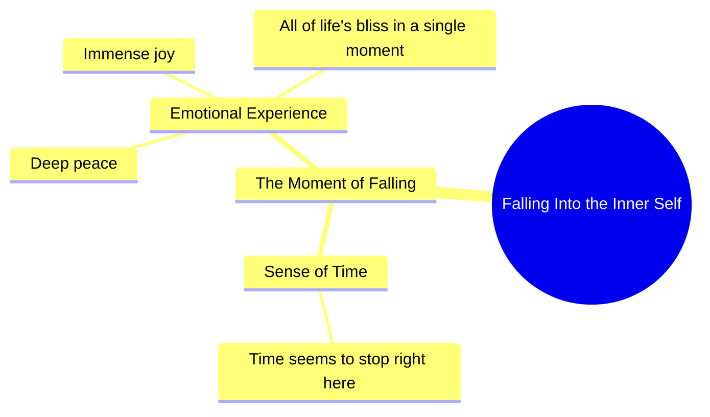

# Quiet Moment of Inner Peace and Joy

> 🌐 **Read this in:** **English** · [中文](../../zh-CN/2026-10/tiktok-transcript-793k-views-16k-reactions-wafa-world-facebookreels-reels-tren-48f6.md)

> **Creator:** [@rani ji ](https://www.tiktok.com/@rani ji ) · **Views:** 271.0K · **Posted:** 2026-10-18 · **Niche:** entertainment
>
> **TL;DR:** The hook uses vivid sensory language and a relatable feeling of time stopping to create an emotional connection and curiosity about the experience.

[Watch original video →](https://www.facebook.com/share/r/18Zf92QGWp/)

## Why This Went Viral

## Hook (first 3 seconds)
- **Verbatim opening line:** "जब अंदर गिरता है न, तो लगता है समय यहीं पे रुख जाए."
- **Hook pattern:** Sensory scene + unresolved "it" (curiosity gap). The phrase "अंदर गिरता है" deliberately withholds *what* is falling — the viewer's brain must stay to resolve the ambiguity.
- **Why it stops the scroll:** It opens mid-experience, not with context. The dangling subject ("it") plus a slowed, intimate delivery creates an information gap the viewer needs closed, and the promise of "समय रुक जाए" (time stopping) signals an emotional payoff is coming.

## Emotional Rhythm
- **0–2s — Curiosity:** Ambiguous "अंदर गिरता है" forces the viewer to ask *what falls?*
- **2–4s — Anticipation:** "समय यहीं पे रुक जाए" introduces a pause/stillness beat — the pacing itself slows.
- **4–6s — Warmth/Resonance:** "इतना सुकून, इतनी खुशी" stacks two positive emotion words, releasing the earlier tension.
- **6–8s — Climax:** "जिन्दगी का सारा आनंद एक पल में मिल गया हो" — the emotional peak, universalizing a single moment into a life-defining one.
- **Twist/suspense:** There is no twist — the video's power is *sustained resonance*, not reversal. The suspense is entirely front-loaded in the withheld subject.
- **Climax moment:** The final line, where a private sensation is reframed as "all of life's joy in one moment."

## Keyword Density
- **अंदर** (inside) — emotional pull; intimacy
- **गिरता** (falling) — the curiosity anchor; drives rewatches to decode
- **समय / पल** (time / moment) — emotional pull; the video's core theme
- **सुकून** (peace) — emotional pull; high-save trigger
- **खुशी** (happiness) — emotional pull
- **जिन्दगी / आनंद** (life / joy) — emotional pull; broadens relatability
- **Algorithmic drivers:** "सुकून," "खुशी," "जिन्दगी" are high-search, high-share sentiment words in Hindi short-form — they pull the video into calm/relatable/motivational feeds.
- **Emotional drivers:** "अंदर गिरता" and "एक पल" — the mystery and the intimacy are what make people *feel* rather than just *find* the video.

## Why It Spreads
- **Deliberate ambiguity in line one** ("जब अंदर गिरता है न") — viewers comment "क्या गिरता है?" which fuels comment-section engagement and rewatch loops.
- **Universal-but-private framing** — "इतना सुकून, इतनी खुशी" lets every viewer project their own memory onto it, maximizing shares to specific people ("this reminded me of you").
- **Escalation to a life-scale claim** — "जिन्दगी का सारा आनंद एक पल में" converts a small moment into a shareable philosophy, the kind of line people screenshot and repost.
- **Spoken-word pacing with a natural pause** ("न," after "गिरता है") creates a breath that mimics real speech — it feels confided, not performed, which lowers the barrier to trust and sharing.
- **Short, quotable length** — the entire transcript is ~30 words; it's fully re-shareable as text/quote, extending reach beyond the video itself.

## What You Can Steal
1. **Open with a dangling subject.** Start mid-action with an unresolved "it/this" so the first 3 seconds create a question the viewer must stay to answer.
2. **Stack two emotion words before the payoff line.** Pair a calm word with a joy word ("सुकून… खुशी") to release tension, then land a single universalizing claim.
3. **Write for the screenshot.** Craft one line ("सारा आनंद एक पल में") that stands alone as a quote — it becomes your free distribution channel.

## Mind Map

## Full Transcript (Generated by [try this transcription tool](https://toktranscript.com/?utm_source=github&utm_medium=breakdown&utm_campaign=tool_attribution))

> 📝 Transcripts on this page are auto-generated and show the first 60%. Want to transcribe any TikTok in 30 seconds and get the full version? [Try TokTranscript free →](https://toktranscript.com/?utm_source=github&utm_medium=breakdown&utm_campaign=transcript_cta)

जब अंदर गिरता है न, तो लगता है समय यहीं पे रुख जाए.

*[Read the full transcript on TokTranscript →](https://toktranscript.com/plaza/tiktok-transcript-793k-views-16k-reactions-wafa-world-facebookreels-reels-tren-48f6?utm_source=github&utm_medium=breakdown&utm_campaign=transcript_full)*

## Browse More

- All [entertainment](../../by-niche/en/entertainment.md) breakdowns
- All [Sensory Immersion + Time-Stop Promise](../../by-pattern/en/hook-sensory-immersion-time-stop-promise.md) examples

## Video Info

| | |
|---|---|
| Creator | [@rani ji ](https://www.tiktok.com/@rani ji ) |
| Original video | [https://www.facebook.com/share/r/18Zf92QGWp/](https://www.facebook.com/share/r/18Zf92QGWp/) |
| Original title | 793K views · 16K reactions | Wafa World 🥀 #FacebookReels #Reels #TrendingReels #ReelsVideo #ShortVideo #ViralVideo #Explore #ForYou #Dosti #Friendship #OnlineDosti #DesiVibes #UrduPosts #FollowForMore | rani ji |
| Views | 271.0K (270958) |
| Posted | 2026-10-18 |
| Duration | 0s |
| Niche | `entertainment` |
| Hook pattern | `Sensory Immersion + Time-Stop Promise` |
| Original language | `en` |
| Available languages | en, zh-CN |
| Generated | 2026-10-21 by [TokTranscript](https://toktranscript.com/) |

---

*This breakdown is for educational analysis under fair use. Original video © [@rani ji ](https://www.tiktok.com/@rani ji ). All transcripts are auto-generated and may contain errors.*

*Want to analyze your own TikToks like this? [free TikTok transcript generator →](https://toktranscript.com/viral-breakdown?utm_source=github&utm_medium=breakdown&utm_campaign=footer_cta)*