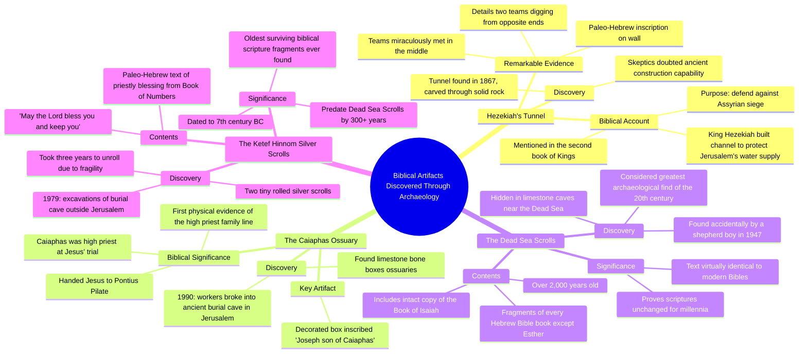

# Biblical Artifacts Actually Found: Hezekiah's Tunnel

> 🌐 **Read this in:** **English** · [中文](../../zh-CN/2026-10/tiktok-transcript-796k-views-48k-reactions-things-from-the-bible-that-have-act-b181.md)

> **Creator:** [@History Decoded](https://www.tiktok.com/@History Decoded) · **Views:** 448.7K · **Posted:** 2026-10-17 · **Niche:** entertainment
>
> **TL;DR:** The hook creates a strong curiosity gap by teasing a record-breaking discovery while promising a list of tangible biblical artifacts.

[Watch original video →](https://www.facebook.com/share/v/1LrZMuCrBE/)

## Why This Went Viral

## Hook (first 3 seconds)
- "Things from the Bible that have actually been found. The last discovery gives us the oldest surviving piece of the Bible ever found."
- **List + open-loop hook** (curiosity gap with a superlative teaser)
- It promises verifiable proof for a high-stakes claim ("actually been found") and immediately withholds the best item ("the last discovery"), forcing viewers to stay for the payoff.

## Emotional Rhythm
- **Curiosity** — "actually been found" frames the video as evidence vs. doubt.
- **Doubt → validation** — Hezekiah's Tunnel: "skeptics doubted… however in 1867 explorers discovered the actual tunnel." Repeated skepticism-then-proof loop.
- **Awe** — "two teams of stonecutters dug from opposite ends and miraculously met in the middle."
- **Tangible stakes** — Caiaphas ossuary: "turning a prominent biblical figure into a tangible part of history."
- **Authority/credibility spike** — Dead Sea Scrolls: "greatest archaeological find of the 20th century," "virtually identical."
- **Micro-tension / retention reset** — "Before I reveal the last one, make sure to hit that follow button." (re-opens the loop mid-video)
- **Climax** — Silver Scrolls: "oldest fragments of biblical scripture ever discovered in human history," preceded by the "three years just to unroll them" delay.
- **Resonance close** — the priestly blessing quoted verbatim ("May the Lord bless you and keep you") lands emotionally, then a question CTA.

## Keyword Density
- **Bible / biblical** (highest frequency — core topic anchor)
- **Discovered / found / uncovered**
- **Ancient** (ancient city, ancient burial cave, ancient manuscripts, ancient Paleo-Hebrew)
- **Oldest / first / ever** (superlative cluster)
- **Inscription / text / scrolls**
- **Jerusalem**
- **Skeptics doubted → proved**
- **History / human history**
- Algorithmic reach drivers: *Bible, discovered, ancient, oldest, Jerusalem* — high-search, high-identity terms that pull both religious and history/archaeology audiences.
- Emotional pull drivers: *miraculously, skeptics doubted, tangible, oldest ever, bless you and keep you* — these convert curiosity into shares and comments.

## Why It Spreads
- **Open loop with a named payoff** — "The last discovery gives us the oldest surviving piece of the Bible ever found" creates a debt the viewer must pay by watching to the end; the mid-video "Before I reveal the last one…" re-tightens it.
- **Doubt-then-proof pattern repeated 3x** — "skeptics doubted whether such a tunnel could be built… however in 1867 explorers discovered the actual tunnel" — each cycle delivers a mini dopamine hit that keeps retention high.
- **Numbered list structure** — "Number 1… Number 2… Number 3… Number 4" gives viewers a clear progress bar, reducing drop-off because the end feels near and countable.
- **Identity + evidence for a passionate niche** — "proving that the biblical scriptures remained unchanged for millennia" gives a religious audience shareable ammunition; the archaeology framing recruits skeptics and history fans too.
- **Emotional payload at the climax** — quoting "May the Lord bless you and keep you" right after "oldest fragments… ever discovered in human history" makes the ending feel personal, driving saves and comments ("Which of these… did you find most fascinating?").

## What You Can Steal
- **Front-load a superlative open loop** — open with "the last one is the [biggest/oldest/first] ever found" and explicitly re-tease it mid-video to reset retention.
- **Use the doubt→proof beat as your engine** — state the skeptic's objection, then the discovery that settles it; repeat this 3–4 times per video.
- **End on a quotable emotional line, not a fact** — close with a short human phrase (a blessing, a quote, a one-liner) before asking a single low-friction question to farm comments.

## Mind Map

## Full Transcript (Generated by [free TikTok transcript generator](https://toktranscript.com/?utm_source=github&utm_medium=breakdown&utm_campaign=tool_attribution))

> 📝 Transcripts on this page are auto-generated and show the first 60%. Want to transcribe any TikTok in 30 seconds and get the full version? [Try TokTranscript free →](https://toktranscript.com/?utm_source=github&utm_medium=breakdown&utm_campaign=transcript_cta)

Things from the Bible that have actually been found. The last discovery gives us the oldest surviving piece of the Bible ever found. Number 1. Hezekiah's Tunnel. Beneath the ancient city of Jerusalem lies an incredible engineering marvel known as Hezekiah's Tunnel. Mentioned in the second book of Kings, the Bible states that King Hezekiah constructed a massive underground channel to protect Jerusalem's water supply from an impending Assyrian siege. For a long time skeptics doubted whether such a tunnel could be built in ancient times. However in 1867 explorers discovered the actual tunnel carved entirely through solid rock. Even more amazing, an ancient Paleo-Hebrew inscription was found on the wall, detailing exactly how two teams of stonecutters dug from opposite ends and miraculously met in the middle. Number 2, The Caiaphas Ossuary In 1990, workers constructing a park in Jerusalem accidentally broke through the roof of an ancient burial cave. Inside archaeologists discovered a collection of limestone bone boxes, known as ossuaries. One beautifully decorated box immediately caught their attention bearing the inscription Joseph son of Caiaphas. According to the New Testament Caiaphas was the powerful high priest who presided over the trial of Jesus and handed him over to Pontius Pilate. This discovery provided the first direct physical evidence of the high priest family line turning a prominent biblical figure into a tangible part of history Number 3 the Dead Sea Scrolls Discovered entirely by accident by a young shepherd boy in 1947 the Dead Sea Scrolls are widely considered the greatest archaeological find of the 20th century.

*[Read the full transcript on TokTranscript →](https://toktranscript.com/plaza/tiktok-transcript-796k-views-48k-reactions-things-from-the-bible-that-have-act-b181?utm_source=github&utm_medium=breakdown&utm_campaign=transcript_full)*

## Browse More

- All [entertainment](../../by-niche/en/entertainment.md) breakdowns
- All [Curiosity Gap + Record-Breaking Tease](../../by-pattern/en/hook-curiosity-gap-record-breaking-tease.md) examples

## Video Info

| | |
|---|---|
| Creator | [@History Decoded](https://www.tiktok.com/@History Decoded) |
| Original video | [https://www.facebook.com/share/v/1LrZMuCrBE/](https://www.facebook.com/share/v/1LrZMuCrBE/) |
| Original title | 796K views · 48K reactions | Things from the Bible That Have Actually Been Found. . . . #history #DidYouKnow #historylovers #historyfacts #historymatters @followers @top fans #bible | History Decoded |
| Views | 448.7K (448707) |
| Posted | 2026-10-17 |
| Duration | 0s |
| Niche | `entertainment` |
| Hook pattern | `Curiosity Gap + Record-Breaking Tease` |
| Original language | `en` |
| Available languages | en, zh-CN |
| Generated | 2026-10-19 by [TokTranscript](https://toktranscript.com/) |

---

*This breakdown is for educational analysis under fair use. Original video © [@History Decoded](https://www.tiktok.com/@History Decoded). All transcripts are auto-generated and may contain errors.*

*Want to analyze your own TikToks like this? [free TikTok transcript generator →](https://toktranscript.com/viral-breakdown?utm_source=github&utm_medium=breakdown&utm_campaign=footer_cta)*