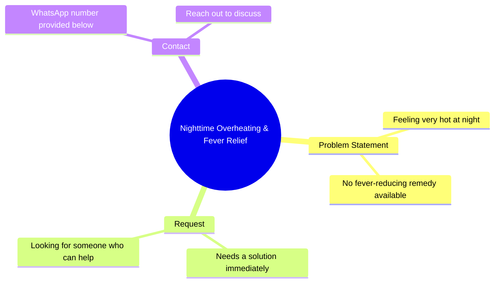

# Bank-Seized Fortuner & Scorpio at Lowest Prices

> 🌐 **Read this in:** **English** · [中文](../../zh-CN/2026-10/tiktok-transcript-898k-views-26k-reactions-whatsapp-https-whatsapp-openinapp-l-b23f.md)

> **Creator:** [@REENA DEVI](https://www.tiktok.com/@REENA DEVI) · **Views:** 337.3K · **Posted:** 2026-10-17 · **Niche:** other
>
> **TL;DR:** Opens with an intimate bodily confession that creates curiosity, then pivots to a relatable unmet need for a fix.

[Watch original video →](https://www.facebook.com/share/r/14tCE2Hr3Qi/)

## Why This Went Viral

## Hook (first 3 seconds)
- Verbatim opening: "मैं रात में बहुत गरम हो जाती हूं लेकिन बुखार ठीक करने वाला कोई नहीं मिलता है" ("I get very hot at night, but there's no one to cure the fever").
- Hook pattern: **First-person confession + vulnerability contrast** (physical/emotional need stated as a problem with no solution).
- Why it stops the scroll: It opens mid-intimacy — a personal, slightly ambiguous complaint ("I get very hot at night") that reads as either health plea or loneliness confession. The ambiguity forces the brain to resolve it, and the "no one is there" line triggers instant empathy. The viewer stays to find out *who she is* and *what she wants*.

## Emotional Rhythm
- **Curiosity (0–3s):** Ambiguous "I get very hot at night" — is this medical? Emotional? Sexual? Brain needs closure.
- **Tension (3–7s):** "No one to cure the fever" — isolation, unmet need. Viewer feels the gap.
- **Pivot / call-to-action (7–10s):** "I need someone at once — I've put my WhatsApp below, come tell me." Need converts into an open invitation.
- **Resonance:** Loneliness + health vulnerability is a universal late-night feeling; the direct address ("come tell me") makes the viewer the solution.
- **Climax:** The WhatsApp drop — the emotional plea collapses into a transactional CTA. This abrupt shift is the shareable "wait, what?" moment.
- **Twist:** The setup implies a medical/emotional confession; the payoff is a contact solicitation. The mismatch is what people screenshot and forward.

## Keyword Density
- **रात में** ("at night") — emotional pull; sets intimate, lonely frame.
- **बहुत गरम** ("very hot") — curiosity driver; ambiguous, high-comment bait.
- **बुखार** ("fever") — algorithmic reach; health-adjacent keyword pulls a broad search/diagnosis audience.
- **कोई नहीं** ("no one") — emotional pull; isolation signal.
- **एक साथ ही चाहिए** ("need at once") — urgency; drives DM/comment action.
- **वाटसप** ("WhatsApp") — conversion keyword; off-platform funnel signal.
- **आके बताओ** ("come tell me") — engagement driver; explicit CTA.
- Algorithmic reach: *बुखार, रात, वाटसप* (health + time + platform = broad topical match). Emotional pull: *गरम, कोई नहीं, चाहिए* (vulnerability + urgency).

## Why It Spreads
- **Ambiguity as a comment engine:** "रात में बहुत गरम हो जाती हूं" can be read as illness, loneliness, or flirtation — viewers comment to ask "what do you mean?", and comment velocity feeds distribution.
- **Empathy + concern sharing:** "बुखार ठीक करने वाला कोई नहीं मिलता" makes people tag friends or share with "someone check on her" — sharing is framed as care, lowering the social cost of spreading.
- **Direct-address CTA:** "नीचे वाटसप दी हूं आके बताओ" converts passive viewers into DM/comment actors, and every reply is a fresh engagement signal.
- **Pattern-break payoff:** The confession-to-CTA pivot violates the expected narrative (health plea → sales/contact pitch), producing the "wait, what?" reaction that drives rewatches and quote-shares.
- **Night-time framing:** "रात में" targets a specific viewing window when loneliness content peaks, increasing resonance and save/share behavior.

## What You Can Steal
- **Open with an unresolved first-person line** that has two readings — ambiguity buys you 3 extra seconds and comment volume.
- **Convert emotion into one explicit action** ("come tell me below") — a single, low-friction CTA beats three vague ones.
- **Use a pattern-break pivot** near the end (confession → invitation) so the video is rewatchable and screenshot-worthy; the mismatch is the share trigger.

## Mind Map

## Full Transcript (Generated by [TokTranscript](https://toktranscript.com/?utm_source=github&utm_medium=breakdown&utm_campaign=tool_attribution))

> 📝 Transcripts on this page are auto-generated and show the first 60%. Want to transcribe any TikTok in 30 seconds and get the full version? [Try TokTranscript free →](https://toktranscript.com/?utm_source=github&utm_medium=breakdown&utm_campaign=transcript_cta)

मैं रात में बहुत गरम हो जाती हूं लेकिन बुखार ठीक करने वाला कोई नहीं मिलता है 

*[Read the full transcript on TokTranscript →](https://toktranscript.com/plaza/tiktok-transcript-898k-views-26k-reactions-whatsapp-https-whatsapp-openinapp-l-b23f?utm_source=github&utm_medium=breakdown&utm_campaign=transcript_full)*

## Browse More

- All [other](../../by-niche/en/other.md) breakdowns
- All [Personal Confession + Unmet Need](../../by-pattern/en/hook-personal-confession-unmet-need.md) examples

## Video Info

| | |
|---|---|
| Creator | [@REENA DEVI](https://www.tiktok.com/@REENA DEVI) |
| Original video | [https://www.facebook.com/share/r/14tCE2Hr3Qi/](https://www.facebook.com/share/r/14tCE2Hr3Qi/) |
| Original title | 898K views · 26K reactions | WhatsApp👉https://WhatsApp.openinapp.link/dj8cw . . . . 🚘Bank-Seized Fortuner & Scorpio at the Lowest Prices | Bank Auction 2026 #auction #BankAuction #Fortuner #Scorpio #CarsForSale #Auction2026 #viralreels | REENA DEVI |
| Views | 337.3K (337311) |
| Posted | 2026-10-17 |
| Duration | 0s |
| Niche | `other` |
| Hook pattern | `Personal Confession + Unmet Need` |
| Original language | `en` |
| Available languages | en, zh-CN |
| Generated | 2026-10-20 by [TokTranscript](https://toktranscript.com/) |

---

*This breakdown is for educational analysis under fair use. Original video © [@REENA DEVI](https://www.tiktok.com/@REENA DEVI). All transcripts are auto-generated and may contain errors.*

*Want to analyze your own TikToks like this? [TokTranscript.com →](https://toktranscript.com/viral-breakdown?utm_source=github&utm_medium=breakdown&utm_campaign=footer_cta)*