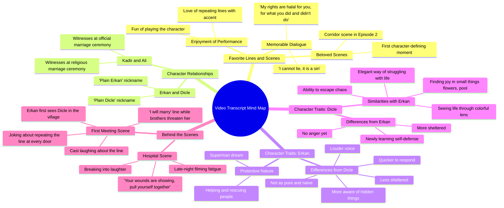

# Aytaç Şaşmaz and Helin Kandemir Q&A Interview

> 🌐 **Read this in:** **English** · [中文](../../zh-CN/2026-10/tiktok-transcript-ayta-a-maz-ve-helinkandemir-ile-bol-kahkahal-bir-soru-cevap-b456.md)

> **Creator:** [@sevdigimsensindizi](https://www.tiktok.com/@sevdigimsensindizi) · **Views:** 805.2K · **Posted:** 2026-10-20 · **Niche:** entertainment
>
> **TL;DR:** Opens with a heartfelt, culturally resonant phrase that immediately evokes curiosity about the relationship and context.

[Watch original video →](https://vt.tiktok.com/ZSgS6C7xN/)

## Why This Went Viral

## Hook (first 3 seconds)
- Opens with a rapid double greeting — "merhabalar merhabalar" — then immediately pivots to a quoted emotional line: "sen cevaplancan daha geçen gün konuştuk orda hakkını helal et diyodu" (referencing a recent scene where a character asks for forgiveness).
- **Hook pattern:** Scene/quote-drop + emotional callback (starts mid-conversation, as if the viewer walked into a reunion).
- Why it stops the scroll: it feels like eavesdropping on two beloved co-stars reuniting, and the "hakkını helal et" (forgive me / grant me your blessing) line is a high-emotion phrase that fans of the show instantly recognize — recognition triggers the pause.

## Emotional Rhythm
- **Curiosity** (0–5s): who is talking, what scene are they referencing?
- **Tension/nostalgia** (5–20s): the "yaptıklarına da yapmadıklarına da" (for what you did and didn't do) repetition — a heavy, bittersweet forgiveness line delivered twice, building ache.
- **Resonance** (20–45s): favorite-line ranking ("ben yalan konuşamam günah") — fans get the payoff of hearing the actor's own favorite moment.
- **Playful relief** (45–75s): the "dümdüz Erkan / dümdüz Dicle" bit — laughter breaks the tension.
- **Warm reflection** (75–110s): character analysis — "koruyucu olması," "superman olmak," Dicle's ability to find joy in chaos.
- **Climax:** the hospital-scene story — "eline bak dedim yaraların var dedim toparlan artık" — an improvised line born from late-night exhaustion and laughter. This is the emotional peak: real, unscripted, intimate.
- **Twist/button** (final seconds): "ben evlenirim" repeated as a running joke — "ben her kapıyı açtığımda ben evlenirim" — ends on laughter and a quotable catchphrase.

## Keyword Density
- **"yaptıklarına da yapmadıklarına da"** (what you did and didn't do) — emotional pull; the forgiveness motif.
- **"ben evlenirim"** (I'll marry her) — the signature catchphrase; algorithmic reach via recognizability.
- **"dümdüz"** (plain/simple) — meme-able, repeatable, clip-friendly.
- **"Dicle" / "Erkan"** — character names; drive search and fandom recommendation.
- **"helal olsun"** (blessing/forgiveness) — emotional pull.
- **"koruyucu"** (protective) — thematic keyword for character analysis.
- **"yalan konuşamam günah"** (I can't lie, it's a sin) — quotable, high-recall line.
- **"hastane sahnesi"** (hospital scene) — scene-specific search term.
- Algorithmic reach: character names, "ben evlenirim," "dümdüz" (repeatable, meme-able). Emotional pull: "helal olsun," "yaptıklarına da yapmadıklarına da," "koruyucu."

## Why It Spreads
- **Recognition loop:** the opening quote "hakkını helal et" and "yaptıklarına da yapmadıklarına da" are repeated twice — fans of the show instantly identify the scene, and repetition makes the phrase stick for non-fans too.
- **Catchphrase payoff:** "ben evlenirim" is delivered as a running gag ("ben her kapıyı açtığımda ben evlenirim") — a quotable, shareable line that works as a standalone clip even without context.
- **Behind-the-scenes intimacy:** the hospital story ("gece geç saat olunca... gülmeye başlıyosun... eline bak dedim yaraların var dedim") gives viewers the feeling of insider access — unscripted, human, funny.
- **Character-analysis resonance:** "Dicle çok kaotik bi ortamda... çiçeğe bakıp mutlu olabiliyo" — viewers project themselves onto the characters, driving comments and shares ("this is so me").
- **Laughter as social proof:** the transcript is full of "ha ha" and overlapping speech — the clip *sounds* like fun, which makes it feel like an invitation to join, not a performance.

## What You Can Steal
- **Open mid-quote, not mid-intro:** start on a recognizable emotional line ("hakkını helal et...") instead of a greeting — recognition is the fastest scroll-stopper.
- **Repeat your best line twice:** the "yaptıklarına da yapmadıklarına da" double-delivery makes the phrase memorable and clip-quotable — plant one repeatable phrase per video.
- **End on a running gag, not a summary:** close with the catchphrase callback ("ben evlenirim") so the last emotion is laughter — the button is what gets replayed and shared.

## Mind Map

## Full Transcript (Generated by [TokTranscript](https://toktranscript.com/?utm_source=github&utm_medium=breakdown&utm_campaign=tool_attribution))

> 📝 Transcripts on this page are auto-generated and show the first 60%. Want to transcribe any TikTok in 30 seconds and get the full version? [Try TokTranscript free →](https://toktranscript.com/?utm_source=github&utm_medium=breakdown&utm_campaign=transcript_cta)

merhabalar merhabalar sen cevaplancan daha geçen gün konuştuk orda hakkını helal et diyodu Dicle yaptıklarına da yapmadıklarına yaptıklarına da yapmadıklarına da sonra ben de tekrar ediyodum yaptıklarına da yapmadıklarına o benim çok içimi acıtıyodu yani benim hakkım da sana helal olsun bu arada yaptıklarına da yapmadıklarına da benim hakkım da helal olsun yaptıklarına da yapmadıklarına da benim en sevdiğim repliğim ama ben yalan konuşamam günah seviyorum 2. bölümde ilk geldiği zaman koridorda bi sahne çekmiştik ben yalan konuşamam günahdır ilk hani karaktere dair bi şey söylediğimiz yeri seviyorum ben şeyi de çok seviyorum ya yani senin tekrar etmeyi de seviyorum evet şiveyle di mi evet biz de seviyoruz onu oynamayı da ilk aklıma geldiği için bunu söylüyorum Kadir de bizim imam nikahımızın şahidiydi ama sonra gördük neler olduğunu Ali bizim imam nikahımızın şahididir ayıptır ya hee Kadir de bizim resmi nikahımızın şahidiyi gördük sonra olduğunu benim en sevdiğim rap'li dümdüz Erkan sen bundan sonra benim için dümdüz erkansın aynen sen benim için artık sade erkansın sen artık böyle dümdüz erkansın dümdüz Dicle sen de dümdüz dicle'sin benim Erkan'la en belirgin özelliğim benzer özelliğim bence koruyucu olması benim zaten hayal ettiğim hayat böyle superman olmak ha ha bi gün inşallah uçabilicem bunu biliyoruz ya ama onun kurtarma tarafında yani insanlara el uzatma tarafında seviyorum ordan ııı bence birbirimize benziyoruz yani o taraftan böyle hayatı hep böyle rengarenk 1 pencereden görüyo ya Dicle çok kavatik bi ortamda da mesaj atıyorum çiçeğe bakıp mutlu olabiliyo ya da havuzu görünce mutlu olup ordan kopabilme becerisi ha ha ya kaos'tan kendi kendini çıkarabilme yeteneğini kendime benzetiyorum evet hayatla mücadele şeklinin eee zarif olmasını kendime benzetiyorum ya ben erken kadar saf bi adam değilim onun kadar temiz eee yani bazı şeyler oluyo içerden bi gözden o görmüyo ama ben görürdüm ben

*[Read the full transcript on TokTranscript →](https://toktranscript.com/plaza/tiktok-transcript-ayta-a-maz-ve-helinkandemir-ile-bol-kahkahal-bir-soru-cevap-b456?utm_source=github&utm_medium=breakdown&utm_campaign=transcript_full)*

## Browse More

- All [entertainment](../../by-niche/en/entertainment.md) breakdowns
- All [Emotional Quote Recall](../../by-pattern/en/hook-emotional-quote-recall.md) examples

## Video Info

| | |
|---|---|
| Creator | [@sevdigimsensindizi](https://www.tiktok.com/@sevdigimsensindizi) |
| Original video | [https://vt.tiktok.com/ZSgS6C7xN/](https://vt.tiktok.com/ZSgS6C7xN/) |
| Original title | #AytaçŞaşmaz ve #HelinKandemir ile bol kahkahalı bir Soru-Cevap! ❤️ 🌼... |
| Views | 805.2K (805200) |
| Posted | 2026-10-20 |
| Duration | 0s |
| Niche | `entertainment` |
| Hook pattern | `Emotional Quote Recall` |
| Original language | `en` |
| Available languages | en, zh-CN |
| Generated | 2026-10-21 by [TokTranscript](https://toktranscript.com/) |

---

*This breakdown is for educational analysis under fair use. Original video © [@sevdigimsensindizi](https://www.tiktok.com/@sevdigimsensindizi). All transcripts are auto-generated and may contain errors.*

*Want to analyze your own TikToks like this? [the tool we used to generate this →](https://toktranscript.com/viral-breakdown?utm_source=github&utm_medium=breakdown&utm_campaign=footer_cta)*