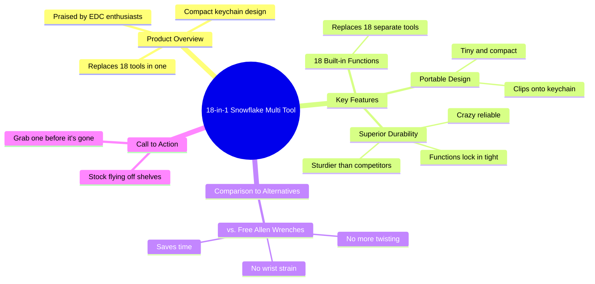

# 18-in-1 Snowflake Multi Tool EDC Wrench Review

> 🌐 **Read this in:** **English** · [中文](../../zh-CN/2026-10/tiktok-transcript-be-sure-to-carry-this-snowflake-wrench-with-you-when-you-re-aeab.md)

> **Creator:** [@rodney.owens87](https://www.tiktok.com/@rodney.owens87) · **Views:** 1.2M · **Posted:** 2026-10-16 · **Niche:** tech
>
> **TL;DR:** Opens with strong praise to grab attention, then immediately agitates a common pain point to create urgency.

[Watch original video →](https://www.tiktok.com/@rodney.owens87/video/7637541548686658830?is_from_webapp=1&sender_device=pc&web_id=7695616896544015903)

## Why This Went Viral

## Hook (first 3 seconds)
- **Verbatim:** "Whoever invented this thing deserves a raise."
- **Hook pattern:** Bold claim + curiosity gap (unresolved "this thing").
- **Why it stops the scroll:** It opens with praise for an unnamed object, creating an information gap the viewer must close. No context = forced micro-commitment to keep watching.

## Emotional Rhythm
- **0–3s — Curiosity:** "deserves a raise" (what is it?).
- **3–7s — Pain agitation:** "still twisting away with those free Allen wrenches, wasting time and wrecking your wrist" (viewer self-identifies as the victim).
- **7–10s — Relief/reveal:** "Toss that junk aside and check this out" + product name drop.
- **10–18s — Authority stacking:** "EDC fanatics swear by," "18 in 1," "replaces 18 tools."
- **18–25s — Desire escalation:** keychain clip, "blows every other multi tool out of the water," "way sturdier," "crazy reliable."
- **Climax:** "Every function locks in tight so it won't let you down" — the reliability promise resolves the wrist-wrecking fear from the opening.
- **25–30s — Urgency close:** "Stock is flying off the shelves. Grab one before it's gone."

## Keyword Density
- **Strongest repeated terms:** *tool / multi tool* (×5), *18* (×3), *thing/this* (×4), *wrist/wrecking*, *keychain*, *sturdy/reliable/locks in tight*, *stock flying off the shelves*.
- **Algorithmic drivers:** "multi tool," "18 in 1," "EDC," "keychain" — search + category signals that route the video into gadget/gear feeds.
- **Emotional pull:** "wrecking your wrist," "won't let you down," "before it's gone" — pain, trust, and scarcity that convert viewers into buyers.

## Why It Spreads
- **Pain-first framing:** "wasting time and wrecking your wrist" makes the viewer the hero of a problem they didn't know was being solved — high shareability to "someone who needs this."
- **Specificity as proof:** "18 in 1," "18 built in functions," "clip right onto your keychain" — concrete numbers beat vague claims and survive comment-section scrutiny.
- **Insider authority:** "the kind EDC fanatics swear by" borrows credibility from a niche community, making the recommendation feel peer-vetted rather than ad-like.
- **Superlative stacking:** "blows every other multi tool out of the water," "way sturdier than anything else" — creates a comparison frame that invites debate and duets/stitches.
- **Scarcity close:** "Stock is flying off the shelves. Grab one before it's gone" — triggers FOMO that converts passive viewers into clickers, boosting the engagement signal the algorithm rewards.

## What You Can Steal
1. **Open with praise for an unnamed thing.** "Whoever invented this deserves a raise" forces the viewer to stay for the reveal — no product name until second 7.
2. **Agitate the pain before you pitch.** Name the specific annoyance ("twisting away with free Allen wrenches") so the viewer feels seen before you sell the fix.
3. **Stack one number, one niche, one superlative.** "18 in 1" + "EDC fanatics" + "blows everything else out of the water" gives the algorithm a category, the viewer a tribe, and the pitch a claim worth arguing about.

## Mind Map

## Full Transcript (Generated by [free TikTok transcript generator](https://toktranscript.com/?utm_source=github&utm_medium=breakdown&utm_campaign=tool_attribution))

> 📝 Transcripts on this page are auto-generated and show the first 60%. Want to transcribe any TikTok in 30 seconds and get the full version? [Try TokTranscript free →](https://toktranscript.com/?utm_source=github&utm_medium=breakdown&utm_campaign=transcript_cta)

Whoever invented this thing deserves a raise. Are you still twisting away with those free Allen wrenches, wasting time and wrecking your wrist? Toss that junk aside and check this out. This is an 18 in 1 snowflake multi tool, the kind EDC fanatic swear by. It's packed with 18 built in functions. So it basically replaces 18 tools in one. The best part is tiny enough to clip right onto your keychain.

*[Read the full transcript on TokTranscript →](https://toktranscript.com/plaza/tiktok-transcript-be-sure-to-carry-this-snowflake-wrench-with-you-when-you-re-aeab?utm_source=github&utm_medium=breakdown&utm_campaign=transcript_full)*

## Browse More

- All [tech](../../by-niche/en/tech.md) breakdowns
- All [Praise + Problem Agitation](../../by-pattern/en/hook-praise-problem-agitation.md) examples

## Video Info

| | |
|---|---|
| Creator | [@rodney.owens87](https://www.tiktok.com/@rodney.owens87) |
| Original video | [https://www.tiktok.com/@rodney.owens87/video/7637541548686658830?is_from_webapp=1&sender_device=pc&web_id=7695616896544015903](https://www.tiktok.com/@rodney.owens87/video/7637541548686658830?is_from_webapp=1&sender_device=pc&web_id=7695616896544015903) |
| Original title | Be sure to carry this snowflake wrench with you when you're out.Caugh... |
| Views | 1.2M (1200000) |
| Posted | 2026-10-16 |
| Duration | 0s |
| Niche | `tech` |
| Hook pattern | `Praise + Problem Agitation` |
| Original language | `en` |
| Available languages | en, zh-CN |
| Generated | 2026-10-17 by [TokTranscript](https://toktranscript.com/) |

---

*This breakdown is for educational analysis under fair use. Original video © [@rodney.owens87](https://www.tiktok.com/@rodney.owens87). All transcripts are auto-generated and may contain errors.*

*Want to analyze your own TikToks like this? [TokTranscript →](https://toktranscript.com/viral-breakdown?utm_source=github&utm_medium=breakdown&utm_campaign=footer_cta)*