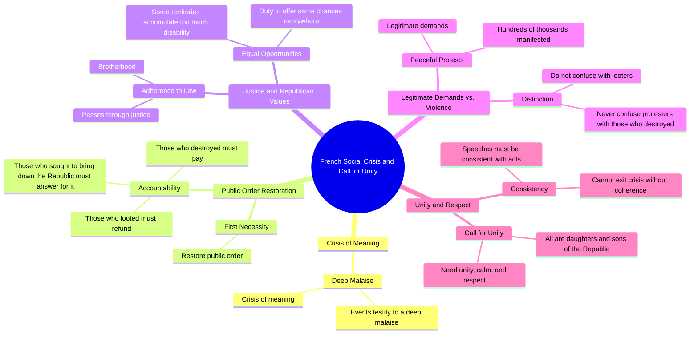

# Jacques Chirac 21 Years Earlier: A Crisis of Meaning

> 🌐 **Read this in:** **English** · [中文](../../zh-CN/2026-10/tiktok-transcript-c-tait-vingt-et-un-ans-plus-t-t-le-pr-sident-jacques-chirac-fa33.md)

> **Creator:** [@quotidienofficiel](https://www.tiktok.com/@quotidienofficiel) · **Views:** 438.1K · **Posted:** 2026-10-19 · **Niche:** other
>
> **TL;DR:** The hook immediately identifies a profound societal problem, creating curiosity about the solution.

[Watch original video →](https://vt.tiktok.com/ZSgBJawcH/)

## Why This Went Viral

## Hook (first 3 seconds)
- **Verbatim opening:** "these events testify to a deep malaise it's a crisis of meaning"
- **Hook pattern:** Bold claim + abstract diagnosis (a "crisis of meaning" framing dropped with zero setup)
- **Why it stops the scroll:** It opens mid-thought with high-stakes language ("deep malaise," "crisis of meaning") that sounds like a verdict being delivered. No greeting, no context — the viewer lands inside a serious pronouncement and has to stay to find out *what events* and *whose crisis*. The elevated register signals authority, which buys the next few seconds.

## Emotional Rhythm
- **Beat 1 — Curiosity/gravity:** "crisis of meaning" + "these images" → viewer needs the referent.
- **Beat 2 — Confusion-turned-intrigue:** "what they have in their head / how French people can do that to France" → a jarring, almost accusatory question that raises stakes and identity stakes.
- **Beat 3 — Tension (institutional):** "the duty of the Republic… same chances… too much disability" → abstract policy language creates a lull; tension is deferred, not released.
- **Beat 4 — Shame/anger resonance:** "we all feel anger tonight… shame to see the streets… ransacked is unbearable" → first real emotional spike; collective "we" invites the viewer in.
- **Beat 5 — Hard turn to order:** "restore public order… those who destroyed must pay… looted must refund… will have to answer for it" → rhythmic triplet, escalating consequence.
- **Beat 6 — Twist/softening:** "we must never confuse them with those who destroyed" → sudden empathy pivot; reframes the "them."
- **Beat 7 — Climax:** "all the daughters and sons of the Republic" → the emotional peak; inclusion language lands hardest here.
- **Beat 8 — Resolution/call:** "unity of calm and respect… make the speeches consistent and the acts" → closing demand, a critique aimed inward.
- **Climax moment:** "that they are all the daughters and sons of the Republic" — the pivot from punishment to belonging is the line most likely to be clipped, quoted, and re-shared.

## Keyword Density
- **Republic** (repeated ~5x) — the load-bearing word; drives both algorithmic topic clustering (politics/France/civic) and emotional pull (belonging, legitimacy).
- **Destroyed / looted / ransacked / violence** — the conflict cluster; highest algorithmic reach (news/conflict signals) and the source of visceral tension.
- **Crisis / malaise / difficulties** — diagnostic framing; pulls in the "explainer" audience.
- **Unity / calm / respect / brotherhood** — the resolution cluster; drives shares and saves (quotable, aspirational).
- **Justice / law / duty** — authority signals; boosts credibility and comment-section debate.
- **"Daughters and sons of the Republic"** — the signature phrase; highest emotional pull, most meme-able.
- **Algorithmic vs. emotional:** conflict words (destroyed, looted, violence) and the entity word "Republic" drive *reach* (topic classification, news adjacency). "Crisis of meaning," "shame," and "daughters and sons" drive *emotional pull* and re-sharing.

## Why It Spreads
- **It opens on a verdict, not a setup.** "It's a crisis of meaning" forces the viewer to reverse-engineer the context — a completion gap that keeps them watching past the 3-second drop-off.
- **It runs a full emotional arc in under a minute.** Anger ("shame to see the streets… ransacked") → punishment ("those who destroyed must pay") → empathy twist ("we must never confuse them") → inclusion ("daughters and sons of the Republic"). The twist is what makes it quotable rather than one-note.
- **The triplet rhythm is built for clipping.** "Those who destroyed must pay / those who have looted must refund / those who sought to bring down the Republic will have to answer for it" is a self-contained, rhythmic unit — ideal for captions, stitch reactions, and comment bait.
- **It invites the viewer into a "we."** "We all feel anger tonight," "we all wondered" — collective framing converts passive viewers into participants who share to signal their own stance.
- **It ends on a self-critique, not a slogan.** "Make the speeches consistent and the acts" turns the camera on the speaker's own side — a rare move that sparks debate in comments, and comment velocity is a spread multiplier.

## What You Can Steal
1. **Open on the conclusion, not the context.** Lead with your boldest diagnostic line ("it's a crisis of meaning") and let the viewer stay to find out what it refers to. Cut every greeting and preamble.
2. **Build a punishment-to-empathy twist.** Use a rhythmic triplet of consequences, then pivot to a line that reframes the "them" as "us" ("daughters and sons of the Republic"). The twist is the shareable moment — design one per video.
3. **End on a demand aimed at your own side.** A closing self-critique ("make the speeches consistent and the acts") outperforms a generic call-to-action because it provokes comments and signals integrity.

## Mind Map

## Full Transcript (Generated by [free TikTok transcript generator](https://toktranscript.com/?utm_source=github&utm_medium=breakdown&utm_campaign=tool_attribution))

> 📝 Transcripts on this page are auto-generated and show the first 60%. Want to transcribe any TikTok in 30 seconds and get the full version? [Try TokTranscript free →](https://toktranscript.com/?utm_source=github&utm_medium=breakdown&utm_campaign=transcript_cta)

these events testify to a deep malaise it's a crisis of meaning 1 benchmark crisis by looking at these images we all wondered what they have in their head how French people can do that to France the duty of the Republic is to offer everywhere and to each his own the same chances but some territories accumulate too much disability we all feel anger tonight of shame to see the streets of our cities thus ransacked is unbearable in the face of the violence of recent weeks in the face of suffering and the difficulties of time of our fellow citizens especially among the most vulnerable the 1st necessity is to restore public order those who destroyed must pay those who have looted must refund those who sought to bring down the Republic will have to answer for it but adherence to the law and t

*[Read the full transcript on TokTranscript →](https://toktranscript.com/plaza/tiktok-transcript-c-tait-vingt-et-un-ans-plus-t-t-le-pr-sident-jacques-chirac-fa33?utm_source=github&utm_medium=breakdown&utm_campaign=transcript_full)*

## Browse More

- All [other](../../by-niche/en/other.md) breakdowns
- All [Problem Declaration](../../by-pattern/en/hook-problem-declaration.md) examples

## Video Info

| | |
|---|---|
| Creator | [@quotidienofficiel](https://www.tiktok.com/@quotidienofficiel) |
| Original video | [https://vt.tiktok.com/ZSgBJawcH/](https://vt.tiktok.com/ZSgBJawcH/) |
| Original title | C’était vingt et un ans plus tôt. Le président Jacques Chirac prenait... |
| Views | 438.1K (438100) |
| Posted | 2026-10-19 |
| Duration | 0s |
| Niche | `other` |
| Hook pattern | `Problem Declaration` |
| Original language | `en` |
| Available languages | en, zh-CN |
| Generated | 2026-10-20 by [TokTranscript](https://toktranscript.com/) |

---

*This breakdown is for educational analysis under fair use. Original video © [@quotidienofficiel](https://www.tiktok.com/@quotidienofficiel). All transcripts are auto-generated and may contain errors.*

*Want to analyze your own TikToks like this? [free TikTok transcript generator →](https://toktranscript.com/viral-breakdown?utm_source=github&utm_medium=breakdown&utm_campaign=footer_cta)*