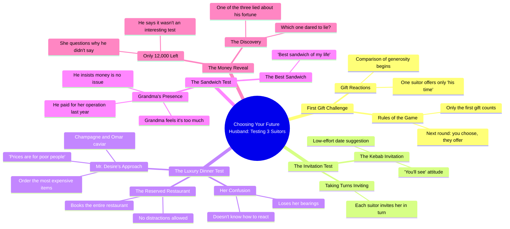

# Girl Must Choose Between 3 Future Husbands

> 🌐 **Read this in:** **English** · [中文](../../zh-CN/2026-10/tiktok-transcript-elle-doit-en-choisir-un-fruitdrama-fruitstory-ai-france-brai-5a9f.md)

> **Creator:** [@fruitdramafr6](https://www.tiktok.com/@fruitdramafr6) · **Views:** 3.8M · **Posted:** 2026-10-09 · **Niche:** entertainment
>
> **TL;DR:** Sets up a high-stakes dating test with three men, immediately creating curiosity and tension.

[Watch original video →](https://vm.tiktok.com/ZN8BduEKG//)

## Why This Went Viral

## Hook (first 3 seconds)
- Verbatim opening: "choisis ton futur mari" ("choose your future husband") — followed instantly by "non je vais tester les 3" ("no, I'm going to test all 3").
- Hook pattern: **bold claim + premise question** hybrid — a "choose one" dating-game setup that gets flipped by a rebellious "actually, I'll test all three."
- Why it stops the scroll: It frames a high-stakes, instantly legible game (pick a husband) in under 2 seconds, then subverts the expected format. The viewer needs the answer to "which one wins?" — a curiosity gap opened before they can decide to leave.

## Emotional Rhythm
- **Beat 1 — Curiosity (0–5s):** The "test all 3" premise sets up a competition. "1ère cadeau seulement" ("only the first gift") establishes rules.
- **Beat 2 — Comic contrast (5–15s):** Kebab guy vs. "Monsieur Désir champagne Omar caviar" — laughter and absurdity. "Les prix c'est pour les pauvres" ("prices are for poor people") spikes intrigue about who's flashy vs. real.
- **Beat 3 — Tension build (15–30s):** The reserved-restaurant guy, the no-music scene, the "je sais plus trop où j'en suis" — the viewer starts sensing one of these men is performing wealth.
- **Beat 4 — Emotional twist (30–45s):** Grandma scene. "C'est le meilleur sandwich de ma vie" → "il m'a payé mon opération l'année dernière" → "c'est que des sous, moi je me débrouille." Real warmth lands against the earlier flashiness.
- **Climax:** "Attends c'est pour ça que t'as que 12.000 ?" — the reveal that the "rich" persona is broke, and the modest one is the real deal. The line "l'un des 3 ment sur sa fortune" ("one of the 3 is lying about his fortune") is the payoff punch.
- **Resolution:** The narrator declares the test "très intéressant" — reframing the whole video as a social experiment, not a date.

## Keyword Density
- "test / tester" — drives the format recognition and rewatchability.
- "choisis / choisis ton futur mari" — the premise hook, high comment-bait.
- "cadeau / offrir / payé" — anchors the money theme.
- "champagne / caviar / kebab / sandwich" — class-contrast keywords, strong emotional pull.
- "mamie / opération" — the empathy trigger; drives shares.
- "12.000 / sous / fortune / pauvres" — the money-truth axis.
- "mentir / ment / osé mentir" — the reveal keyword; drives the final question and comments.
- Algorithmic reach drivers: "test," "mari," "mentir" (searchable, trend-aligned). Emotional pull drivers: "mamie," "opération," "sandwich de ma vie."

## Why It Spreads
- **The reversal structure is comment-bait.** "L'un des 3 ment sur sa fortune, lequel a osé mentir" ends on an open question — viewers flood comments with guesses, and the algorithm reads that as engagement.
- **Class-contrast is universally legible.** "Les prix c'est pour les pauvres" vs. "c'est que des sous, moi je me débrouille" needs no translation of culture — it's a status-vs-substance story anyone can react to.
- **The grandma beat manufactures an emotional spike.** "Il m'a payé mon opération l'année dernière" reframes the video from comedy to heart, which drives saves and shares from viewers who came for the joke.
- **Fast-cut, multi-character format rewards rewatch.** Three men, rapid scene switches, and a final "which one lied?" prompt make viewers re-scan for clues — boosting watch time and completion rate.
- **The "test" framing invites duets and stitches.** The premise ("I'll test all 3") is a template others can copy, spawning derivative content that feeds the original's reach.

## What You Can Steal
- **Open with a rule, then break it.** State the format ("choose one") and immediately subvert it ("no, I'll test all three") in the first 3 seconds — the subversion is what stops the scroll.
- **Plant the twist early, pay it off late.** The money theme is set up in the first 15 seconds ("prices are for poor people") and detonated at the end ("you only have 12,000?"). Seed the contradiction, don't reveal it.
- **End on a question the audience can answer.** "Which one lied?" converts passive viewers into commenters — the single highest-leverage move for algorithmic push on short-form.

## Mind Map

## Full Transcript (Generated by [TokTranscript.com](https://toktranscript.com/?utm_source=github&utm_medium=breakdown&utm_campaign=tool_attribution))

> 📝 Transcripts on this page are auto-generated and show the first 60%. Want to transcribe any TikTok in 30 seconds and get the full version? [Try TokTranscript free →](https://toktranscript.com/?utm_source=github&utm_medium=breakdown&utm_campaign=transcript_cta)

choisis ton futur mari non je vais tester les 3 ah on peut gagner du temps non 1ère cadeau seulement le 1ère le prochain c'est toi qui choisis et toi tu m'offres quoi mon temps ha ha 1ère test vous m'invitez chacun votre tour facile et lui il t'invite où au kebab tu verras j'ai hâte monsieur désir champagne Omar caviar prenez le plus cher tu regardes même pas les prix les prix c'est pour les pauvres plus vite toi t'es sérieux là pardon devant toi j'sais plus comment faire tu as réservé tout le restaurant comme ça personne ne nous dérange tu ne réponds pas rien d'important viens y a même pas de musique on en a pas besoin j'sais plus trop où j'en suis là goû

*[Read the full transcript on TokTranscript →](https://toktranscript.com/plaza/tiktok-transcript-elle-doit-en-choisir-un-fruitdrama-fruitstory-ai-france-brai-5a9f?utm_source=github&utm_medium=breakdown&utm_campaign=transcript_full)*

## Browse More

- All [entertainment](../../by-niche/en/entertainment.md) breakdowns
- All [Challenge/Test Hook](../../by-pattern/en/hook-challenge-test-hook.md) examples

## Video Info

| | |
|---|---|
| Creator | [@fruitdramafr6](https://www.tiktok.com/@fruitdramafr6) |
| Original video | [https://vm.tiktok.com/ZN8BduEKG//](https://vm.tiktok.com/ZN8BduEKG//) |
| Original title | Elle Doit En Choisir Un  #fruitdrama #fruitstory #ai  #france  #brainrot |
| Views | 3.8M (3800000) |
| Posted | 2026-10-09 |
| Duration | 0s |
| Niche | `entertainment` |
| Hook pattern | `Challenge/Test Hook` |
| Original language | `en` |
| Available languages | en, zh-CN |
| Generated | 2026-10-11 by [TokTranscript](https://toktranscript.com/) |

---

*This breakdown is for educational analysis under fair use. Original video © [@fruitdramafr6](https://www.tiktok.com/@fruitdramafr6). All transcripts are auto-generated and may contain errors.*

*Want to analyze your own TikToks like this? [TokTranscript →](https://toktranscript.com/viral-breakdown?utm_source=github&utm_medium=breakdown&utm_campaign=footer_cta)*