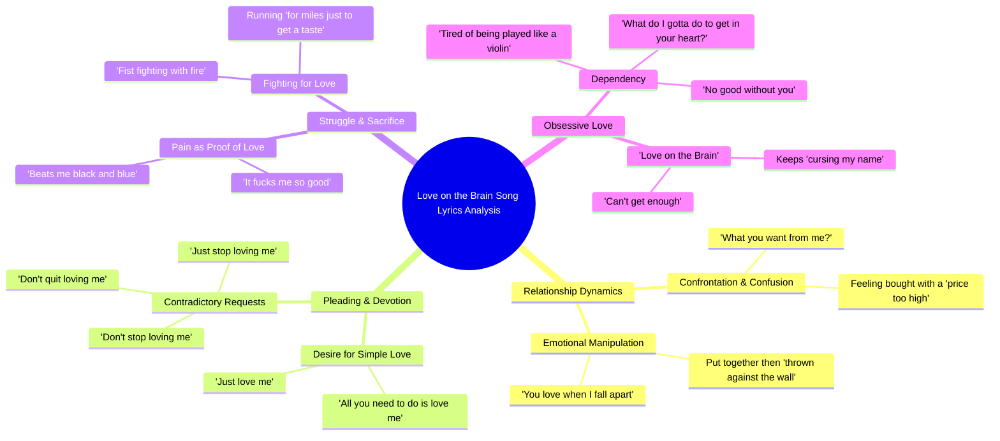

# Polygel With Soft Gel Nail Tip Extensions

> 🌐 **Read this in:** **English** · [中文](../../zh-CN/2026-10/tiktok-transcript-polygel-with-soft-gel-nail-tips-extensions-love-the-results-d190.md)

> **Creator:** [@marisolbeauty](https://www.tiktok.com/@marisolbeauty) · **Views:** 953.8K · **Posted:** 2026-10-13 · **Niche:** entertainment
>
> **TL;DR:** Opens with a raw, relatable question that instantly pulls viewers into the emotional conflict.

[Watch original video →](https://www.tiktok.com/@marisolbeauty/video/7691414100663880974)

## Why This Went Viral

## Hook (first 3 seconds)
- **Verbatim opening:** "And you got me like, girl, what you want from me? What you want from me?"
- **Hook pattern:** Direct-address question — a repeated, almost pleading question aimed straight at an implied "you."
- **Why it stops the scroll:** The repetition ("What you want from me?") creates instant tension without setup. No context needed — the viewer is dropped mid-argument, which forces the brain to resolve the unresolved. Questions are the cheapest attention tax you can charge a scroller.

## Emotional Rhythm
- **0–5s — Curiosity/confrontation:** The opening question frames a power struggle. Viewer asks: who is she, who is he, what happened?
- **5–20s — Push-pull tension:** "tried to buy you pretty hard, but a price too high" → "you love when I fall apart / so you can put me together and throw me against the wall." Toxic-love dynamic is named explicitly. Suspense builds around *why* she stays.
- **20–35s — Pleading spiral:** "Don't you stop loving me / Don't quit loving me / Just stop loving me" — the contradiction (don't stop / just stop) is the emotional pivot. Ambivalence peaks.
- **35–50s — Climax:** "I'm fist fighting with fire / just to get close to you" and "It beats me black and blue / but it fucks me so good." This is the moment — pain and pleasure fused in one line. Highest resonance point.
- **50s–end — Resignation loop:** "Must be love on the brain" repeats as a mantra. Emotional landing is not relief — it's surrender. That unresolved ending is what drives rewatches and comments.

## Keyword Density
- **"love"** (loving / love on the brain) — highest frequency; emotional pull + search-friendly
- **"me" / "you"** — pronoun density creates parasocial intimacy; every line feels addressed to the viewer
- **"stop" / "quit" / "don't"** — negation cluster; drives the ambivalence that makes the hook sticky
- **"brain"** — the title phrase; algorithmic anchor for search and sound reuse
- **"fire" / "burning" / "black and blue"** — sensory pain imagery; emotional pull
- **"enough" / "can't get enough"** — scarcity framing; loops the listener back to the top
- **"baby"** — intimacy marker; softens every harsh line around it

**Algorithmic vs. emotional:** "love on the brain," "baby," and "love" drive reach (searchable, sound-matchable, emotionally tagged). "Stop," "fire," "black and blue," and "can't get enough" drive the emotional pull that makes people save, share, and stitch.

## Why It Spreads
- **Contradiction as a hook engine.** "Don't you stop loving me / Don't quit loving me / Just stop loving me" is a self-contradicting triplet. Viewers can't resolve it in one pass, so they replay — and replays are the single strongest ranking signal on short-form.
- **Pain-pleasure fusion is highly quotable.** "It beats me black and blue / but it fucks me so good" is the line people screenshot, caption, and duet. One line doing double duty (shock + relatability) is the share unit.
- **Universal toxic-love script.** "Fist fighting with fire just to get close to you" maps onto any obsessive relationship. The viewer doesn't need to know the artist — they insert themselves.
- **Address-based pronoun loop.** "You got me like / what you want from me" makes the viewer the "you." That second-person framing turns passive listening into felt accusation — the strongest driver of comment-section confessionals.
- **Mantra repetition of the title.** "Must be love on the brain" lands 3+ times. Repetition converts a lyric into a hook, a caption, and a search term simultaneously.

## What You Can Steal
1. **Open mid-conflict, not mid-setup.** Start on the question or accusation, not the backstory. If your first line needs context to land, cut it.
2. **Write one contradictory triplet.** A three-line sequence where line 3 reverses lines 1–2 ("don't stop / don't quit / just stop") is a replay machine. Build it deliberately.
3. **Fuse two opposite emotions in one sentence.** Pain + pleasure, love + violence, need + resentment. One fused line outperforms ten clean ones because it's the line people quote.

## Mind Map

## Full Transcript (Generated by [TokTranscript.com](https://toktranscript.com/?utm_source=github&utm_medium=breakdown&utm_campaign=tool_attribution))

> 📝 Transcripts on this page are auto-generated and show the first 60%. Want to transcribe any TikTok in 30 seconds and get the full version? [Try TokTranscript free →](https://toktranscript.com/?utm_source=github&utm_medium=breakdown&utm_campaign=transcript_cta)

And you got me like, girl, what you want from me? What you want from me? And tried to buy you pretty hard, but a price too high. Baby, you got me like gold. You love when I fall apart. So you can put me together and throw me against the wall. Baby, you got me like gold. Don't you stop loving me Don't quit loving me Just stop loving me And babe, I'm fist fighting with fire Just to get close to you And quit burning something for me And I run for miles just to get a taste Must be love on the brain That's got me feeling this way It beats me black and blue But it fucks me so good And I c

*[Read the full transcript on TokTranscript →](https://toktranscript.com/plaza/tiktok-transcript-polygel-with-soft-gel-nail-tips-extensions-love-the-results-d190?utm_source=github&utm_medium=breakdown&utm_campaign=transcript_full)*

## Browse More

- All [entertainment](../../by-niche/en/entertainment.md) breakdowns
- All [Direct Question Hook](../../by-pattern/en/hook-direct-question-hook.md) examples

## Video Info

| | |
|---|---|
| Creator | [@marisolbeauty](https://www.tiktok.com/@marisolbeauty) |
| Original video | [https://www.tiktok.com/@marisolbeauty/video/7691414100663880974](https://www.tiktok.com/@marisolbeauty/video/7691414100663880974) |
| Original title | polygel with soft gel nail tips extensions love the results  #nailsar... |
| Views | 953.8K (953800) |
| Posted | 2026-10-13 |
| Duration | 0s |
| Niche | `entertainment` |
| Hook pattern | `Direct Question Hook` |
| Original language | `en` |
| Available languages | en, zh-CN |
| Generated | 2026-10-16 by [TokTranscript](https://toktranscript.com/) |

---

*This breakdown is for educational analysis under fair use. Original video © [@marisolbeauty](https://www.tiktok.com/@marisolbeauty). All transcripts are auto-generated and may contain errors.*

*Want to analyze your own TikToks like this? [TokTranscript.com →](https://toktranscript.com/viral-breakdown?utm_source=github&utm_medium=breakdown&utm_campaign=footer_cta)*