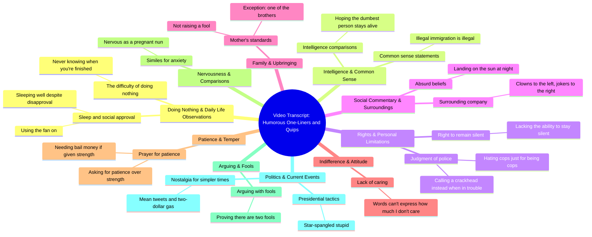

# Senator John Kennedy's Funniest Debate Comebacks

> 🌐 **Read this in:** **English** · [中文](../../zh-CN/2026-10/tiktok-transcript-senator-john-kennedy-iconic-moments-senatorkennedy-politics-fcb6.md)

> **Creator:** [@tyusapolitics](https://www.tiktok.com/@tyusapolitics) · **Views:** 940.1K · **Posted:** 2026-10-19 · **Niche:** entertainment
>
> **TL;DR:** The hook presents a counterintuitive idea that immediately grabs attention by challenging common assumptions.

[Watch original video →](https://vt.tiktok.com/ZSghqVcXb/)

## Why This Went Viral

## Hook (first 3 seconds)
- **Verbatim opener:** "Doing nothing is hard because you never know when you're finished."
- **Hook pattern:** Paradox / counterintuitive claim (a Zen-koan-style inversion of a lazy stereotype).
- **Why it stops the scroll:** It's a brain-teaser that resolves in under two seconds. The viewer's brain flags "wait, that's actually true" — the micro-"aha" creates an open loop the rest of the video promises to fill with more of the same wit.

## Emotional Rhythm
- **0–3s — Curiosity:** The paradox opener ("doing nothing is hard") sets an intellectual puzzle.
- **3–8s — Whiplash / absurdist relief:** "How do you sleep at night…" → "With the fan on." Setup-then-deflation. Laugh lands fast, establishing the format: *expectation → punchline*.
- **8–20s — Escalating tension via taboo:** "Illegal immigration is illegal. Duh." and "call a crackhead" push into edgy territory. Mild discomfort + humor = high-arousal emotion (the shareable kind).
- **20–30s — Resonance dip:** "I have the right to remain silent. I just don't have the ability." and "Words can't express how much I don't care" — relatable self-deprecation, a breather between punches.
- **30–40s — Peak tension + twist:** "God, please give me patience. Because if you give me strength, I'm going to need bail money." This is the **climax** — the longest setup and the biggest payoff, a clean two-part joke with a violent twist.
- **40–end — Political resonance + closing button:** "Star spangled stupid" and "a mean tweet and two dollar gas" pivot to shared cultural grievance, then close on a relatable sigh. The final line functions as a *call to identity*, not just a joke.

## Keyword Density
- **"Dumb / dumbest / fool"** — repeated twice; drives the "stupidity" theme that anchors the humor.
- **"Nothing / don't / not"** — negation density is unusually high; creates a cynical, contrarian tone.
- **"God / patience / strength"** — the climax cluster; emotionally loaded, algorithmically sticky (religion + violence combo).
- **"Illegal / cops / president / tweet / gas"** — political keywords that pull in comment-section debate.
- **"Right / wrong / prove"** — moral framing words that invite viewers to take sides.
- **"Sleep / night / patience"** — soft, human words that contrast with the edgy content, improving retention.

**Algorithmic vs. emotional:** "President," "cops," "illegal," and "tweet" drive **reach** (comment wars, shares, search). "Dumb," "fool," "patience," and "sleep" drive **emotional pull** (relatability, self-recognition). The video's genius is stacking both — political keywords for distribution, self-deprecating keywords for resonance.

## Why It Spreads
- **Rapid-fire joke stacking = retention machine.** Every 3–5 seconds delivers a new punchline ("With the fan on," "call a crackhead," "bail money"). Viewers can't leave without hearing the next one — completion rate feeds the algorithm.
- **Quotable, screenshot-able lines.** "Words can't express how much I don't care" and "I have the right to remain silent. I just don't have the ability" are built for captions, comments, and reposts. Each line is a shareable unit.
- **Taboo + politics = comment-section fuel.** "Illegal immigration is illegal. Duh" and "star spangled stupid" are engineered to split audiences. Controversy in comments signals engagement to the platform, boosting distribution.
- **Universal identity hooks.** "My mother did not raise a fool. And if she did, it was one of my brothers" — every viewer with a sibling feels seen. Relatable family humor broadens the audience beyond the political core.
- **Climax placement.** The "bail money" joke sits at ~70% through — right where drop-off peaks. A strong payoff there recaptures viewers and pushes them to the end, lifting average watch time.

## What You Can Steal
1. **Open with a paradox, not a premise.** A line like "Doing nothing is hard" forces a mental double-take in under two seconds. Write your first line as a *contradiction the viewer must resolve* — it buys you the next 10 seconds.
2. **Stack jokes at 3–5 second intervals.** Don't build one long setup. Alternate setup → punchline → setup → punchline so there's never a dead beat. Use the "expectation → deflation" pattern ("How do you sleep at night?" → "With the fan on").
3. **Put your strongest joke at 65–75% through the video.** That's where retention sags. A big payoff there ("bail money") recaptures viewers and carries them to the end — and the end is what the algorithm rewards.

## Mind Map

## Full Transcript (Generated by [try this transcription tool](https://toktranscript.com/?utm_source=github&utm_medium=breakdown&utm_campaign=tool_attribution))

> 📝 Transcripts on this page are auto-generated and show the first 60%. Want to transcribe any TikTok in 30 seconds and get the full version? [Try TokTranscript free →](https://toktranscript.com/?utm_source=github&utm_medium=breakdown&utm_campaign=transcript_cta)

Doing nothing is hard because you never know when you're finished. How do you sleep at night knowing that some people don't like you? With the fan on. I'm not saying you're the dumbest person in the world, but you better hope the dumbest person in the world doesn't die. Illegal immigration is illegal. Duh. I have the right to remain silent. I just don't have the ability. You hate cops just because they're cops. The next time you get in trouble, call a crackhead. Clowns to the left of me, jokers to the right. She thinks you can land on the sun if you go at night. My mother did not raise a fool.

*[Read the full transcript on TokTranscript →](https://toktranscript.com/plaza/tiktok-transcript-senator-john-kennedy-iconic-moments-senatorkennedy-politics-fcb6?utm_source=github&utm_medium=breakdown&utm_campaign=transcript_full)*

## Browse More

- All [entertainment](../../by-niche/en/entertainment.md) breakdowns
- All [Paradoxical Statement](../../by-pattern/en/hook-paradoxical-statement.md) examples

## Video Info

| | |
|---|---|
| Creator | [@tyusapolitics](https://www.tiktok.com/@tyusapolitics) |
| Original video | [https://vt.tiktok.com/ZSghqVcXb/](https://vt.tiktok.com/ZSghqVcXb/) |
| Original title | Senator John Kennedy iconic moments #senatorkennedy #politics #usa #t... |
| Views | 940.1K (940100) |
| Posted | 2026-10-19 |
| Duration | 0s |
| Niche | `entertainment` |
| Hook pattern | `Paradoxical Statement` |
| Original language | `en` |
| Available languages | en, zh-CN |
| Generated | 2026-10-20 by [TokTranscript](https://toktranscript.com/) |

---

*This breakdown is for educational analysis under fair use. Original video © [@tyusapolitics](https://www.tiktok.com/@tyusapolitics). All transcripts are auto-generated and may contain errors.*

*Want to analyze your own TikToks like this? [TokTranscript →](https://toktranscript.com/viral-breakdown?utm_source=github&utm_medium=breakdown&utm_campaign=footer_cta)*