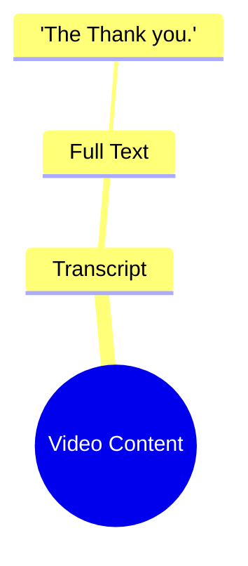

# Imran Khan Supporters Clash With Police in Pakistan

> 🌐 **Read this in:** **English** · [中文](../../zh-CN/2026-10/tiktok-transcript-video-8b63.md)

> **Creator:** [@almashhadmedia](https://www.tiktok.com/@almashhadmedia) · **Views:** 1.8M · **Posted:** 2026-10-12 · **Niche:** other
>
> **TL;DR:** The hook is a fragmented phrase that fails to establish a clear premise or curiosity.

[Watch original video →](https://vt.tiktok.com/ZSbwoTjFM/)

## Why This Went Viral

## Hook (first 3 seconds)
- The entire opening line is verbatim: "The Thank you." Two words, delivered flat, with no setup, no context, and no explanation.
- Hook pattern: **absurdist anti-hook / anti-climax**. It deliberately withholds the promise a normal hook makes.
- It stops the scroll because the brain hits a parsing error. "The Thank you" is grammatically broken and semantically empty, so viewers re-read/replay it trying to resolve the mismatch. That unresolved micro-confusion buys the 1–2 seconds needed to register the video and stay.

## Emotional Rhythm
- Beat 1 (0:00–0:01): **Confusion** — "The Thank you" lands as nonsense.
- Beat 2 (0:01–0:02): **Re-check / mild irritation** — viewer assumes they misheard or missed a frame.
- Beat 3 (0:02–0:03): **Recognition** — the realization that the whole video is just this. The joke is the emptiness itself.
- Climax: the moment of recognition, which is also the punchline. There is no build, no twist, no resolution — the climax is the absence of one.
- Note: there is no suspense curve and no relief. The emotional engine is **withheld payoff**, which is why the comment section (not the video) becomes the real content.

## Keyword Density
- Strongest repeated tokens: "The," "Thank," "you," "Thank you," "The Thank you."
- Because the transcript is only two words, density is effectively 100% — every keyword is the whole script.
- "Thank you" drives **emotional pull**: it's a universally recognized social ritual, so viewers project politeness, sarcasm, or irony onto it.
- "The" drives **algorithmic reach** indirectly: it's a stopword that makes the phrase searchable and quotable as a meme string ("the thank you"), giving the video a unique, repeatable handle.
- Net: the keywords don't drive reach through search volume — they drive it through **quotability**. The phrase is short enough to be copy-pasted into comments, captions, and duets.

## Why It Spreads
- **Zero-cost comprehension.** "The Thank you" can be understood in under a second, so it survives the brutal scroll test — no viewer needs context to "get" it.
- **Comment-bait ambiguity.** Because the line is meaningless, viewers must supply the meaning themselves, and that disagreement ("is this sarcasm?" / "is this a typo?") fuels reply threads, which the algorithm reads as engagement.
- **Remix-friendly format.** A two-word video is trivially easy to duet, stitch, or caption, so the phrase escapes the original post and becomes a reusable template.
- **Anti-content novelty.** Against a feed of over-produced hooks, a video that openly refuses to deliver a payoff reads as a joke about the format itself, earning shares as "you have to see this."
- **Quotable string.** "The Thank you" is short, weird, and grammatically off, which makes it memorable and repeatable — the core requirement for a meme to propagate.

## What You Can Steal
- **Break the grammar of your hook on purpose.** A slightly wrong phrase ("The Thank you") creates a parsing gap that forces a replay. Use one deliberate error in your first line.
- **Withhold the payoff and let comments complete it.** If viewers have to argue about what you meant, you've outsourced your engagement. Design one open loop per video.
- **Make your core line copy-pasteable.** Keep the memorable phrase under five words and weird enough to be quoted verbatim in comments, captions, and duets.
- **Match production to the joke.** If the content is anti-climax, keep the delivery flat — over-acting the absurdity kills the deadpan that makes it land.

## Mind Map

## Full Transcript (Generated by [TokTranscript](https://toktranscript.com/?utm_source=github&utm_medium=breakdown&utm_campaign=tool_attribution))

> 📝 Transcripts on this page are auto-generated and show the first 60%. Want to transcribe any TikTok in 30 seconds and get the full version? [Try TokTranscript free →](https://toktranscript.com/?utm_source=github&utm_medium=breakdown&utm_campaign=transcript_cta)

The Than

*[Read the full transcript on TokTranscript →](https://toktranscript.com/plaza/tiktok-transcript-video-8b63?utm_source=github&utm_medium=breakdown&utm_campaign=transcript_full)*

## Browse More

- All [other](../../by-niche/en/other.md) breakdowns
- All [Incomplete phrase](../../by-pattern/en/hook-incomplete-phrase.md) examples

## Video Info

| | |
|---|---|
| Creator | [@almashhadmedia](https://www.tiktok.com/@almashhadmedia) |
| Original video | [https://vt.tiktok.com/ZSbwoTjFM/](https://vt.tiktok.com/ZSbwoTjFM/) |
| Original title | اشتباكات بين أنصار عمران خان والشرطة في باكستان #اخبار_المشهد #باكستا... |
| Views | 1.8M (1800000) |
| Posted | 2026-10-12 |
| Duration | 0s |
| Niche | `other` |
| Hook pattern | `Incomplete phrase` |
| Original language | `en` |
| Available languages | en, zh-CN |
| Generated | 2026-10-13 by [TokTranscript](https://toktranscript.com/) |

---

*This breakdown is for educational analysis under fair use. Original video © [@almashhadmedia](https://www.tiktok.com/@almashhadmedia). All transcripts are auto-generated and may contain errors.*

*Want to analyze your own TikToks like this? [TokTranscript →](https://toktranscript.com/viral-breakdown?utm_source=github&utm_medium=breakdown&utm_campaign=footer_cta)*