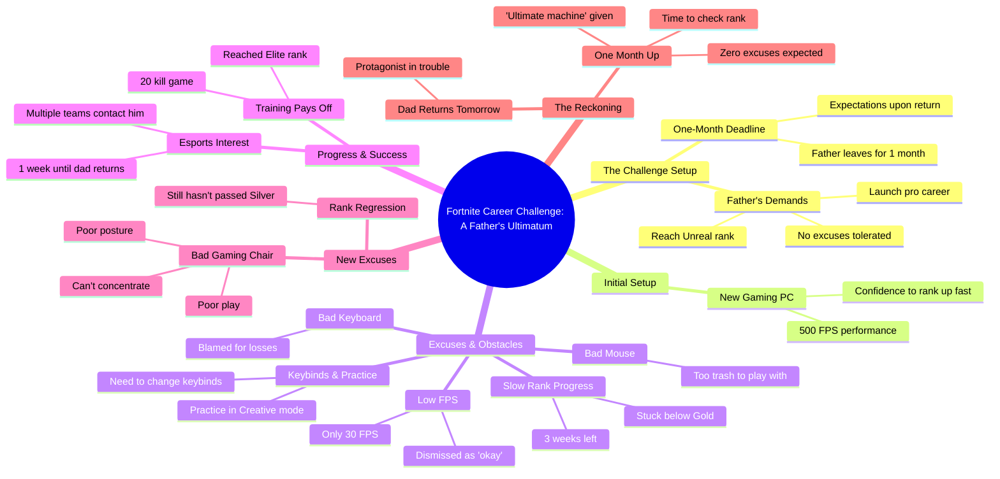

# Strawberry vs Kiwi Race to Unreal Rank in Fortnite

> 🌐 **Read this in:** **English** · [中文](../../zh-CN/2026-10/tiktok-transcript-who-will-reach-the-unreal-rank-first-vs-brainrot-ai-fortnite-11c5.md)

> **Creator:** [@thedogfather.tv](https://www.tiktok.com/@thedogfather.tv) · **Views:** 1.6M · **Posted:** 2026-10-12 · **Niche:** entertainment
>
> **TL;DR:** The hook immediately grabs attention with a shocking and humorous parental command that sets up the entire narrative.

[Watch original video →](https://www.tiktok.com/@thedogfather.tv/video/7689199943046679830?is_from_webapp=1&sender_device=pc&web_id=7652449168514991629)

## Why This Went Viral

## Hook (first 3 seconds)
- **Verbatim opening line:** "Starting today, I order you to make a career on Fortnite."
- **Hook pattern:** Bold command / authority-figure ultimatum (a "strict parent gives impossible order" setup).
- **Why it stops the scroll:** It fuses two things viewers can't ignore — a high-stakes parental demand and the absurd premise of "go pro at Fortnite." The word "order" signals conflict, and the gaming context promises either a satisfying win or a spectacular fail. Instant curiosity gap: *will the kid pull it off?*

## Emotional Rhythm
- **Beat 1 — Curiosity (0–5s):** Dad's ultimatum + "I see more potential in you than your brother" plants a rivalry seed and a deadline (1 month).
- **Beat 2 — Confidence → friction (early):** "500 fps, I'm gonna become unreal in a flash" → immediately "this mouse is too trash."
- **Beat 3 — Escalating excuse loop (tension build):** Each item (mouse → keyboard → chair) becomes the scapegoat for failure. Rank regresses: gold → silver, deadline compresses: 3 weeks → 1 week → tomorrow.
- **Beat 4 — False triumph (twist):** "20 kills, I'm elite, esports teams contacted me" — a spike of hope that's immediately undercut by "this gaming chair is trash."
- **Beat 5 — Climax:** "Dad comes home tomorrow. Now I'm really in trouble." Maximum stakes + zero progress.
- **Beat 6 — Payoff setup:** "Time to see if my champion made it to unreal." Suspense lands on the door opening — the reveal is withheld, driving comments and rewatches.

## Keyword Density
- **"Unreal"** — the aspirational goal; algorithmic gaming keyword + emotional target.
- **"Trash"** — the repeated excuse word (mouse, keyboard, chair); drives comedic rhythm.
- **"Dad / father"** — anchors the family-stakes emotional pull.
- **"Rank"** (gold/silver/elite) — gaming-native term, boosts niche reach.
- **"FPS" / "PC"** — hardware keywords that signal authenticity to the gaming audience.
- **"Excuses"** — the thematic spine; bookends the video.
- **"Come home"** — the recurring deadline phrase that builds tension.
- **Reach drivers:** *Fortnite, Unreal, FPS, rank, esports* — these feed the gaming algorithm and search.
- **Emotional pull drivers:** *dad, brother, proud, trouble, excuses* — these make it relatable beyond gamers.

## Why It Spreads
- **Universal "blame the gear" joke:** Every gamer (and every procrastinator) recognizes "this mouse is too trash" / "this keyboard is trash" / "this chair is trash" — it's a self-aware roast of a behavior millions do.
- **Ticking-clock structure:** The deadline compresses (1 month → 3 weeks → 1 week → tomorrow), forcing viewers to keep watching for the outcome — a classic retention device.
- **Family-stakes relatability:** "I see more potential in you than in your brother" and "He'll be proud" turn a gaming clip into a father-son pressure story anyone can feel.
- **Subverted expectation:** The "20 kills, elite, esports contacted me" line baits a happy ending, then yanks it away with "this gaming chair is trash" — the twist is the shareable moment.
- **Withheld payoff:** Ending on "Time to see if my champion made it to unreal" denies resolution, driving comments ("did he make it?") and rewatches.

## What You Can Steal
1. **Open with an authority ultimatum + deadline.** A command with a countdown ("You have 1 month, no excuses") creates instant stakes and a reason to watch to the end.
2. **Use a repeating escalation device.** The "X is trash" loop with shrinking time windows is a simple, funny engine that keeps viewers hooked — find your own repeatable beat.
3. **Fake the win, then undercut it.** Give viewers a false climax ("I'm elite, teams contacted me") right before the real twist — this is the moment people screenshot and share.
4. **Withhold the final result.** End on the door opening instead of the answer; unresolved endings spike comments and replays.

## Mind Map

## Full Transcript (Generated by [TokTranscript.com](https://toktranscript.com/?utm_source=github&utm_medium=breakdown&utm_campaign=tool_attribution))

> 📝 Transcripts on this page are auto-generated and show the first 60%. Want to transcribe any TikTok in 30 seconds and get the full version? [Try TokTranscript free →](https://toktranscript.com/?utm_source=github&utm_medium=breakdown&utm_campaign=transcript_cta)

Starting today, I order you to make a career on Fortnite. You. I bought you the best PC. I see a lot more potential in you than in your brother. You do your best. I'm not expecting much. Anyway, I'm leaving for 1 month. When I return I want to see you. Unreal and already launched in a pro career. No excuses. With my PC running at 500 fps, I'm gonna become unreal in a flash. What? But seriously, this mouse is too trash. I can't play like this. Well it only runs at 30 fps, but honestly it's okay. Before starting a game I need to change my key binds and practice a bit in creative mode. But it's not possible. This keyboard is trash. I swear I lose because of the keyboard.

*[Read the full transcript on TokTranscript →](https://toktranscript.com/plaza/tiktok-transcript-who-will-reach-the-unreal-rank-first-vs-brainrot-ai-fortnite-11c5?utm_source=github&utm_medium=breakdown&utm_campaign=transcript_full)*

## Browse More

- All [entertainment](../../by-niche/en/entertainment.md) breakdowns
- All [Direct Command + Absurd Premise](../../by-pattern/en/hook-direct-command-absurd-premise.md) examples

## Video Info

| | |
|---|---|
| Creator | [@thedogfather.tv](https://www.tiktok.com/@thedogfather.tv) |
| Original video | [https://www.tiktok.com/@thedogfather.tv/video/7689199943046679830?is_from_webapp=1&sender_device=pc&web_id=7652449168514991629](https://www.tiktok.com/@thedogfather.tv/video/7689199943046679830?is_from_webapp=1&sender_device=pc&web_id=7652449168514991629) |
| Original title | Who will reach the UNREAL RANK first? 🍓 vs 🥝 #brainrot #ai #fortnite ... |
| Views | 1.6M (1600000) |
| Posted | 2026-10-12 |
| Duration | 0s |
| Niche | `entertainment` |
| Hook pattern | `Direct Command + Absurd Premise` |
| Original language | `en` |
| Available languages | en, zh-CN |
| Generated | 2026-10-13 by [TokTranscript](https://toktranscript.com/) |

---

*This breakdown is for educational analysis under fair use. Original video © [@thedogfather.tv](https://www.tiktok.com/@thedogfather.tv). All transcripts are auto-generated and may contain errors.*

*Want to analyze your own TikToks like this? [try this transcription tool →](https://toktranscript.com/viral-breakdown?utm_source=github&utm_medium=breakdown&utm_campaign=footer_cta)*