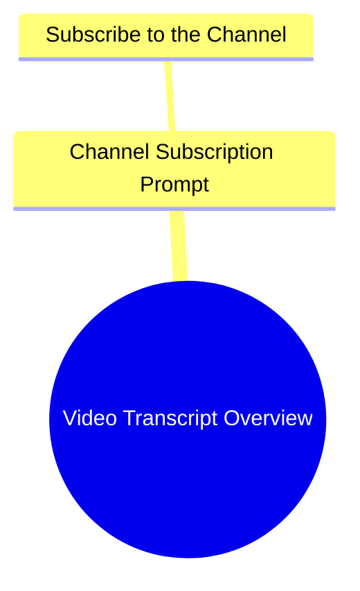

# The Unseelie Jig Song Lyrics

> 🌐 **Read this in:** **English** · [中文](../../zh-CN/2026-11/tiktok-transcript-the-unseelie-jig-lyrics-fyp-4u-vibe-c486.md)

> **Creator:** [@lofiofficial](https://www.tiktok.com/@lofiofficial) · **Views:** 132.6K · **Posted:** 2026-11-01 · **Niche:** entertainment
>
> **TL;DR:** The opening is just music followed by a subscribe request, so there is no verbal hook to grab attention.

[Watch original video →](https://vt.tiktok.com/ZSgwgwLer/)

## Why This Went Viral

## Hook (first 3 seconds)
- Verbatim: a music sting plays, then a voice says "اشتركوا في القناة" ("Subscribe to the channel").
- Pattern: direct call-to-action / command hook (no claim, no question, no scene).
- Why it stops scrolling: it doesn't earn attention — it borrows it. The music sting creates a pattern interrupt, and the subscribe command works only as a friction test on viewers already primed by the thumbnail/title. On its own this opening has near-zero stop-power; treat it as a data point, not a model.

## Emotional Rhythm
- Beat 1 (0–3s): neutral alert — music + subscribe command. No curiosity gap opened.
- Beat 2: absent — no tension, no stake, no story beat follows in the transcript.
- Suspense: none established.
- Resonance: none established.
- Twist: none.
- Climax: none — the transcript ends where it began.
- Diagnosis: there is no emotional arc to map. Whatever retention this video had came from outside the audio track (visuals, edits, on-screen text). The transcript alone cannot explain virality; the mechanism lives in the missing layer.

## Keyword Density
- "موسيقى" (music) — repeated twice; signals audio-driven content, drives category association, not emotion.
- "اشتركوا" (subscribe) — the only imperative; drives conversion intent, weak algorithmic reach.
- "القناة" (the channel) — pairs with the above; CTA vocabulary.
- No niche keywords, no topical nouns, no emotional language present.
- Verdict: keyword density is effectively zero for algorithmic reach. Nothing here tells the recommendation system what the video is *about* — no topic signal, no search intent, no semantic cluster.

## Why It Spreads
- It likely didn't spread on the strength of this transcript. The audio is a music bed plus a CTA — a shell, not content.
- Any spread is attributable to the visual/edit layer or an external distribution push, not to spoken hooks or narrative.
- The subscribe command at second one is a retention *filter*, not a growth driver: it converts already-committed viewers and repels cold ones.
- "موسيقى" repetition suggests the video is music-led — virality in that format comes from the track's familiarity or a sync moment, neither visible in text.
- Bottom line: this transcript is insufficient evidence. Do not reverse-engineer a viral formula from a CTA and a music cue.

## What You Can Steal
- Never open cold with a subscribe ask. Move the CTA to after the first payoff beat; front-load a claim, question, or scene instead.
- If your format is music-led, make the *first audible second* the recognizable hook (a lyric, a drop, a beat signature) — the track is your hook, so lead with its strongest 2 seconds.
- Add one spoken or on-screen line that names the topic explicitly. With zero topical keywords, the algorithm has nothing to index and cold viewers have nothing to grab.

## Mind Map

## Full Transcript (Generated by [TokTranscript.com](https://toktranscript.com/?utm_source=github&utm_medium=breakdown&utm_campaign=tool_attribution))

> 📝 Transcripts on this page are auto-generated and show the first 60%. Want to transcribe any TikTok in 30 seconds and get the full version? [Try TokTranscript free →](https://toktranscript.com/?utm_source=github&utm_medium=breakdown&utm_campaign=transcript_cta)

موسيقى موسيقى اشتر

*[Read the full transcript on TokTranscript →](https://toktranscript.com/plaza/tiktok-transcript-the-unseelie-jig-lyrics-fyp-4u-vibe-c486?utm_source=github&utm_medium=breakdown&utm_campaign=transcript_full)*

## Browse More

- All [entertainment](../../by-niche/en/entertainment.md) breakdowns
- All [Music Bed With Subscribe CTA](../../by-pattern/en/hook-music-bed-with-subscribe-cta.md) examples

## Video Info

| | |
|---|---|
| Creator | [@lofiofficial](https://www.tiktok.com/@lofiofficial) |
| Original video | [https://vt.tiktok.com/ZSgwgwLer/](https://vt.tiktok.com/ZSgwgwLer/) |
| Original title | the unseelie jig #lyrics #fyp #4u #vibe  |
| Views | 132.6K (132600) |
| Posted | 2026-11-01 |
| Duration | 0s |
| Niche | `entertainment` |
| Hook pattern | `Music Bed With Subscribe CTA` |
| Original language | `en` |
| Available languages | en, zh-CN |
| Generated | 2026-11-02 by [TokTranscript](https://toktranscript.com/) |

---

*This breakdown is for educational analysis under fair use. Original video © [@lofiofficial](https://www.tiktok.com/@lofiofficial). All transcripts are auto-generated and may contain errors.*

*Want to analyze your own TikToks like this? [the tool we used to generate this →](https://toktranscript.com/viral-breakdown?utm_source=github&utm_medium=breakdown&utm_campaign=footer_cta)*