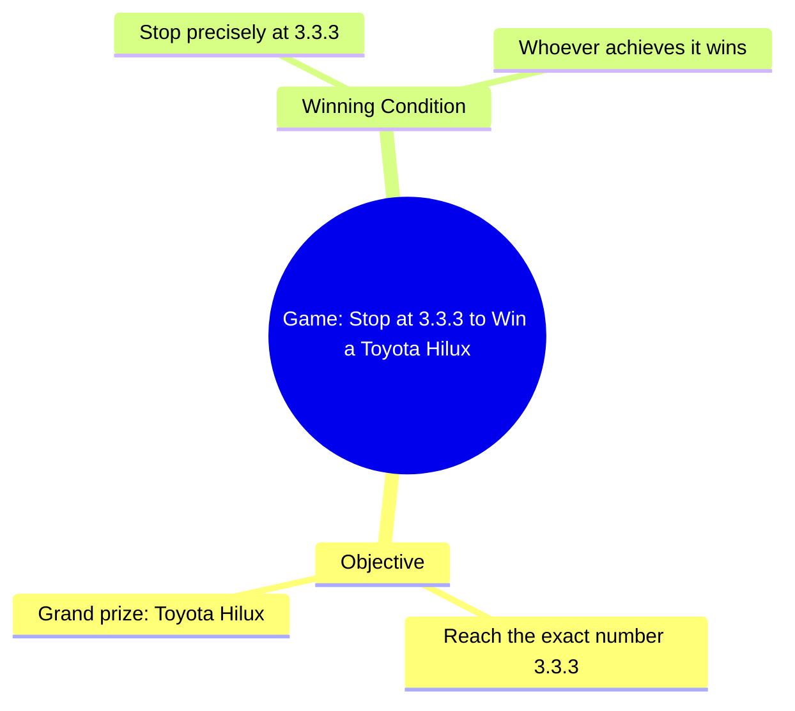

# Toyota Hilux Grand Prize Contest at Dealership Opening

> 🌐 **Read this in:** [English](../../en/2026-10/tiktok-transcript-1-6m-views-27k-reactions-toyota-toyotadealership-toyotaafric-7676.md) · **中文**

> **Creator:** [@ꓔ𝚘𝚢𝚘𝚝𝚊 𝙳𝚎𝚊𝚕𝚕𝚎𝚛 𝙵𝚊𝚗𝚜](https://www.tiktok.com/@ꓔ𝚘𝚢𝚘𝚝𝚊 𝙳𝚎𝚊𝚕𝚕𝚎𝚛 𝙵𝚊𝚗𝚜) · **Views:** 517.3K · **Posted:** 2026-10-17 · **Niche:** entertainment
>
> **TL;DR:** It presents a clear, difficult challenge with a valuable reward, creating immediate curiosity and suspense.

[Watch original video →](https://www.facebook.com/share/r/1DUAFfTKHs/)

## Why This Went Viral

## 钩子（前3秒）
- **逐字开场白：** “谁能在数字3.3.3停下来，谁就能赢得大奖——一辆丰田Hilux。”
- **钩子模式：** 挑战+奖品悬念（一种“竞赛邀请”式钩子），带有具体数字和高价值奖励。
- **为什么能让人停下滚动：** 它瞬间把观众从被动观看者重新定位为潜在参赛者。一个具体、令人向往的奖品（丰田Hilux），加上一个听起来简单的任务（“只要在3.3.3停下来”），会立刻制造出“我也能做到”的反射——而“3.3.3”的具体性让它感觉像一场真实、可赢的游戏，而不是含糊的标题党。

## 情绪节奏
- **好奇（0–3秒）：** 奖品+规则设定——“有什么陷阱？”
- **期待/紧张（前中段）：** 观众在脑中预演任务，并开始预测谁会赢，或者会怎样出错。
- **悬念峰值（尝试时）：** 在3.3.3处或附近停下的那一刻——他们会精准命中还是冲过头？这正是观众自己的“我就会……”评论开始出现的地方。
- **反转/揭晓（高潮）：** 结果——成功、差一点，还是失败。高潮就是数字落定的那一瞬间（或没有落定），因为它解决了钩子设定的整个前提。
- **释然/挫败共鸣（后续）：** 对结果的反应——赢了就满足，输了就替人挫败。无论哪种情绪都会推动评论。

## 关键词密度
- **“3.3.3”**——锚点；推动重看和评论（“就差一点！”）。
- **“赢”/“大奖”**—— stakes与奖励框架。
- **“丰田Hilux”**——具体、高价值对象；强情绪拉力和分享性。
- **“停下”**——挑战的动作动词。
- **“谁”**——包容性；邀请每位观众进入游戏。
- **“能做到”**——暗示难度，提升紧张感。
- **算法驱动词：** “赢”“大奖”“丰田Hilux”——高意图、高搜索/收藏词，传递价值与奖励信号。
- **情绪驱动词：** “3.3.3”“停下”“谁”——制造参与式、值得重看的紧张感，推动评论和重看。

## 为什么会传播
- **内置参与感：** “谁能在3.3.3停下来”把每位观众都变成想象中的参赛者——人们会评论自己的策略，或者说“我会在3.2停”。
- **高价值、易识别的奖品：** 点名“一辆丰田Hilux”让 stakes 变得可感、可分享；观众会@想要它的朋友。
- **精准张力：** 精确的“3.3.3”目标制造差一点命中的动态——尝试越接近，重看和评论冲动越强（“就差一点！”）。
- **规则简单，结果不可预测：** 一句话解释整个游戏，所以任何人都能立刻跟上——低认知负荷，高留存。
- **结果驱动循环：** 钩子承诺一个解决（谁赢），而回报时刻会吸引重看以捕捉确切瞬间——提升观看时长和完播率。

## 你可以借鉴什么
1. **用挑战+点名奖品开场。** 用一句话说明规则和奖励（比如“在3.3.3停下→赢一辆Hilux”），让观众立刻成为参与者。
2. **使用高度具体的目标数字或细节。** 精确性（“3.3.3”）制造差一点命中的张力，并给评论者一个确切可争论的点。
3. **为回看时刻而设计。** 朝一个清晰高潮（数字落定的瞬间）构建，让观众重看以捕捉它——并评论自己的“我就会……”看法。

## Mind Map

## Full Transcript (Generated by [TokTranscript 转录工具](https://toktranscript.com/?utm_source=github&utm_medium=breakdown&utm_campaign=tool_attribution))

> 📝 Transcripts on this page are auto-generated and show the first 60%. Want to transcribe any TikTok in 30 seconds and get the full version? [Try TokTranscript free →](https://toktranscript.com/?utm_source=github&utm_medium=breakdown&utm_campaign=transcript_cta)

Whoever manages to stop at the number 3.3.3 will wi

*[Read the full transcript on TokTranscript →](https://toktranscript.com/plaza/tiktok-transcript-1-6m-views-27k-reactions-toyota-toyotadealership-toyotaafric-7676?utm_source=github&utm_medium=breakdown&utm_campaign=transcript_full)*

## Browse More

- All [entertainment](../../by-niche/zh-CN/entertainment.md) breakdowns
- All [Challenge with Prize](../../by-pattern/zh-CN/hook-challenge-with-prize.md) examples

## Video Info

| | |
|---|---|
| Creator | [@ꓔ𝚘𝚢𝚘𝚝𝚊 𝙳𝚎𝚊𝚕𝚕𝚎𝚛 𝙵𝚊𝚗𝚜](https://www.tiktok.com/@ꓔ𝚘𝚢𝚘𝚝𝚊 𝙳𝚎𝚊𝚕𝚕𝚎𝚛 𝙵𝚊𝚗𝚜) |
| Original video | [https://www.facebook.com/share/r/1DUAFfTKHs/](https://www.facebook.com/share/r/1DUAFfTKHs/) |
| Original title | 1.6M views · 27K reactions | #Toyota #toyotadealership #ToyotaAfrica #GrandOpening #ToyotaSouthAfrica🇿🇦 #ToyotaBotswana🇧🇼 #ToyotaNigeria🇳🇬 #ToyotaGhana🇬🇭 #ToyotaKenya🇰🇪 #ToyotaUganda🇺🇬 #ToyotaTanzania🇹🇿 #NigeriaCars #GhanaCars #KenyaCars #AfricanCars #CarsAfrica #AfricaReels #CarReels #AmericanCars #USACars🇺🇸 #UKCars🇬🇧 #CanadaCars🇨🇦 #AustraliaCars🇦🇺 #NewZealandCars🇳🇿 #FYP #ViralVideos #ForyouPage #FypReels #ViralReels #ReelsAfrica #ToyotaLovers #ViralVideos #ForyouPage #FypAfrica #ViralReels | ꓔ𝚘𝚢𝚘𝚝𝚊 𝙳𝚎𝚊𝚕𝚕𝚎𝚛 𝙵𝚊𝚗𝚜 |
| Views | 517.3K (517269) |
| Posted | 2026-10-17 |
| Duration | 0s |
| Niche | `entertainment` |
| Hook pattern | `Challenge with Prize` |
| Original language | `en` (this page translated by AI) |
| Available languages | en, zh-CN |
| Generated | 2026-10-19 by [TokTranscript](https://toktranscript.com/) |

---

*This breakdown is for educational analysis under fair use. Original video © [@ꓔ𝚘𝚢𝚘𝚝𝚊 𝙳𝚎𝚊𝚕𝚕𝚎𝚛 𝙵𝚊𝚗𝚜](https://www.tiktok.com/@ꓔ𝚘𝚢𝚘𝚝𝚊 𝙳𝚎𝚊𝚕𝚕𝚎𝚛 𝙵𝚊𝚗𝚜). All transcripts are auto-generated and may contain errors.*

*Want to analyze your own TikToks like this? [免费 TikTok 文稿生成器 →](https://toktranscript.com/viral-breakdown?utm_source=github&utm_medium=breakdown&utm_campaign=footer_cta)*