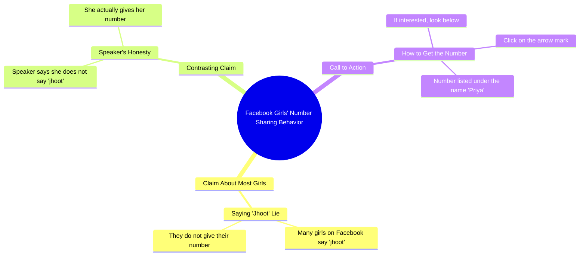

# Bank Auction Fortuner and Scorpio Cars Cheap

> 🌐 **Read this in:** [English](../../en/2026-10/tiktok-transcript-11m-views-143k-reactions-fortuner-auction-roamingbird-auctio-c14f.md) · **中文**

> **Creator:** [@प्रिया कुमारी ](https://www.tiktok.com/@प्रिया कुमारी ) · **Views:** 4.1M · **Posted:** 2026-10-09 · **Niche:** entertainment
>
> **TL;DR:** The hook sets up a clear contrast between other girls who lie and the speaker who genuinely gives her number, creating curiosity and trust.

[Watch original video →](https://www.facebook.com/share/r/18Dvaaz8Xk/)

## Why This Went Viral

## 钩子（前3秒）
- **逐字开场：** “फेस्बुक पे बहुत सी लड़कियां जूट बोलती है, अपना नंबर नहीं देती, लेकिन मैं जूट नहीं बोलती, मैं सही में अपना नंबर देती हूँ”（“Facebook上很多女孩说谎/装，她们不给自己的号码，但我不说谎，我真的给号码”）
- **钩子模式：** 对比 + 大胆宣称（“别的女孩做X，但我做相反的事”），叠加禁忌/好奇心触发点（一个女人公开提供自己的电话号码）。
- **为什么能让人停下滚动：** 它利用了社会比较和禁忌。观众的大脑立刻会问“这是真的吗？”和“这个女孩是谁？”——一句话里留下两个未解问题。把自己定位为“和其他女孩不同”也同时钓住男性注意力和女性互动（认同或愤怒）。

## 情绪节奏
- **0–3秒——好奇 + 轻微震惊：** 对比式宣称（“别人说谎，我不说”）瞬间制造认知张力。
- **3–6秒——认同/信任节拍：** “मैं सही में अपना नंबर देती हूँ”（“我真的给号码”）强化真诚感，把观众拉得更深。
- **6–9秒——奖励/CTA尖峰：** “अगर चाहिए तो नीचे देखो तीर वाला निशान पर क्लिक करें”（“如果你想要，看下面，点击箭头标记”）把好奇心转化为行动冲动。
- **高潮时刻：** 揭示“मेरा नंबर प्रिया के नाम”（“我的号码在Priya这个名字下面”）——这个回报让承诺显得具体且可执行。
- **反转/共鸣：** 整个视频是软性诱饵——“号码”被包装成真实提供，而这正是让评论和私信持续涌入的原因。

## 关键词密度
- **फेस्बुक（Facebook）**——平台关键词，推动算法触达和语境。
- **लड़कियां（女孩们）**——受众定位关键词，同时触发男性好奇和女性反应。
- **नंबर（号码）**——核心情绪/好奇心关键词，重复3次。
- **जूट / झूठ（说谎）**——道德对比关键词，制造“我们 vs 他们”的框架。
- **सही में（真的/实际上）**——真实性标记，提升信任感。
- **नीचे देखो（看下面）**——互动/CTA关键词，推动点击和评论。
- **तीर वाला निशान（箭头标记）**——方向提示，专为UI驱动动作设计。
- **प्रिया（Priya）**——个性化关键词，让提供显得有人情味且具体。

**算法驱动因素：** Facebook、号码、नीचे देखो、तीर वाला निशान（平台 + 行动词）。
**情绪拉力：** लड़कियां、जूट、सही में、प्रिया（身份、道德、真实性、个人名字）。

## 为什么会传播
- **禁忌提供式诱饵：** “मैं सही में अपना नंबर देती हूँ”承诺了社会上罕见的东西——一个女人公开分享联系方式——这会触发分享、收藏和私信。
- **我们 vs 他们的框架：** “बहुत सी लड़कियां जूट बोलती है... लेकिन मैं जूट नहीं बोलती”把说话者定位为例外，这会吸引支持者和批评者都来评论。
- **明确的CTA循环：** “नीचे देखो तीर वाला निशान पर क्लिक करें”强制产生UI互动，抬高观看时长和点击率信号，而算法会奖励这些。
- **点名个性化：** “मेरा नंबर प्रिया के नाम”让承诺显得可验证且个人化，这会增加评论量（“有人找到了吗？”）。
- **短小、单一想法的脚本：** 零废话——整个视频就是一个承诺 + 一个CTA，使其容易在没有上下文的情况下重看和分享。

## 你可以借鉴什么
- **用对比式宣称开场。** “每个人都做X，但我做Y”是一句话钩子，能瞬间制造张力，并把你定位为例外。
- **埋住回报，然后用CTA引导。** 承诺某个具体东西，然后引导观众做一个具体动作（“点击下面的箭头”）——这会把好奇心转化为可衡量的互动。
- **使用一个情绪关键词重复2–3次。** 选一个与身份或禁忌相关的词（号码、真相、谎言），重复它来同时锚定算法和观众记忆。

## Mind Map

## Full Transcript (Generated by [TokTranscript](https://toktranscript.com/?utm_source=github&utm_medium=breakdown&utm_campaign=tool_attribution))

> 📝 Transcripts on this page are auto-generated and show the first 60%. Want to transcribe any TikTok in 30 seconds and get the full version? [Try TokTranscript free →](https://toktranscript.com/?utm_source=github&utm_medium=breakdown&utm_campaign=transcript_cta)

फेस्बुक पे बहुत सी लड़कियां जूट बोलती है, अपना नंबर नहीं देती, लेकिन मैं जूट नहीं बोलती, मैं सही में अपना नंबर देती हू

*[Read the full transcript on TokTranscript →](https://toktranscript.com/plaza/tiktok-transcript-11m-views-143k-reactions-fortuner-auction-roamingbird-auctio-c14f?utm_source=github&utm_medium=breakdown&utm_campaign=transcript_full)*

## Browse More

- All [entertainment](../../by-niche/zh-CN/entertainment.md) breakdowns
- All [Contrast Hook: 'Others do X, but I do Y'](../../by-pattern/zh-CN/hook-contrast-hook-others-do-x-but-i-do-y.md) examples

## Video Info

| | |
|---|---|
| Creator | [@प्रिया कुमारी ](https://www.tiktok.com/@प्रिया कुमारी ) |
| Original video | [https://www.facebook.com/share/r/18Dvaaz8Xk/](https://www.facebook.com/share/r/18Dvaaz8Xk/) |
| Original title | 11M views · 143K reactions | बैंक के द्वारा खींचा हुआ Fortuner, स्कॉर्पियो सबसे सस्ता #auction #roamingbird #auction2025 #scorpiosellToday #viral #reelsvideo #viralreels | प्रिया कुमारी |
| Views | 4.1M (4148839) |
| Posted | 2026-10-09 |
| Duration | 0s |
| Niche | `entertainment` |
| Hook pattern | `Contrast Hook: 'Others do X, but I do Y'` |
| Original language | `en` (this page translated by AI) |
| Available languages | en, zh-CN |
| Generated | 2026-10-11 by [TokTranscript](https://toktranscript.com/) |

---

*This breakdown is for educational analysis under fair use. Original video © [@प्रिया कुमारी ](https://www.tiktok.com/@प्रिया कुमारी ). All transcripts are auto-generated and may contain errors.*

*Want to analyze your own TikToks like this? [TikTok 转录工具 →](https://toktranscript.com/viral-breakdown?utm_source=github&utm_medium=breakdown&utm_campaign=footer_cta)*