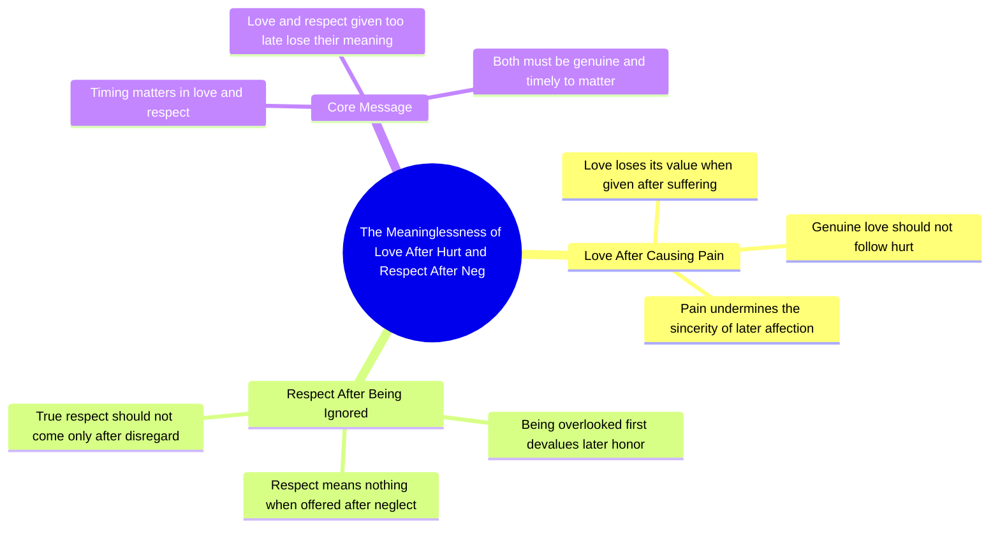

# Respect After Neglect Loses Its Meaning

> 🌐 **Read this in:** [English](../../en/2026-10/tiktok-transcript-1m-views-35k-reactions-sadreels-sadvideo-trendingreels-nidha-e4e7.md) · **中文**

> **Creator:** [@Nidha Bapan](https://www.tiktok.com/@Nidha Bapan) · **Views:** 428.5K · **Posted:** 2026-10-18 · **Niche:** entertainment
>
> **TL;DR:** It sets up a sharp emotional contradiction between hurt and love that viewers instantly recognize from their own relationships.

[Watch original video →](https://www.facebook.com/share/r/1BnEwx4TAx/)

## Why This Went Viral

## 钩子（前3秒）
- **逐字开场白：** “कश्ट देने के बाद दिया गया प्यार और नजर अंदास करने के बाद दी गई इज़त के कोई माइने नहीं रहते”——“在造成伤害之后给予的爱，以及在忽视某人之后给予的尊重——两者都毫无意义。”
- **钩子模式：** **对比 + 大胆断言。** 两个平行分句，各自将一个伤口（“痛苦”“被忽视”）与一个迟来的姿态（“爱”“尊重”）配对，然后给出一个直白的裁决（“毫无意义”）。
- **为什么它能让人停下滚动：** 它以一个道德评判开场，而非铺垫。观众被直接丢进一个结论——要么认同，要么想反驳——而平行结构（Y之后X，Y之后X）在节奏上足够悦耳，能把注意力撑满整句。

## 情绪节奏
- **节拍1——共鸣（0–2秒）：** “कश्ट देने के बाद”／“नजर अंदास करने के बाद”——观众立刻将其映射到一段个人记忆：被伤害，然后被太迟地安抚。
- **节拍2——张力（2–5秒）：** 第二个分句从不同角度构建同样的伤口（尊重而非爱），从情感伤害升级为社会性伤害。
- **节拍3——裁决／释放（5–8秒）：** “कोई माइने नहीं रहते”——释放。观众私下的委屈被大声地肯定了。
- **高潮：** 最后一句“कोई माइने नहीं रहते”——整个视频就是为了落在这个裁决上而设计的。之前的一切都是铺垫。
- **共鸣点：** “इज़त”（尊重／尊严）这个词——它把私人的心碎转化为公开的、可分享的委屈，这正是让人们标记他人的原因。

## 关键词密度
- **कश्ट**（痛苦）——情感牵引
- **प्यार**（爱）——情感牵引 + 高搜索量
- **नजर अंदास**（忽视／移开目光）——情感牵引，极具共鸣
- **इज़त**（尊重／尊严）——情感牵引，强分享触发点
- **माइने नहीं रहते**（毫无意义）——裁决短语；通过评论争论（“但有时候确实有……”）驱动算法传播
- **बाद**（之后）——结构性关键词；重复两次，是对比的引擎
- **传播驱动 vs. 牵引驱动：** “प्यार”和“इज़त”是*情感*关键词——它们让人感到被看见。“माइने नहीं रहते”是*算法*关键词——它是一个绝对化断言，而绝对化断言会从不同意的人那里催生评论、合拍和拼接。

## 为什么它会传播
- **它命名了一个具体而普遍的伤口。** “कश्ट देने के बाद दिया गया प्यार”描述了一种精确的背叛动态（伤害—然后道歉），数百万人经历过却很少看到被如此表达——共鸣驱动收藏和分享。
- **平行结构易于引用。** “X के बाद दिया गया Y”重复两次，使这句话像谚语一样运作——易于截图、配文或作为文字转发。
- **它是一个绝对化裁决，从而引发辩论。** “कोई माइने नहीं रहते”不留任何细微差别的空间，于是观众评论补充例外——而评论量是最强的分发信号。
- **它给了观众一件武器。** 分享它是一种不直接说出口就能对某人传达信息的方式——尤其是“इज़त”，它把视频变成了一条含沙射影式的信息，从而驱动私信和快拍分享。
- **零铺垫，纯回报。** 整个视频就是那个包袱。没有会丢失的语境，所以它作为6秒短片、文字上屏帖或配音同样有效——最大化转发面。

## 你可以借鉴什么
- **以裁决开场，而非故事。** 用结论开启你的第一句（“X毫无意义”“没人告诉你关于Y的这件事”），让观众自己的记忆来提供语境。
- **用平行分句构建。** 重复一个语法框架两次（“在A之后……在B之后……”），让这句话感觉像出自作者之手、值得引用——平行结构是让一个句子可被截图的关键。
- **以绝对化收尾。** 用一个拒绝细微差别的短语收束（“毫无意义”“从不”“永远”）。绝对化会把被动观众变成捍卫例外的评论者——而评论是免费的分发。

## Mind Map

## Full Transcript (Generated by [拆解你自己的 TikTok](https://toktranscript.com/?utm_source=github&utm_medium=breakdown&utm_campaign=tool_attribution))

> 📝 Transcripts on this page are auto-generated and show the first 60%. Want to transcribe any TikTok in 30 seconds and get the full version? [Try TokTranscript free →](https://toktranscript.com/?utm_source=github&utm_medium=breakdown&utm_campaign=transcript_cta)

कश्ट देने के बाद दिया गया प्यार और नजर अंदास करने के ब

*[Read the full transcript on TokTranscript →](https://toktranscript.com/plaza/tiktok-transcript-1m-views-35k-reactions-sadreels-sadvideo-trendingreels-nidha-e4e7?utm_source=github&utm_medium=breakdown&utm_campaign=transcript_full)*

## Browse More

- All [entertainment](../../by-niche/zh-CN/entertainment.md) breakdowns
- All [Pain-then-Love Paradox Statement](../../by-pattern/zh-CN/hook-pain-then-love-paradox-statement.md) examples

## Video Info

| | |
|---|---|
| Creator | [@Nidha Bapan](https://www.tiktok.com/@Nidha Bapan) |
| Original video | [https://www.facebook.com/share/r/1BnEwx4TAx/](https://www.facebook.com/share/r/1BnEwx4TAx/) |
| Original title | 1M views · 35K reactions | नजर अंदाज करने के बाद दी गई इज्जत की कोई मायने नहीं रहा रहता#SadReels💔🥀😔 #SadVideo💔😭🖤 #TrendingReels🥀💔😢 | Nidha Bapan |
| Views | 428.5K (428465) |
| Posted | 2026-10-18 |
| Duration | 0s |
| Niche | `entertainment` |
| Hook pattern | `Pain-then-Love Paradox Statement` |
| Original language | `en` (this page translated by AI) |
| Available languages | en, zh-CN |
| Generated | 2026-10-19 by [TokTranscript](https://toktranscript.com/) |

---

*This breakdown is for educational analysis under fair use. Original video © [@Nidha Bapan](https://www.tiktok.com/@Nidha Bapan). All transcripts are auto-generated and may contain errors.*

*Want to analyze your own TikToks like this? [免费 TikTok 文稿生成器 →](https://toktranscript.com/viral-breakdown?utm_source=github&utm_medium=breakdown&utm_campaign=footer_cta)*