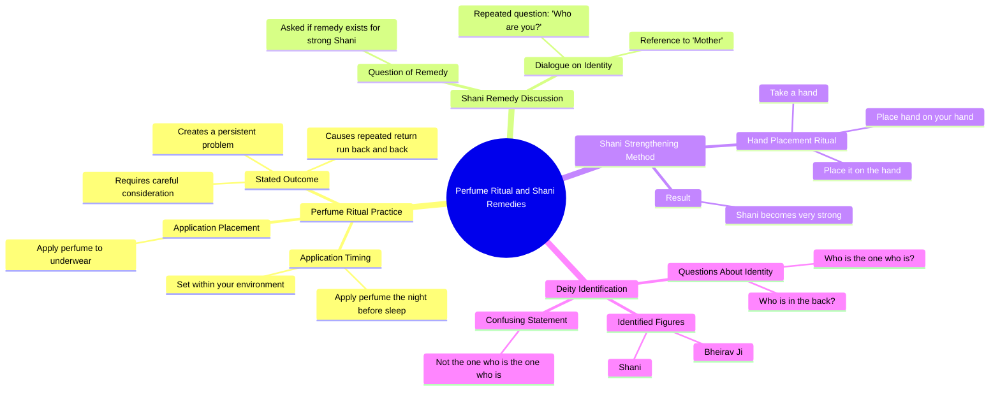

# Apply Perfume to Underwear Before Sleep Remedy

> 🌐 **Read this in:** [English](../../en/2026-10/tiktok-transcript-1m-views-62k-reactions-under-garments-perfume-remedy-explore-dda5.md) · **中文**

> **Creator:** [@Third Degree Podcast](https://www.tiktok.com/@Third Degree Podcast) · **Views:** 1.9M · **Posted:** 2026-10-11 · **Niche:** entertainment
>
> **TL;DR:** The speaker immediately promises to reveal a new method, creating anticipation and curiosity.

[Watch original video →](https://www.facebook.com/share/r/18VmKnCxGA/)

## Why This Went Viral

## 钩子（前3秒）
- **逐字开场：**“我再给你展示一个。在你睡觉前，在你的环境里放上香水。”
- **钩子模式：**大胆的指导性断言＋禁忌/秘密知识（“另一个”暗示这是一系列隐藏的补救方法）。
- **为什么能让人停下滚动：**它从动作中途开始，带着权威感（“我将展示给你”），承诺了一个具体的仪式（睡前用香水），而且措辞恰好足够奇怪（“在你的环境里”“在你的内裤里”），从而触发困惑—好奇。观众会留下来弄清楚这到底是怎么回事。

## 情绪节奏
- **0–3秒——好奇：**一个自信的人物发出了一条奇怪的指令。没有给出任何背景。
- **3–8秒——困惑/紧张：**“这是个问题。你会跑回来，又跑回来。”模糊的威胁制造了不安，却没有给出解答。
- **8–15秒——恳求/绝望：**“你有让shani变强的补救方法吗？母亲？”说话者从权威转向乞求——这种语调上的急转直下，读起来要么像仪式，要么像痛苦，要么像戏仿。
- **15–25秒——重复循环：**“你是谁？母亲？Shani是个好的。”名字（Shani、Bheirav Ji）被不断堆叠，却不加解释——悬念持续。
- **高潮：**“拿起一只手，把一只手放在你的手上。把它放在手上。Shani会变得非常强大。”——这个“补救方法”终于落地，但它毫无意义，而这正是回报。
- **解决：**没有。视频以未解决的重复结束（“这不是那个谁是那个谁是的人”），把观众又循环回开头。

## 关键词密度
- **Shani**（重复约5次）——锚定关键词；在熟悉占星/宗教语境的受众中推动搜索/发现。
- **手**（重复约5次）——身体性的、直击感官的；让仪式显得可触摸。
- **母亲**（重复3次）——情感牵引；触发保护性/家庭性的情感。
- **“你是谁／谁是那个”**——重复模式，制造出催眠般的、吟诵式的节奏。
- **香水／内裤／睡觉**——感官性、私密性的关键词，因为在这种语境中出人意料，所以能提升留存。
- **补救方法**——算法磁铁；“补救方法”＋被点名的神祇＝高意图搜索流量。
- **Bheirav Ji**——小众宗教关键词；吸引一个特定的信徒社群。

**算法驱动因素：** *Shani、补救方法、Bheirav Ji*（搜索＋主题聚类）。
**情绪驱动因素：** *母亲、手、你是谁*（亲密、困惑、吟诵节奏）。

## 为什么它会传播
- **未解之谜让视频循环。**文字记录从未解答“你是谁？”，也没有说明香水仪式到底有什么作用——所以观众会重看以解码它，从而拉高观看时长和重看次数。
- **语调上的模糊性助长评论大战。**这是真正的补救方法、布道、戏仿，还是一位痛苦的长者？像“把它放进你的内裤里。这是个问题”这样的台词荒诞到足以同时招来嘲弄和真诚解读——无论哪种，评论都会爆炸。
- **重复起到吟诵的作用。**“谁是那个谁是那个谁是”模仿了咒语结构，让音频变得黏耳，容易二创、拼接或混音。
- **文化特异性创造圈内分享。**Shani和Bheirav Ji对印度教/占星受众来说是可识别的，他们会在自己的社群中把它当作“你不会相信这个”来分享。
- **可引用的荒诞性。**“在你睡觉前，在你的环境里放上香水”和“把它放在手上”会立刻成为可做表情包的配文/评论素材——这个视频既以视频形式传播，也以文本形式传播。

## 你可以借鉴什么
1. **从指令中途开场，而不是从介绍中途开场。**以“我再给你展示一个”的能量开始——不要铺垫，不要问候。把观众直接丢进一个已经在进行中的动作里。
2. **构建吟诵，而不是脚本。**把一句短语重复3–5次（“你是谁”“把它放在手上”）来制造节奏。重复正是让音频可混音、可记忆的关键。
3. **以未解决收尾。**不要回答你提出的问题。如果观众必须重看或评论才能弄明白发生了什么，算法就会用观看时长和互动来奖励你。

## Mind Map

## Full Transcript (Generated by [TikTok 转录工具](https://toktranscript.com/?utm_source=github&utm_medium=breakdown&utm_campaign=tool_attribution))

> 📝 Transcripts on this page are auto-generated and show the first 60%. Want to transcribe any TikTok in 30 seconds and get the full version? [Try TokTranscript free →](https://toktranscript.com/?utm_source=github&utm_medium=breakdown&utm_campaign=transcript_cta)

I will show you another one. Put perfume in the night before you sleep in your environment. And put it in your underwear. This is a problem. You will run back and back. You should think about it. Do you have a remedy for shani to strong? Mother? Who are you? Mother? Shani is a good one. Take a hand and put a hand on your hand

*[Read the full transcript on TokTranscript →](https://toktranscript.com/plaza/tiktok-transcript-1m-views-62k-reactions-under-garments-perfume-remedy-explore-dda5?utm_source=github&utm_medium=breakdown&utm_campaign=transcript_full)*

## Browse More

- All [entertainment](../../by-niche/zh-CN/entertainment.md) breakdowns
- All [Direct Promise of Demonstration](../../by-pattern/zh-CN/hook-direct-promise-of-demonstration.md) examples

## Video Info

| | |
|---|---|
| Creator | [@Third Degree Podcast](https://www.tiktok.com/@Third Degree Podcast) |
| Original video | [https://www.facebook.com/share/r/18VmKnCxGA/](https://www.facebook.com/share/r/18VmKnCxGA/) |
| Original title | 1M views · 62K reactions | Under Garments पर perfume लगाओ! . . . . . . #remedy #explore #viralreels #reelitfeelit #astrology | Third Degree Podcast |
| Views | 1.9M (1869105) |
| Posted | 2026-10-11 |
| Duration | 0s |
| Niche | `entertainment` |
| Hook pattern | `Direct Promise of Demonstration` |
| Original language | `en` (this page translated by AI) |
| Available languages | en, zh-CN |
| Generated | 2026-10-12 by [TokTranscript](https://toktranscript.com/) |

---

*This breakdown is for educational analysis under fair use. Original video © [@Third Degree Podcast](https://www.tiktok.com/@Third Degree Podcast). All transcripts are auto-generated and may contain errors.*

*Want to analyze your own TikToks like this? [免费 TikTok 文稿生成器 →](https://toktranscript.com/viral-breakdown?utm_source=github&utm_medium=breakdown&utm_campaign=footer_cta)*