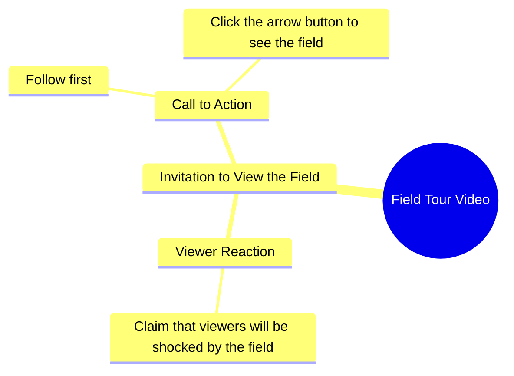

# Farmer Shows Off Her Field in Urdu Video

> 🌐 **Read this in:** [English](../../en/2026-10/tiktok-transcript-20m-views-254k-reactions-wafa-world-facebookreelsviral-reels-9e68.md) · **中文**

> **Creator:** [@Sujata ](https://www.tiktok.com/@Sujata ) · **Views:** 7.0M · **Posted:** 2026-10-11 · **Niche:** other
>
> **TL;DR:** The hook uses a bold shock statement followed by a direct challenge to follow and watch, creating immediate curiosity and engagement.

[Watch original video →](https://www.facebook.com/share/r/19LZJJzYoU/)

## Why This Went Viral

## 钩子（前3秒）
- **逐字开场白：** “जो खेत में आपको दिखाने वाली हूँ, आप मेरा खेत देखकर शायद आपके होश उड़ जाएंगे.”（“我即将在我的田里给你看的东西——看到我的田，你的魂可能都要飞了。”）
- **钩子模式：** 大胆断言 + 悬念未揭（“你不敢相信”／震惊承诺），叠加一个直接挑战。
- **为什么能让人停下滑动：** 它把极端的情绪承诺前置（“होश उड़ जाएंगे”＝你会被震住），却什么都不展示。断言与未见回报之间的落差，制造了一个大脑想要闭合的开放回路。紧接着的一句（“हिम्मत है तो पहले फॉलो करो”——“有胆量就先关注”）把好奇转化为挑战，一拍之内同时触发自尊与顺从。

## 情绪节奏
- **第1拍——好奇（0–2秒）：** “जो खेत में आपको दिखाने वाली हूँ”设定了一个未指明的揭示。扣住不说＝张力。
- **第2拍——升级／造势（2–4秒）：** “आपके होश उड़ जाएंगे”用夸张的后果把情绪赌注拉高。
- **第3拍——挑战／叫板（4–6秒）：** “हिम्मत है तो पहले फॉलो करो”把观众从被动观看者翻转成被挑战的参与者。
- **第4拍——微承诺 + 行动号召（6–8秒）：** “तीर के बटन पे क्लिक करके खुद खेत देख लो”——“箭头按钮”（点赞／分享）指令作为回报闸门落下。
- **高潮时刻：** 叫板那句——“हिम्मत है तो पहले फॉलो करो。”这是情绪峰值，因为它把自尊当武器。真正的田地揭示被刻意放在高潮*之后*，所以视频的张力是靠互动而非内容来化解的。
- **悬念**落在被扣住的田地上；**共鸣**落在乡村／农耕身份上（“मेरा खेत”），让观众感觉被亲自邀请进某个人的世界。

## 关键词密度
- **खेत（田地）**——重复3次；锚定主题与赛道（农业／乡村内容）。
- **देखना / दिखाना / देख लो（看／给看／去看）**——重复3次；驱动“看这个”的祈使语气。
- **आप / आपके（你／你的）**——重复4次；直接称呼让观众始终是主语。
- **होश उड़ जाएंगे（你会被震住）**——高唤醒情绪短语；留存钩子。
- **हिम्मत（胆量／勇气）**——叫板关键词；触发自尊反应。
- **फॉलो（关注）**——主要算法行动号召。
- **तीर के बटन（箭头按钮／点赞）**——次级互动行动号召。
- **算法触达驱动词：** फॉलो、तीर के बटन、देख लो——这些是明确的互动指令，喂养观看时长与互动信号。
- **情绪拉力驱动词：** होश उड़ जाएंगे、हिम्मत、मेरा खेत——这些制造出让人*想要*顺从、而不只是被要求顺从的切身利害感。

## 为什么它会传播
- **开放回路且没有早期回报。** “जो खेत में आपको दिखाने वाली हूँ”承诺了一个在这段片段里始终没展示的揭示——观众会重看或留言要求看，两者都会助推算法。
- **自尊诱饵式行动号召。** “हिम्मत है तो पहले फॉलो करो”把关注重新定义为对勇气的测试。人们关注是为了证明创作者错了，而不是因为被礼貌地请求——这是强得多的转化触发器。
- **全程直接第二人称称呼。** “आपको”“आपके”“आप मेरा खेत देखकर”——观众是被*对着*说，而不是被说给。正是这种个人化，让一块普通的田感觉像是*他们的*田。
- **赛道身份信号。** “मेरा खेत”触达庞大的印地语带农耕受众，而他们在短视频内容里很少看到自己被置于中心——高共鸣＝高社群内分享。
- **一口气叠加行动号召。** 关注 + 点赞（“तीर के बटन”）在任何内容交付之前接连发出，所以互动发生在观众有时间决定不互动之前。

## 你可以偷什么
1. **用扣住的震惊承诺开场，而不是回报。** 说出他们即将看到什么、以及那会对他们造成什么（“你的脑子会炸”），然后延迟揭示。落差就是留存。
2. **把行动号召变成叫板。** 把“请关注”换成挑战（“有胆量就先关注”）。自尊比礼貌更能转化。
3. **全程用第二人称说话。** 每一句都应包含“你／你的”，让观众感觉被亲自称呼——这正是让普通话题感觉像他们自己故事的原因。

## Mind Map

## Full Transcript (Generated by [免费 TikTok 文稿生成器](https://toktranscript.com/?utm_source=github&utm_medium=breakdown&utm_campaign=tool_attribution))

> 📝 Transcripts on this page are auto-generated and show the first 60%. Want to transcribe any TikTok in 30 seconds and get the full version? [Try TokTranscript free →](https://toktranscript.com/?utm_source=github&utm_medium=breakdown&utm_campaign=transcript_cta)

जो खेत में आपको दिखाने वाली हूँ, आप मेरा खेत देखकर शायद आपके होश उड़ जाएंगे. हिम्मत है तो

*[Read the full transcript on TokTranscript →](https://toktranscript.com/plaza/tiktok-transcript-20m-views-254k-reactions-wafa-world-facebookreelsviral-reels-9e68?utm_source=github&utm_medium=breakdown&utm_campaign=transcript_full)*

## Browse More

- All [other](../../by-niche/zh-CN/other.md) breakdowns
- All [Shock + Challenge Hook](../../by-pattern/zh-CN/hook-shock-challenge-hook.md) examples

## Video Info

| | |
|---|---|
| Creator | [@Sujata ](https://www.tiktok.com/@Sujata ) |
| Original video | [https://www.facebook.com/share/r/19LZJJzYoU/](https://www.facebook.com/share/r/19LZJJzYoU/) |
| Original title | 20M views · 254K reactions | Wafa World 🥀 #facebookreelsviral #reelsfb #trendingreelsvideo #reelsvideo #shortvideofbreels #viralvideo #explore #dosti #friendshipgoals #OnlineDosti #DesiVibe #urdupostdaily #followformore | Sujata |
| Views | 7.0M (6966839) |
| Posted | 2026-10-11 |
| Duration | 0s |
| Niche | `other` |
| Hook pattern | `Shock + Challenge Hook` |
| Original language | `en` (this page translated by AI) |
| Available languages | en, zh-CN |
| Generated | 2026-10-11 by [TokTranscript](https://toktranscript.com/) |

---

*This breakdown is for educational analysis under fair use. Original video © [@Sujata ](https://www.tiktok.com/@Sujata ). All transcripts are auto-generated and may contain errors.*

*Want to analyze your own TikToks like this? [TokTranscript →](https://toktranscript.com/viral-breakdown?utm_source=github&utm_medium=breakdown&utm_campaign=footer_cta)*