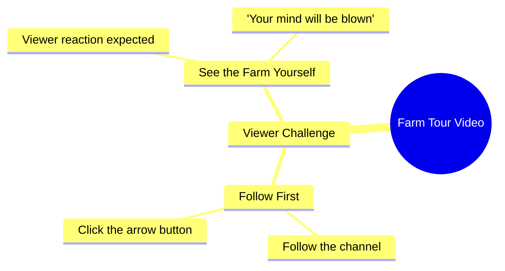

# Woman Shows Her Field and Challenges Viewers to Follow

> 🌐 **Read this in:** [English](../../en/2026-10/tiktok-transcript-21m-views-264k-reactions-wafa-world-facebookreelsviral-reels-12b6.md) · **中文**

> **Creator:** [@Sujata ](https://www.tiktok.com/@Sujata ) · **Views:** 7.3M · **Posted:** 2026-10-17 · **Niche:** other
>
> **TL;DR:** It pairs an extreme shock promise with a dare ('हिम्मत है तो') that forces viewers to follow and watch to prove themselves.

[Watch original video →](https://www.facebook.com/share/r/1E3rFfnEK3/)

## Why This Went Viral

## 钩子（前3秒）
- **逐字开场：** “जो खेत में आपको दिखाने वाली हूँ, आप मेरा खेत देखकर शायद आपके होश उड़ जाएंगे.”（“我接下来要给你们看我家地里的东西——看到我的地，你们大概会惊掉下巴。”）
- **钩子模式：** **大胆断言 + 悬念留白**（“你不敢相信我地里有什么”）融合**叫板/挑战**（“हिम्मत है तो”——“有胆你就来”）。
- **为什么能让人停下划动：** 它承诺了一个极端却未言明的回报（“होश उड़ जाएंगे”），却不展示——形成一个开放的好奇回路。叫板（“有胆你就来”）把观众从被动划屏者变成被挑战的参与者，而紧接着的关注 + 点击指令（“पहले फॉलो करो, फिर तीर के बटन पे क्लिक करकर”）在观众来得及反悔之前，就把这股好奇心尖峰转化为行动。

## 情绪节奏
- **节拍1——好奇尖峰（0–2秒）：** “जो खेत में आपको दिखाने वाली हूँ”——承诺一个未点名的揭晓。开放回路。
- **节拍2——升级/轻度震惊（2–5秒）：** “आपके होश उड़ जाएंगे”——悬念被拉到最大夸张。张力拉满，却仍无视觉回报。
- **节拍3——挑战/挑衅（5–7秒）：** “हिम्मत है तो”——向观众叫板；制造自我卷入和微张力（“我敢吗？”）。
- **节拍4——指令/回报闸门（7–10秒）：** “पहले फॉलो करो, फिर तीर के बटन पे क्लिक करके खुद खेत देख लो”——揭晓被明确锁在关注 + 点击之后。
- **悬念落点：** 在叫板处（“हिम्मत है तो”）——观众此刻已被个人化地卷入。
- **高潮时刻：** 指令“खुद खेत देख लो”（“自己去看那块地”）——文字稿在揭晓*之前*就结束了，使那块被扣住的地本身成为观众必须追进下一帧/评论区的那个高潮。

## 关键词密度
- **खेत（地/田地）**——重复3次；锚点名词。驱动话题/算法相关性（农业、乡村内容）和可搜索性。
- **दिखाने / देखो / देख（展示/看）**——揭晓类动词；驱动好奇心引擎。
- **होश उड़ जाएंगे（惊掉下巴）**——情绪夸张关键词；情绪拉力最强。
- **हिम्मत（勇气）**——挑战关键词；把被动观众转化为参与观众。
- **फॉलो（关注）**——直接的算法CTA；驱动粉丝转化信号。
- **तीर के बटन（箭头按钮/下一个）**——留存/下一条视频CTA；驱动会话观看信号。
- **आप / आपके（你/你的）**——第二人称称呼；个性化并维持情绪拉力。

*算法触达：* खेत、फॉलो、तीर के बटन（话题 + 互动信号）。*情绪拉力：* होश उड़ जाएंगे、हिम्मत、दिखाने/देखो（好奇 + 挑战）。

## 为什么它会传播
- **带点名但未展示回报的开放好奇回路：** “जो खेत में आपको दिखाने वाली हूँ… होश उड़ जाएंगे”承诺了一个具体的揭晓（那块地），却在文字稿中从未兑现——观众必须观看/重看/评论才能填补这个缺口。
- **叫板机制制造自我卷入：** “हिम्मत है तो”向观众叫板；人们会分享自己“通过”的挑战，并在评论中证明自己没被吓退——助推评论区速度。
- **硬闸门式CTA堆叠：** “पहले फॉलो करो, फिर तीर के बटन पे क्लिक करके”把好奇心尖峰直接转化为关注 + 下一条视频点击——这是平台最奖励的两个信号。
- **夸张作为可分享语言：** “आपके होश उड़ जाएंगे”是一句可引用、可做成梗的短语，观众会在评论和合拍中重复，把触达延伸到原受众之外。
- **第二人称亲密感：** 反复出现的“आप/आपके”让人感觉被直接点名，提高完播率和私信/分享行为（“你必须看看这个”）。

## 你可以借鉴什么
- **以点名但扣住的回报 + 夸张开场：** 说明*你要展示什么*以及*反应会有多极端*，但前3秒不要展示——例如：“我[某物]里那个会让你惊掉下巴的东西。”
- **用叫板把划屏者转化为评论者：** 一句简短的挑战（“有胆你就……”“我赌你做不到看这个而不……”）制造自我卷入并驱动评论速度。
- **把揭晓锁在一个清晰动作之后：** 在好奇心峰值处堆叠一个关注 + 一个点击指令——不要把CTA埋在结尾；把它们放在张力最高处。

## Mind Map

## Full Transcript (Generated by [TikTok 转录工具](https://toktranscript.com/?utm_source=github&utm_medium=breakdown&utm_campaign=tool_attribution))

> 📝 Transcripts on this page are auto-generated and show the first 60%. Want to transcribe any TikTok in 30 seconds and get the full version? [Try TokTranscript free →](https://toktranscript.com/?utm_source=github&utm_medium=breakdown&utm_campaign=transcript_cta)

जो खेत में आपको दिखाने वाली हूँ, आप मेरा खेत देखकर शायद आपके होश उड़ जाएंगे. हिम्मत है तो

*[Read the full transcript on TokTranscript →](https://toktranscript.com/plaza/tiktok-transcript-21m-views-264k-reactions-wafa-world-facebookreelsviral-reels-12b6?utm_source=github&utm_medium=breakdown&utm_campaign=transcript_full)*

## Browse More

- All [other](../../by-niche/zh-CN/other.md) breakdowns
- All [Shock Promise + Dare-to-Watch Challenge](../../by-pattern/zh-CN/hook-shock-promise-dare-to-watch-challenge.md) examples

## Video Info

| | |
|---|---|
| Creator | [@Sujata ](https://www.tiktok.com/@Sujata ) |
| Original video | [https://www.facebook.com/share/r/1E3rFfnEK3/](https://www.facebook.com/share/r/1E3rFfnEK3/) |
| Original title | 21M views · 264K reactions | Wafa World 🥀 #facebookreelsviral #reelsfb #trendingreelsvideo #reelsvideo #shortvideofbreels #viralvideo #explore #dosti #friendshipgoals #OnlineDosti #DesiVibe #urdupostdaily #followformore | Sujata |
| Views | 7.3M (7286626) |
| Posted | 2026-10-17 |
| Duration | 0s |
| Niche | `other` |
| Hook pattern | `Shock Promise + Dare-to-Watch Challenge` |
| Original language | `en` (this page translated by AI) |
| Available languages | en, zh-CN |
| Generated | 2026-10-18 by [TokTranscript](https://toktranscript.com/) |

---

*This breakdown is for educational analysis under fair use. Original video © [@Sujata ](https://www.tiktok.com/@Sujata ). All transcripts are auto-generated and may contain errors.*

*Want to analyze your own TikToks like this? [TokTranscript →](https://toktranscript.com/viral-breakdown?utm_source=github&utm_medium=breakdown&utm_campaign=footer_cta)*