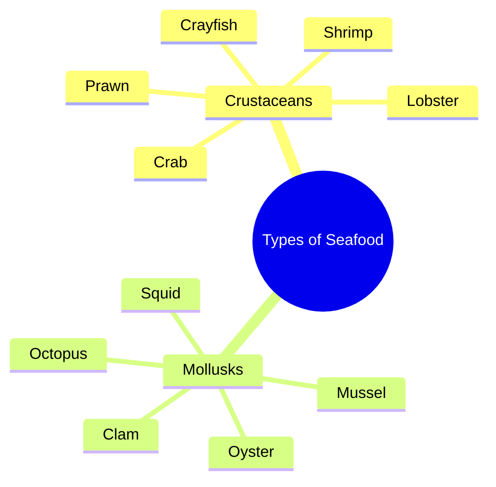

# Name These 10 Seafood in English Vocabulary Quiz

> 🌐 **Read this in:** [English](../../en/2026-10/tiktok-transcript-3-9m-views-41k-reactions-can-you-name-all-these-seafood-corr-14a7.md) · **中文**

> **Creator:** [@learnwithashmeet](https://www.tiktok.com/@learnwithashmeet) · **Views:** 1.6M · **Posted:** 2026-10-10 · **Niche:** food
>
> **TL;DR:** The hook immediately lists popular seafood items, triggering curiosity about the purpose of the list and appealing to food enthusiasts.

[Watch original video →](https://www.facebook.com/share/r/19v8TSRA7m/)

## Why This Went Viral

## 钩子（前3秒）
- 逐字开场：“虾、龙虾、蟹、牡蛎、鱿鱼、章鱼、对虾、肌肉、蛤蜊、小龙虾。”
- 钩子模式：**连发式清单 / 模式打断**（毫无铺垫的机关枪式罗列）。
- 为什么能止住滑动：大脑天生寻找模式。一串熟悉的海鲜词汇在零语境下抛出，会立刻制造出“这是什么，要往哪去？”的缺口。速度和节奏像挑战或记忆测试，触发完成主义本能——观众留下来看自己能否跟上，或是否有包袱要抖。

## 情绪节奏
- 节拍1（0–2秒）：**好奇 / 轻微困惑**——“他为什么只是在念海鲜名？”
- 节拍2（2–6秒）：**识别与节奏锁定**——观众开始预测下一个词，进入恍惚般的韵律。
- 节拍3（6–9秒）：**张力飙升**——清单超出预期地继续；“muscle”（拼错的“mussel”）作为一个细微错误或怪点落地，制造微型电击。
- 节拍4（9–11秒）：**反高潮 / 荒诞式释然**——“crayfish”戛然而止，没有回报、反转或解释。缺乏收束*就是*包袱。
- 高潮时刻：最后一个词“crayfish”——不是因为它戏剧化，而是因为它确认了没有反转。对预期回报的颠覆就是峰值。

## 关键词密度
- 最强重复/负载词：**shrimp、lobster、crab、oyster、squid、octopus、prawn、muscle/mussel、clam、crayfish**
- 算法触达驱动词：“shrimp”“lobster”“crab”“octopus”——高搜索量的海鲜词，能拉来美食、烹饪和海洋内容受众。
- 情绪拉动驱动词：“muscle”（拼写错误/歧义）和“crayfish”（意外的收尾词）——这些制造评论区争论和重看。
- 注：密度是100%名词，零动词或连接组织。这是刻意的——读起来像字幕、测验答案或发烧梦，既助长困惑又增强记忆点。

## 为什么它会传播
- **零语境荒诞主义**：文字稿只是一份清单。没有铺垫、没有包袱、没有脸、没有解释。这种真空迫使观众投射意义——“这是机器人？中风？加密信息？”——而投射驱动评论。
- **通过“muscle”错误制造评论诱饵**：“muscle”而非“mussel”是最具分享性的细节。这是一个微小、可辩护的错误，招来纠正、嘲讽和合拍/拼接回应。每次纠正都是一条评论；每条评论都是信号助推。
- **完成主义陷阱**：清单触发心理上的完成需求。观众看到最后以“完成”序列，这抬高了观看时长和循环潜力——尤其当视频短到能自动播放两遍时。
- **梗模板潜力**：格式可无限混改。任何人都能换上自己的清单（汽车零件、前任、宝可梦、蔬菜）并搭上同样的结构性玩笑。这把一个视频变成趋势。
- **意图模糊**：是玩笑？测试？故障？文字稿不给答案。模糊内容被分享，因为人们*带着问题*分享——“这是什么？”——这是最高价值的分享触发。

## 你可以偷什么
- **用清单开场，而不是句子。** 跳过“大家好，今天我想聊……”直接从快速名词或短语中途开始。缺失的语境就是钩子。
- **埋一个微小、可争议的瑕疵。** 一个拼写错误、一个可疑的加入项或一个奇怪的排序，给观众在评论区纠正的东西。纠正=互动。
- **不解决就结束。** 抵制解释、总结或落一个道德教训的冲动。清单后突然停止迫使重看和“等等，就这？”式分享——而算法两者都算。

## Mind Map

## Full Transcript (Generated by [TikTok 转录工具](https://toktranscript.com/?utm_source=github&utm_medium=breakdown&utm_campaign=tool_attribution))

> 📝 Transcripts on this page are auto-generated and show the first 60%. Want to transcribe any TikTok in 30 seconds and get the full version? [Try TokTranscript free →](https://toktranscript.com/?utm_source=github&utm_medium=breakdown&utm_campaign=transcript_cta)

Shrimp, lobster, crab, oyster, squid, octopus,

*[Read the full transcript on TokTranscript →](https://toktranscript.com/plaza/tiktok-transcript-3-9m-views-41k-reactions-can-you-name-all-these-seafood-corr-14a7?utm_source=github&utm_medium=breakdown&utm_campaign=transcript_full)*

## Browse More

- All [food](../../by-niche/zh-CN/food.md) breakdowns
- All [Rapid-fire Seafood Enumeration](../../by-pattern/zh-CN/hook-rapid-fire-seafood-enumeration.md) examples

## Video Info

| | |
|---|---|
| Creator | [@learnwithashmeet](https://www.tiktok.com/@learnwithashmeet) |
| Original video | [https://www.facebook.com/share/r/19v8TSRA7m/](https://www.facebook.com/share/r/19v8TSRA7m/) |
| Original title | 3.9M views · 41K reactions | Can you name all these seafood correctly? 🦞🦀 Most people know only 2 or 3! Test your vocabulary before checking the answers. #LearnEnglish #EnglishVocabulary #SpokenEnglish #EnglishTips #LearnWithAshmeet | learnwithashmeet |
| Views | 1.6M (1580501) |
| Posted | 2026-10-10 |
| Duration | 0s |
| Niche | `food` |
| Hook pattern | `Rapid-fire Seafood Enumeration` |
| Original language | `en` (this page translated by AI) |
| Available languages | en, zh-CN |
| Generated | 2026-10-12 by [TokTranscript](https://toktranscript.com/) |

---

*This breakdown is for educational analysis under fair use. Original video © [@learnwithashmeet](https://www.tiktok.com/@learnwithashmeet). All transcripts are auto-generated and may contain errors.*

*Want to analyze your own TikToks like this? [免费 TikTok 文稿生成器 →](https://toktranscript.com/viral-breakdown?utm_source=github&utm_medium=breakdown&utm_campaign=footer_cta)*