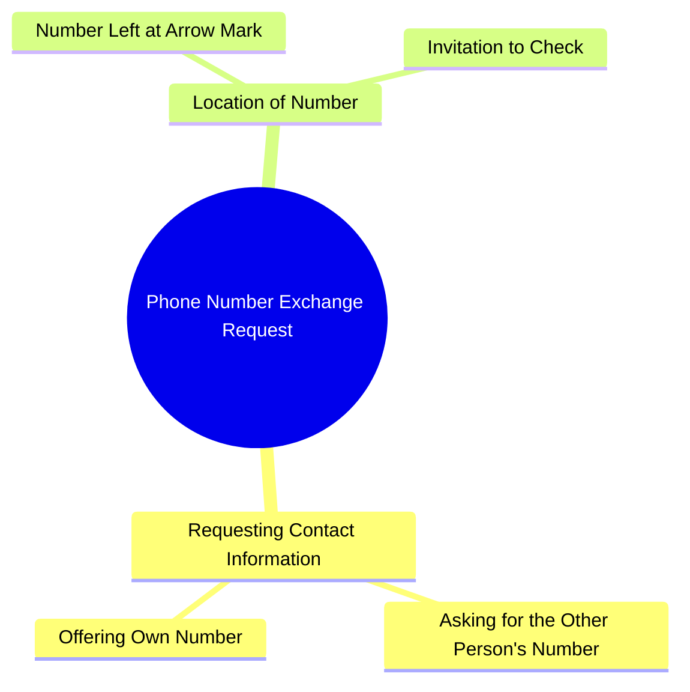

# Saumal Sharma Asks for Number in Comedy Skit

> 🌐 **Read this in:** [English](../../en/2026-10/tiktok-transcript-4m-views-156k-reactions-83c3.md) · **中文**

> **Creator:** [@صومل شرما ](https://www.tiktok.com/@صومل شرما ) · **Views:** 1.2M · **Posted:** 2026-10-12 · **Niche:** entertainment
>
> **TL;DR:** The hook directly asks for the viewer's number or offers his own, creating immediate engagement and curiosity.

[Watch original video →](https://www.facebook.com/share/r/1A12meRwR1/)

## Why This Went Viral

## 钩子（前3秒）
- **逐字稿：** “अपना नंबर दे दीजिए या तो मेरा नंबर ले लीजिए”（“把你的号码给我，或者拿走我的号码”）
- **钩子模式：** 直接要求 + 即时互惠反转（大胆主张/命令）。一句搭讪台词，以交易的形式呈现。
- **为什么能让人停下滑动：** 这是一个*自信、略带荒诞的提议*，零铺垫直接抛出。大脑会识别出“现在有人正在被搭讪”——一个带有风险的社交时刻——而“या तो”（否则）结构制造了一个微型悬念：会是哪一种？

## 情绪节奏
- **第1拍——好奇/兴趣（0–2秒）：** 直白的要号码。观众会问“这是谁，为什么这么直接？”
- **第2拍——紧张感（2–4秒）：** “या तो मेरा नंबर ले लीजिए”——这个提议翻转了权力关系。她会接受吗？这是真的吗？
- **第3拍——转折/揭示（4–6秒）：** “मैंने तीर वाले निशान पे अपना नंबर छोड़ रखा है”——号码不是被给出，而是被*藏起来*了。请求变成了一场寻宝游戏。
- **高潮：** “देख लीजिए”（“去看看”）——邀请对方去追寻。这是回报句；整个视频坍缩成一次挑战。
- **结局：** 没有。视频以开放循环结束（观众从未看到号码），这正是重看和评论激增的原因。

## 关键词密度
- **नंबर（号码）**——重复3次。锚点词；同时驱动理解和重播（观众会重听以确认）。
- **दीजिए / लीजिए（给 / 拿）**——互惠配对。制造交易式节奏。
- **तीर वाले निशान（箭头标记）**——具体性钩子。这是让这句台词可被引用的“意外细节”。
- **छोड़ रखा है（留在那里了）**——暗示预谋。暗示这句台词背后有一个故事。
- **देख लीजिए（去看看）**——行动号召。驱动诸如“kahan hai number?”和“kya ye sach hai?”的评论。

**算法层面 vs. 情绪层面：** “नंबर”和“देख लीजिए”拉动算法触达（高频、可搜索、触发评论）。“तीर वाले निशान”和“छोड़ रखा है”承载情绪拉力——它们把一句搭讪台词变成了一个谜。

## 为什么它会传播
- **1. 它是一句话里的完整故事。** 这句台词包含铺垫（请求）、冲突（或者拿我的）、转折（它藏在箭头标记处）。不需要背景——非常适合静音滑动观看。
- **2. 互惠反转是一种可分享格式。** “把你的给我，或者拿走我的”可以瞬间被改编——创作者可以替换对象（号码 → Instagram，号码 → 地址）并复用这个结构。
- **3. 开放循环强制互动。** “देख लीजिए”在屏幕上从未得到解决。观众评论“number kahan hai?”——评论是算法最喜欢的信号。
- **4. “箭头标记”这个细节异常具体。** 具体性会被读作真实。观众会争论它是真的、玩笑，还是一个地点——三种解读都会产生回复。
- **5. 它短到足以循环。** 约7秒以内意味着重播率接近100%，而重播在短视频排名中权重很高。

## 你可以借鉴什么
- **1. 使用“X 或 Y”的互惠结构。** 把你的请求框定成双向交换（“把你的邮箱给我，或者我把我的丢在评论区”）。这会让观众感觉掌控局面，而你仍然得到行动。
- **2. 把回报藏在一个物理细节里。** 不要直接说出答案，而是指向一个*地点*（“我把它留在箭头标记处了”“看第三张幻灯片”“看牌子后面”）。具体、可定位的细节会驱动评论和重看。
- **3. 以“देख लीजिए”——一个未解决的挑战——结尾。** 永远不要在视频里闭合循环。让评论区成为第二幕。

## Mind Map

## Full Transcript (Generated by [TokTranscript](https://toktranscript.com/?utm_source=github&utm_medium=breakdown&utm_campaign=tool_attribution))

> 📝 Transcripts on this page are auto-generated and show the first 60%. Want to transcribe any TikTok in 30 seconds and get the full version? [Try TokTranscript free →](https://toktranscript.com/?utm_source=github&utm_medium=breakdown&utm_campaign=transcript_cta)

अपना नंबर दे दीजिए या तो मेरा नंबर ले लीजिए मैंने तीर वाले 

*[Read the full transcript on TokTranscript →](https://toktranscript.com/plaza/tiktok-transcript-4m-views-156k-reactions-83c3?utm_source=github&utm_medium=breakdown&utm_campaign=transcript_full)*

## Browse More

- All [entertainment](../../by-niche/zh-CN/entertainment.md) breakdowns
- All [Direct Request with Alternative](../../by-pattern/zh-CN/hook-direct-request-with-alternative.md) examples

## Video Info

| | |
|---|---|
| Creator | [@صومل شرما ](https://www.tiktok.com/@صومل شرما ) |
| Original video | [https://www.facebook.com/share/r/1A12meRwR1/](https://www.facebook.com/share/r/1A12meRwR1/) |
| Original title | 4M views · 156K reactions | اپنا نمبر دیجیے یا میرا | صومل شرما |
| Views | 1.2M (1228673) |
| Posted | 2026-10-12 |
| Duration | 0s |
| Niche | `entertainment` |
| Hook pattern | `Direct Request with Alternative` |
| Original language | `en` (this page translated by AI) |
| Available languages | en, zh-CN |
| Generated | 2026-10-13 by [TokTranscript](https://toktranscript.com/) |

---

*This breakdown is for educational analysis under fair use. Original video © [@صومل شرما ](https://www.tiktok.com/@صومل شرما ). All transcripts are auto-generated and may contain errors.*

*Want to analyze your own TikToks like this? [免费 TikTok 文稿生成器 →](https://toktranscript.com/viral-breakdown?utm_source=github&utm_medium=breakdown&utm_campaign=footer_cta)*