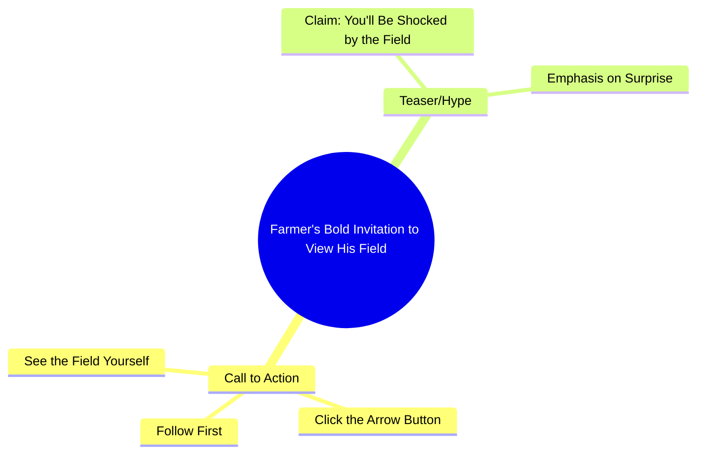

# Farmer Shows Off Field in Urdu Video

> 🌐 **Read this in:** [English](../../en/2026-10/tiktok-transcript-5-1m-views-82k-reactions-wafa-world-facebookreels-reels-tren-9e8c.md) · **中文**

> **Creator:** [@rani ji ](https://www.tiktok.com/@rani ji ) · **Views:** 2.0M · **Posted:** 2026-10-12 · **Niche:** other
>
> **TL;DR:** The hook uses a bold shock claim and a direct challenge to compel viewers to watch and engage.

[Watch original video →](https://www.facebook.com/share/r/1DSFr1dqYY/)

## Why This Went Viral

## 钩子（前3秒）
- **逐字开场：** “जो खत में आपको दिखाने वाली हूँ आप मेरा खेत देखके शायद आपके होश उड़ जाएंगे”（“我要给你看的那块地——看到我的地，你大概会惊掉下巴”）。
- **钩子模式：** 大胆断言 + 震惊预告（“你会惊掉下巴”），再融合挑战/命令（“有胆就先关注”）。
- **为什么能让人停下滑动：** 它在展示任何东西之前，就先抛出一个极端情绪承诺（होश उड़ जाएंगे），制造出一个观众必须填补的开放信息缺口。带有攻击性的“हिम्मत है तो”（有胆的话）是在挑衅观众，而关注门槛则把好奇心转化为一个微承诺动作。

## 情绪节奏
- **0–2秒——震惊承诺：** “आपके होश उड़ जाएंगे”让好奇心飙升，并带来轻微难以置信。
- **2–4秒——挑战/张力：** “हिम्मत है तो पहले फॉलो करो”把好奇心翻转成挑衅——自尊心被卷入。
- **4–6秒——指令/释放阀：** “तीर के बटन पे क्लिक करके”给出一个具体动作，把张力释放为顺从。
- **6秒+——回报铺垫：** “खुद खेत देख लो”把主动权交给观众（“自己去看”），这就是**高潮时刻**——揭示被延后到观众自己的点击，因此情绪峰值是自我生成的。
- **悬念**落在挑衅句（“हिम्मत है तो”）上；**共鸣**落在“खुद खेत देख लो”上，因为它感觉像是一份私人邀请，而不是广告。

## 关键词密度
- **खेत（地/田地）**——重复3次；核心主题关键词，带动垂类/算法触达。
- **देखना / देख लो / दिखाने（看/自己看/展示）**——重复4次；动作关键词，把观众拉向揭示。
- **होश उड़ जाएंगे（惊掉下巴）**——情绪夸张；纯粹的留存诱饵。
- **हिम्मत（胆量/挑衅）**——自尊触发词；提升评论/回复互动。
- **फॉलो（关注）**——直接CTA；推动算法最看重的指标。
- **तीर के बटन / क्लिक（点击按钮）**——微指令；提高看到回报前的完播率。
- **算法触达驱动词：** खेत、देखना、फॉलो——这些匹配搜索/发现意图和平台CTA信号。
- **情绪拉力驱动词：** होश उड़ जाएंगे、हिम्मत——这些制造出让人不划走的情感利害。

## 为什么会传播
- **好奇心缺口一直悬到最后1秒：** 承诺（“आपके होश उड़ जाएंगे”）在口播台词中从未被解决——观众必须点击才能看到，从而被迫完成一个动作。
- **自尊挑衅驱动评论和转发：** “हिम्मत है तो”（有胆的话）邀请观众证明自己，而挑衅往往会稳定地产生回复诱饵和合拍/拼接。
- **明确的关注门槛把好奇心转化为订阅：** “पहले फॉलो करो फिर तीर के बटन पे क्लिक करके”把CTA排成顺序，让关注发生在回报之前，在观众动机最强时捕获他们。
- **第二人称、高亲密度称呼：** “आपको”“आपका”“खुद”让它感觉像私人挑战，而不是广播——私人称呼提高完成率。
- **自我揭示式框架（“खुद खेत देख लो”）：** 通过把揭示交给观众，创作者让回报感觉像是自己挣来的、可分享的——人们会转发自己“发现”的东西。

## 你可以偷什么
- **用夸张承诺开场，而不是描述。** 把“这是我的地”换成“这会让你惊掉下巴”——先抛出情绪利害，再交付主题。
- **用挑衅把被动观众转化为主动观众。** 像“有胆就先关注”这样的句子，会把一次滑动变成自尊驱动的动作，并喂养评论区。
- **延迟回报，并把它交给观众。** 不要在视频里展示一切，而是明确告诉他们该点哪里自己去看——这会同时提高完播率和点击率。

## Mind Map

## Full Transcript (Generated by [TikTok 转录工具](https://toktranscript.com/?utm_source=github&utm_medium=breakdown&utm_campaign=tool_attribution))

> 📝 Transcripts on this page are auto-generated and show the first 60%. Want to transcribe any TikTok in 30 seconds and get the full version? [Try TokTranscript free →](https://toktranscript.com/?utm_source=github&utm_medium=breakdown&utm_campaign=transcript_cta)

जो खत में आपको दिखाने वाली हूँ आप मेरा खेत देखके शायद आपके होश उड़ जाएंगे हिम्मत है तो

*[Read the full transcript on TokTranscript →](https://toktranscript.com/plaza/tiktok-transcript-5-1m-views-82k-reactions-wafa-world-facebookreels-reels-tren-9e8c?utm_source=github&utm_medium=breakdown&utm_campaign=transcript_full)*

## Browse More

- All [other](../../by-niche/zh-CN/other.md) breakdowns
- All [Shock + Challenge](../../by-pattern/zh-CN/hook-shock-challenge.md) examples

## Video Info

| | |
|---|---|
| Creator | [@rani ji ](https://www.tiktok.com/@rani ji ) |
| Original video | [https://www.facebook.com/share/r/1DSFr1dqYY/](https://www.facebook.com/share/r/1DSFr1dqYY/) |
| Original title | 5.1M views · 82K reactions | Wafa World 🥀 #FacebookReels #Reels #TrendingReels #ReelsVideo #ShortVideo #ViralVideo #Explore #ForYou #Dosti #Friendship #OnlineDosti #DesiVibes #UrduPosts #FollowForMore | rani ji |
| Views | 2.0M (1974100) |
| Posted | 2026-10-12 |
| Duration | 0s |
| Niche | `other` |
| Hook pattern | `Shock + Challenge` |
| Original language | `en` (this page translated by AI) |
| Available languages | en, zh-CN |
| Generated | 2026-10-13 by [TokTranscript](https://toktranscript.com/) |

---

*This breakdown is for educational analysis under fair use. Original video © [@rani ji ](https://www.tiktok.com/@rani ji ). All transcripts are auto-generated and may contain errors.*

*Want to analyze your own TikToks like this? [TokTranscript 转录工具 →](https://toktranscript.com/viral-breakdown?utm_source=github&utm_medium=breakdown&utm_campaign=footer_cta)*