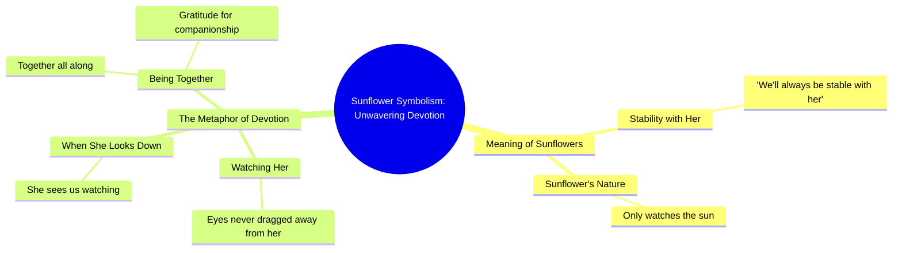

# Sunflower Head Shaker DIY Car Decor

> 🌐 **Read this in:** [English](../../en/2026-10/tiktok-transcript-5-diy-55d6.md) · **中文**

> **Creator:** [@xing_1338](https://www.tiktok.com/@xing_1338) · **Views:** 907.0K · **Posted:** 2026-10-17 · **Niche:** entertainment
>
> **TL;DR:** Opens with a direct question about a familiar symbol, creating an instant curiosity gap that the rest of the video promises to resolve.

[Watch original video →](https://www.tiktok.com/@xing_1338/video/7446644430016236801?is_from_webapp=1&sender_device=pc&web_id=7695616896544015903)

## Why This Went Viral

## 钩子（前3秒）
- **逐字开场：**“你知道向日葵的含义吗？”
- **钩子模式：**提问式钩子（好奇心缺口）与象征物揭示（“向日葵的含义”）融合。
- **为什么能让人停下滚动：**它问了一个观众无法立刻回答、但*感觉*自己应该知道的问题。“含义”一词承诺了回报，而“向日葵”是一个高辨识度、高温暖感的意象。大脑打开了一个循环（“它是什么意思？”），只有继续观看才能闭合。

## 情绪节奏
- **节拍1——好奇（0–2秒）：**“你知道向日葵的含义吗？”打开循环。
- **节拍2——承诺/安慰（2–6秒）：**“它意味着我们和她会永远稳定”给出一个柔和、令人安心的答案——快速消解疑问带来的释然。
- **节拍3——通过隐喻制造张力（6–12秒）：**“像一朵只注视着太阳的向日葵”引入奉献与单向凝视；微妙的酸楚逐渐累积。
- **节拍4——转折/共鸣（12–18秒）：**“而当她低下头时，她会看到我们从未将目光从她身上移开”——凝视反转。观看者变成了被观看者。这是情绪支点。
- **节拍5——收束（最后一句）：**“多亏了一直在一起”落在团聚感上——释然与温暖。
- **高潮：**“当她低下头时，她会看到我们”中的反转——隐喻从渴望转为相互确认的那一刻。这就是人们截图并转发的那句台词。

## 关键词密度
- **最强重复/负载词：***向日葵、太阳、她、永远、稳定、一起、目光/从未将目光移开、含义。*
- **算法触达关键词：**“向日葵”（高搜索、高收藏的美学词）、“含义”（问题意图，驱动评论）、“永远/一起”（关系标记诱饵，触发分享给伴侣）。
- **情绪拉力关键词：**“稳定”、“从未将目光移开”、“一直在一起”——这些承载忠诚/奉献的载荷，驱动收藏和私信而非单纯触达。
- **净效果：**触达词让它被*推送*；情绪词让它被*分享*。“向日葵”和“她”的重叠桥接了两者。

## 为什么它会传播
- **通用关系代理：**“我们和她会永远稳定”让任何观众都能把这句话映射到自己的伴侣身上——视频变成了*他们可以发送的消息*，而不仅仅是他们观看的内容。
- **凝视反转是可引用的转折：**“当她低下头时，她会看到我们从未将目光从她身上移开”是截图句——一个自足、诗意的句子，即使被剪出语境也能成立。
- **低投入高意义格式：**整个文案约50词。简短、缓慢、象征驱动的脚本易于重录、合拍和字幕翻译——助推混剪和拼接量。
- **评论诱饵问题：**以“你知道……的含义吗”开场，会引来纠正、补充和“发给女朋友”的评论——这些互动信号推动进一步分发。
- **标记伴侣机制：**“一直在一起”给观众一个明确的社交动作（分享给他们的人），将被动观众转化为分发节点。

## 你可以借鉴什么
1. **以一个关于熟悉事物的“含义”问题开场。**“你知道[花/颜色/歌曲]实际上意味着什么吗？”——零设置成本的即时好奇心缺口。
2. **构建一个隐喻，然后在结尾反转它。**设置一个凝视/方向（向日葵→太阳），然后在最后三分之一翻转谁在看谁。反转就是你可分享的台词。
3. **写一句截图就绪的句子。**精心打造一句诗意到足以脱离语境独立存在的台词（“从未将目光从她身上移开”）——那就是人们收藏、引用和发送的单位。

## Mind Map

## Full Transcript (Generated by [免费 TikTok 文稿生成器](https://toktranscript.com/?utm_source=github&utm_medium=breakdown&utm_campaign=tool_attribution))

> 📝 Transcripts on this page are auto-generated and show the first 60%. Want to transcribe any TikTok in 30 seconds and get the full version? [Try TokTranscript free →](https://toktranscript.com/?utm_source=github&utm_medium=breakdown&utm_campaign=transcript_cta)

Do you know the meaning of sunflowers? It means we'll always be stable with her. Like a sunflower that only watches the sun And when she looked do

*[Read the full transcript on TokTranscript →](https://toktranscript.com/plaza/tiktok-transcript-5-diy-55d6?utm_source=github&utm_medium=breakdown&utm_campaign=transcript_full)*

## Browse More

- All [entertainment](../../by-niche/zh-CN/entertainment.md) breakdowns
- All [Symbolism Reveal Question](../../by-pattern/zh-CN/hook-symbolism-reveal-question.md) examples

## Video Info

| | |
|---|---|
| Creator | [@xing_1338](https://www.tiktok.com/@xing_1338) |
| Original video | [https://www.tiktok.com/@xing_1338/video/7446644430016236801?is_from_webapp=1&sender_device=pc&web_id=7695616896544015903](https://www.tiktok.com/@xing_1338/video/7446644430016236801?is_from_webapp=1&sender_device=pc&web_id=7695616896544015903) |
| Original title | ดอกทานตะวันเขย่าหัว 5 ชิ้น 🌻สร้างสรรค์ DIY ตกแต่งรถยนต์🚘 กระจายการรัก... |
| Views | 907.0K (907000) |
| Posted | 2026-10-17 |
| Duration | 0s |
| Niche | `entertainment` |
| Hook pattern | `Symbolism Reveal Question` |
| Original language | `en` (this page translated by AI) |
| Available languages | en, zh-CN |
| Generated | 2026-10-18 by [TokTranscript](https://toktranscript.com/) |

---

*This breakdown is for educational analysis under fair use. Original video © [@xing_1338](https://www.tiktok.com/@xing_1338). All transcripts are auto-generated and may contain errors.*

*Want to analyze your own TikToks like this? [TokTranscript →](https://toktranscript.com/viral-breakdown?utm_source=github&utm_medium=breakdown&utm_campaign=footer_cta)*