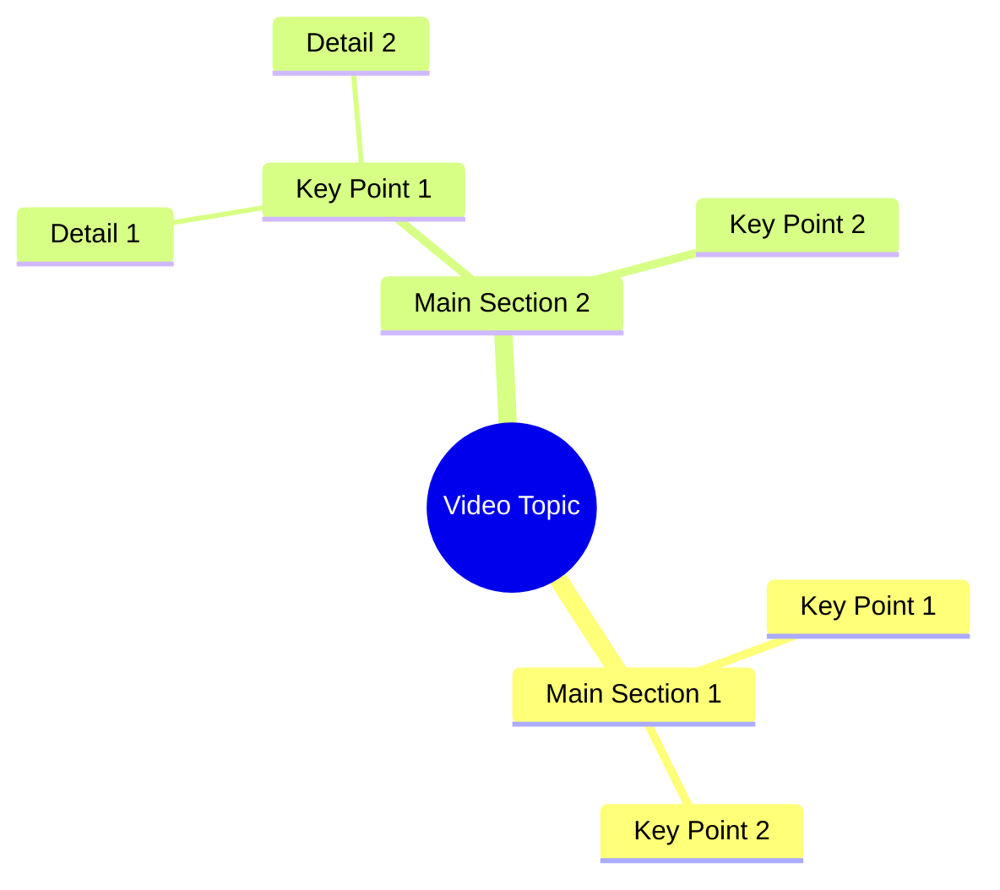

# Woman Seeks Facebook Friend to Message on WhatsApp

> 🌐 **Read this in:** [English](../../en/2026-10/tiktok-transcript-6-1m-views-201k-reactions-wafa-world-facebookreelsviral-reel-96e4.md) · **中文**

> **Creator:** [@Sujata ](https://www.tiktok.com/@Sujata ) · **Views:** 2.3M · **Posted:** 2026-10-12 · **Niche:** entertainment
>
> **TL;DR:** The hook directly challenges the audience's courage, provoking a response.

[Watch original video →](https://www.facebook.com/share/r/184uUnkMtg/)

## Why This Went Viral

## 钩子（前3秒）
- **逐字开场白：** “लगता है किसी मा के लाल में दम नहीं है।”（“看来没有哪个妈生的有种。”）
- **钩子模式：** 直接挑战／侮辱式引战（“没人有这个胆量”）——一种挑衅型钩子。
- **为什么能让人停下滚动：** 这是针对观众本人的叫板。这种嘲讽会激发自尊心和证明对方错了的冲动。再加上是一位女性在挑战“妈生的儿子们”，会立刻制造性别／自尊层面的摩擦，让人很难不做出反应就划走。

## 情绪节奏
- **第1拍——挑衅（0–2秒）：** “没有哪个妈生的有种” → 触发防御心理／好奇心（“她在跟谁说话？”）。
- **第2拍——失败自白（2–5秒）：** “我在Facebook上找了四天朋友，没人关注也没人发消息。” → 脆弱感、共鸣感、小小的丢脸。
- **第3拍——转折／邀约（5–8秒）：** “如果你要当[那个人]，点箭头来WhatsApp。” → 把嘲讽重新包装成邀请；悬念落地为明确的CTA。
- **高潮时刻：** 开场的嘲讽。整个视频就是倒推设计出来的铺垫，让挑战先落地，请求最后落地。
- **悬念／共鸣：** 攻击性开场和示弱中段之间的落差就是张力引擎——观众会留下来看这句侮辱怎么和请求连上。

## 关键词密度
- **“मा के लाल”**（妈生的儿子）——情绪拉力；在文化上承载着勇气／男子气概的含义。
- **“दम नहीं”**（没种）——情绪拉力；驱动评论的侮辱。
- **“फेस्बुक”**（Facebook）——算法触达；平台关键词。
- **“दोस्ट”**（朋友）——情绪拉力；暗示孤独／连接。
- **“चार दिन”**（四天）——数字；为抱怨增加具体性和可信度。
- **“फॉलो”**（关注）——算法触达；平台动作动词。
- **“मेसेज”**（消息）——算法触达＋贴近CTA。
- **“तीर”**（箭头）——平台UI提示，驱动点击行为。
- **“वाट्साप”**（WhatsApp）——算法触达；站外漏斗关键词。

**拆分：** Facebook／关注／消息／箭头／WhatsApp驱动触达和平台信号。“मा के लाल”“दम नहीं”“दोस्ट”驱动情绪反应和评论区互动。

## 为什么会传播
- **侮辱式引战逼出评论。** “किसी मा के लाल में दम नहीं है”就是设计成让男性回复为自己辩护——而每条回复都是排名信号。
- **攻击之后接脆弱，制造情绪急转。** 从“没人有种”跳到“我找了四天，没人给我发消息”，会让说话者变得令人同情，于是观众会因为怜悯或觉得好笑而分享。
- **具体、低摩擦的CTA。** “तीर वाले पे क्लिक करके वाट्साप पे आओ”明确告诉观众该做什么——点箭头，去WhatsApp——把被动观众转成直接联系人。
- **平台原生关键词。** Facebook、关注、消息、WhatsApp都是算法加权词，会把视频推进更多信息流。
- **短且可重复。** 不到10秒，所以很容易循环播放，也会被反复观看以听清具体措辞——从而提升观看时长。

## 你可以借鉴什么
- **用叫板开场，用请求收尾。** 把针对观众身份的挑战放在最前面，然后把它收束成一个明确的行动。
- **使用攻击 → 脆弱 → CTA的三拍结构。** 它让观众在情绪上始终失衡，也让请求显得是挣来的，而不是推销。
- **把平台和动作直接说出来。** 点名Facebook、关注、消息、箭头和WhatsApp，既是在给算法提示，也是在提示观众下一步点哪里。

## Mind Map

## Full Transcript (Generated by [TokTranscript](https://toktranscript.com/?utm_source=github&utm_medium=breakdown&utm_campaign=tool_attribution))

> 📝 Transcripts on this page are auto-generated and show the first 60%. Want to transcribe any TikTok in 30 seconds and get the full version? [Try TokTranscript free →](https://toktranscript.com/?utm_source=github&utm_medium=breakdown&utm_campaign=transcript_cta)

लगता है किसी मा के लाल में दम नहीं है। चार दिन से फेस्बुक पे दोस्ट ढून रही हूं, कोई फॉलो करके मेसेज ही 

*[Read the full transcript on TokTranscript →](https://toktranscript.com/plaza/tiktok-transcript-6-1m-views-201k-reactions-wafa-world-facebookreelsviral-reel-96e4?utm_source=github&utm_medium=breakdown&utm_campaign=transcript_full)*

## Browse More

- All [entertainment](../../by-niche/zh-CN/entertainment.md) breakdowns
- All [Challenge + Call to Action](../../by-pattern/zh-CN/hook-challenge-call-to-action.md) examples

## Video Info

| | |
|---|---|
| Creator | [@Sujata ](https://www.tiktok.com/@Sujata ) |
| Original video | [https://www.facebook.com/share/r/184uUnkMtg/](https://www.facebook.com/share/r/184uUnkMtg/) |
| Original title | 6.1M views · 201K reactions | Wafa World 🥀 #facebookreelsviral #reelsfb #trendingreelsvideo #reelsvideo #shortvideofbreels #viralvideo #explore #dosti #friendshipgoals #OnlineDosti #DesiVibe #urdupostdaily #followformore | Sujata |
| Views | 2.3M (2257671) |
| Posted | 2026-10-12 |
| Duration | 0s |
| Niche | `entertainment` |
| Hook pattern | `Challenge + Call to Action` |
| Original language | `en` (this page translated by AI) |
| Available languages | en, zh-CN |
| Generated | 2026-10-13 by [TokTranscript](https://toktranscript.com/) |

---

*This breakdown is for educational analysis under fair use. Original video © [@Sujata ](https://www.tiktok.com/@Sujata ). All transcripts are auto-generated and may contain errors.*

*Want to analyze your own TikToks like this? [TokTranscript →](https://toktranscript.com/viral-breakdown?utm_source=github&utm_medium=breakdown&utm_campaign=footer_cta)*