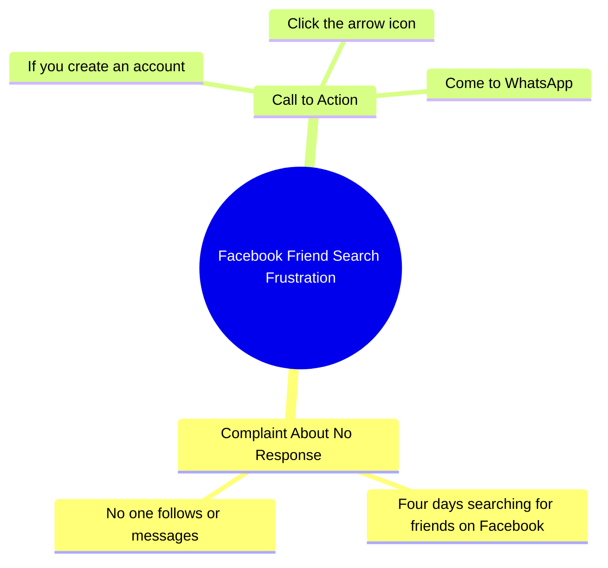

# Woman Seeking Facebook Friends in Urdu Video

> 🌐 **Read this in:** [English](../../en/2026-10/tiktok-transcript-6-4m-views-206k-reactions-wafa-world-facebookreelsviral-reel-e5e4.md) · **中文**

> **Creator:** [@Sujata ](https://www.tiktok.com/@Sujata ) · **Views:** 2.3M · **Posted:** 2026-10-17 · **Niche:** entertainment
>
> **TL;DR:** The taunt 'no son of a mother has guts' dares viewers while framing a relatable social-media frustration, pulling them in to prove themselves.

[Watch original video →](https://www.facebook.com/share/r/1DeVhxjQ1C/)

## Why This Went Viral

## 钩子（前3秒）
- **逐字开场白：**“लगता है किसी मा के लाल में दम नहीं है।”（“看来没有哪个母亲的儿子有胆量。”）
- **钩子模式：** **挑衅／挑战＋侮辱式引战**——直接针对观众自尊心的挑逗，包裹在一个文化负载很重的习语里（“मा के लाल”＝“母亲的儿子”，经典的激将法）。
- **为什么能让人停下滚动：** 这是针对个人的挑战。大脑会条件反射地回答“谁，我？”，然后观众会等着听挑战是什么。这个印地语习语传递出一种有共鸣的、地域性的、口语化的语域——瞬间让人觉得“这就是给我这样的人看的”，从而筛选出高互动的本土受众。

## 情绪节奏
- **第1拍——挑衅（0–2秒）：** 挑逗制造出轻微的不满＋好奇（“什么挑战？”）。
- **第2拍——坦白／脆弱（2–6秒）：** “चार दिन से फेस्बुक पे दोस्ट ढून रही हूं”——语气从咄咄逼人翻转为渴求。这种反差（狠话→孤独的恳求）就是引擎。
- **第3拍——紧张／被拒（6–9秒）：** “कोई फॉलो करके मेसेज ही नहीं कर रहा है”——社交拒绝，一种普遍能引起共鸣的刺痛。
- **第4拍——行动号召／提供解决方案（9–12秒）：** “तीर वाले पे क्लिक करके वाट्साप पे आओ”——一个清晰、具体的指令，把情绪转化为行动。
- **高潮：** 转折句——挑逗崩塌为“没人在给我发消息”的那一刻。情绪急转直下就在这里落地，也是评论者感到不得不回应的地方。
- **反转：** 咄咄逼人的开场被揭示为*孤独的伪装*——一种调包计，让观众感到自己被选中／被需要。

## 关键词密度
- **मा के लाल**（母亲的儿子）——情绪拉力＋文化认同
- **दम नहीं**（没胆量）——挑战框架，激发评论区的反抗
- **फेस्बुक**（Facebook）——平台关键词，算法触达
- **दोस्ट**（朋友）——情绪拉力，共鸣感
- **फॉलो**（关注）——平台／互动关键词，算法触达
- **मेसेज**（消息）——互动关键词
- **तीर**（箭头／点击箭头）——CTA关键词，驱动站外转化
- **वाट्साप**（WhatsApp）——转化关键词，漏斗信号

**触达驱动词：** फेस्बुक、फॉलो、मेसेज、वाट्साप——平台＋行动词，算法和评论区行为会奖励这些词。
**情绪驱动词：** मा के लाल、दम नहीं、दोस्ट——这些制造了人性的刺痛和人们回复的理由。

## 为什么它会传播
- **自尊心诱饵迫使回复。**“किसी मा के लाल में दम नहीं है”是一个激将。观众评论是为了证明他们*确实*有胆量——评论区成了产品，而评论是最强的分发信号。
- **从攻击到脆弱的急转具有分享性。**“चार दिन से... कोई फॉलो करके मेसेज ही नहीं कर रहा है”这句话把强硬的开场重新定义为孤独。人们分享那些让他们感到被看见、而不只是被娱乐的东西。
- **这是一笔身份交易，不是广告。**“तीर वाले पे क्लिक करके वाट्साप पे आओ”把CTA框定为*观众在帮创作者一个忙*——低压力、高配合度，而且它把流量引到站外，可以在那里再次营销。
- **文化习语＝部落筛选器。**“मा के लाल”标出了确切的人群和语言社群，所以算法会找到一个紧密、高亲和力的集群，其互动率远超平均。
- **短、可循环、可重看。** 不到约12秒，有干净的三拍弧线（挑逗→恳求→CTA）——观众会重看以捕捉那个转折，提升观看完成率。

## 你可以借鉴什么
1. **用激将开场，而不是描述。** 用一句让观众自尊心抽动的话开场（“这里没人有胆量……”）——前2秒的挑衅胜过任何铺垫。
2. **在视频中途翻转语气。** 把大胆／攻击性的开场与脆弱的坦白配对。被分享和评论的是这种急转，而不是笑话本身。
3. **让CTA感觉像帮忙，并点明确切动作。**“点击箭头，来WhatsApp”——一个动词，一个目的地，框定为在帮*你*。具体能转化；含糊会死。

## Mind Map

## Full Transcript (Generated by [免费 TikTok 文稿生成器](https://toktranscript.com/?utm_source=github&utm_medium=breakdown&utm_campaign=tool_attribution))

> 📝 Transcripts on this page are auto-generated and show the first 60%. Want to transcribe any TikTok in 30 seconds and get the full version? [Try TokTranscript free →](https://toktranscript.com/?utm_source=github&utm_medium=breakdown&utm_campaign=transcript_cta)

लगता है किसी मा के लाल में दम नहीं है। चार दिन से फेस्बुक पे दोस्ट ढून रही हूं, कोई फॉलो करके मेसेज ही 

*[Read the full transcript on TokTranscript →](https://toktranscript.com/plaza/tiktok-transcript-6-4m-views-206k-reactions-wafa-world-facebookreelsviral-reel-e5e4?utm_source=github&utm_medium=breakdown&utm_campaign=transcript_full)*

## Browse More

- All [entertainment](../../by-niche/zh-CN/entertainment.md) breakdowns
- All [Provocative Taunt + Complaint](../../by-pattern/zh-CN/hook-provocative-taunt-complaint.md) examples

## Video Info

| | |
|---|---|
| Creator | [@Sujata ](https://www.tiktok.com/@Sujata ) |
| Original video | [https://www.facebook.com/share/r/1DeVhxjQ1C/](https://www.facebook.com/share/r/1DeVhxjQ1C/) |
| Original title | 6.4M views · 206K reactions | Wafa World 🥀 #facebookreelsviral #reelsfb #trendingreelsvideo #reelsvideo #shortvideofbreels #viralvideo #explore #dosti #friendshipgoals #OnlineDosti #DesiVibe #urdupostdaily #followformore | Sujata |
| Views | 2.3M (2346635) |
| Posted | 2026-10-17 |
| Duration | 0s |
| Niche | `entertainment` |
| Hook pattern | `Provocative Taunt + Complaint` |
| Original language | `en` (this page translated by AI) |
| Available languages | en, zh-CN |
| Generated | 2026-10-18 by [TokTranscript](https://toktranscript.com/) |

---

*This breakdown is for educational analysis under fair use. Original video © [@Sujata ](https://www.tiktok.com/@Sujata ). All transcripts are auto-generated and may contain errors.*

*Want to analyze your own TikToks like this? [TokTranscript 转录工具 →](https://toktranscript.com/viral-breakdown?utm_source=github&utm_medium=breakdown&utm_campaign=footer_cta)*