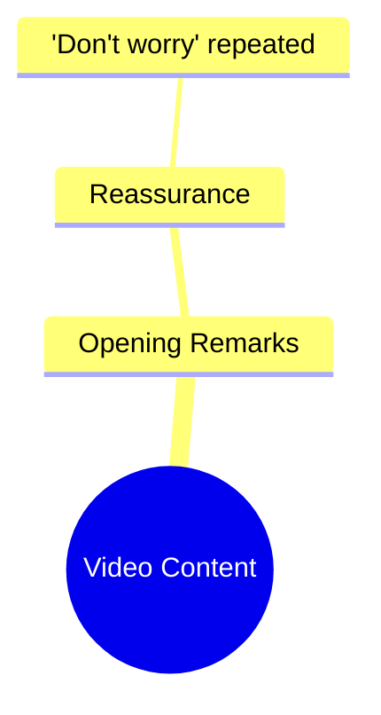

# Ramez Galal Explains His New Show Idea

> 🌐 **Read this in:** [English](../../en/2026-10/tiktok-transcript-6-5m-views-80k-reactions-ramez-galal-b69a.md) · **中文**

> **Creator:** [@Ramez Galal](https://www.tiktok.com/@Ramez Galal) · **Views:** 3.3M · **Posted:** 2026-10-10 · **Niche:** entertainment
>
> **TL;DR:** The hook offers immediate emotional comfort through repetition, creating a soothing effect that resonates with stressed viewers.

[Watch original video →](https://www.facebook.com/share/r/19NEVVbjVk/)

## Why This Went Viral

## 钩子（前3秒）
- 整个开场就是一句重复的话：“No te preocupes, no te preocupes”（“别担心，别担心”），在文字稿中出现了两次，没有铺垫、没有上下文、也没有视觉描述。
- 这是一个**安抚／安慰型钩子**——“情感承诺”模式的一个子类型，创作者用安抚性语言开场，而不是用主张或提问。
- 它能让人停下滑动，因为它与通常那种高音量、高能量的短视频开场截然相反。重复传递出亲密与平静，让视频看起来“安全”——而那些焦虑、疲惫或正在无意识刷屏的观众，会被“接下来会有让人安心的话”这一隐含承诺吸引进来。

## 情绪节奏
- **第1拍——好奇＋即时安慰：** 重复的“no te preocupes”制造了一个小悖论——我还不知道自己在担心什么，你为什么先告诉我别担心？
- **第2拍——预期中的张力：** 因为这句话被重复了，观众会等待那个“但是”或揭晓。重复本身就在积累一种低强度的悬念。
- **第3拍——共鸣：** 这句话听起来具有普遍性。任何观看的人都会把自己的担忧投射进去，从而把一句泛泛之语变成一条私人讯息。
- **高潮：** 第二句“no te preocupes”——重复本身就是高潮。没有反转，没有包袱；情绪顶点就是这份反复强调的安慰。
- **收束：** 释然／宣泄，靠的是语气和重复，而不是新信息。

## 关键词密度
- “No te preocupes”（主导，重复出现）
- “preocupes”（词根，显著度高）
- “no”（否定词，承载安慰）
- “te”（第二人称，让表达直接而私人）
- 隐含：担忧／平静／安慰（语义场，即使没有字面重复）

- **算法传播驱动力：** “No te preocupes”在西班牙语身心健康和励志内容中是高搜索、高收藏短语。它简短、可引用、适合做字幕，从而提升分享和收藏。
- **情绪拉动驱动力：** “te”和“no”——直接称呼加上否定——承担了情绪工作。它们让观众感觉被单独对话，从而推动“lo necesitaba”这类评论。

## 为什么它会传播
- **它把普遍的情绪触发点压缩成一句话。** “No te preocupes”对任何人都适用，在任何语境中都成立，这最大化了可触达受众——与垂直细分内容正好相反。
- **重复带来记忆点和可分享性。** 重复的短语容易被引用、做字幕或拼接，这降低了二次创作和合拍形式的门槛。
- **它是一条“收藏并转发”的视频。** 人们不只是喜欢它——他们会把它发给压力大的朋友，而这是短视频平台上最强的分发信号之一。
- **缺乏上下文是特性，不是缺陷。** 因为没有具体故事，每个观众都会补上自己担忧的理由，这让安慰显得像是量身定制。
- **它契合“安慰内容”浪潮。** 简短、柔和、低制作的安慰视频在某些情绪细分领域会胜过高能量内容，因为它们匹配观众凌晨1点时的真实心情。

## 你可以借鉴什么
- **用情绪回报开场，而不是用铺垫开场。** 把你通常会留到结尾的那句话——“No te preocupes”——放到开头，让视频其余部分来证明它。
- **使用直接称呼＋否定。** “You don't have to…”“No te…”“You're not…”——第二人称加否定会立刻制造亲密感，感觉像一条私人讯息。
- **把核心句子重复一次。** 一次重复就能把一句话变成箴言，使它可引用、可收藏、可转发——这三种行为正是短视频传播的驱动力。

## Mind Map

## Full Transcript (Generated by [免费 TikTok 文稿生成器](https://toktranscript.com/?utm_source=github&utm_medium=breakdown&utm_campaign=tool_attribution))

> 📝 Transcripts on this page are auto-generated and show the first 60%. Want to transcribe any TikTok in 30 seconds and get the full version? [Try TokTranscript free →](https://toktranscript.com/?utm_source=github&utm_medium=breakdown&utm_campaign=transcript_cta)

No te preocupes, no

*[Read the full transcript on TokTranscript →](https://toktranscript.com/plaza/tiktok-transcript-6-5m-views-80k-reactions-ramez-galal-b69a?utm_source=github&utm_medium=breakdown&utm_campaign=transcript_full)*

## Browse More

- All [entertainment](../../by-niche/zh-CN/entertainment.md) breakdowns
- All [Reassurance Repetition](../../by-pattern/zh-CN/hook-reassurance-repetition.md) examples

## Video Info

| | |
|---|---|
| Creator | [@Ramez Galal](https://www.tiktok.com/@Ramez Galal) |
| Original video | [https://www.facebook.com/share/r/19NEVVbjVk/](https://www.facebook.com/share/r/19NEVVbjVk/) |
| Original title | 6.5M views · 80K reactions | لكل الي عايز يعرف فكرة برنامجي الجديد 👀 اديني شرحتها اهو 😂.. ابقوا قابلوني لو فهمتوا 😂😂 | Ramez Galal |
| Views | 3.3M (3321932) |
| Posted | 2026-10-10 |
| Duration | 0s |
| Niche | `entertainment` |
| Hook pattern | `Reassurance Repetition` |
| Original language | `en` (this page translated by AI) |
| Available languages | en, zh-CN |
| Generated | 2026-10-11 by [TokTranscript](https://toktranscript.com/) |

---

*This breakdown is for educational analysis under fair use. Original video © [@Ramez Galal](https://www.tiktok.com/@Ramez Galal). All transcripts are auto-generated and may contain errors.*

*Want to analyze your own TikToks like this? [TokTranscript 转录工具 →](https://toktranscript.com/viral-breakdown?utm_source=github&utm_medium=breakdown&utm_campaign=footer_cta)*