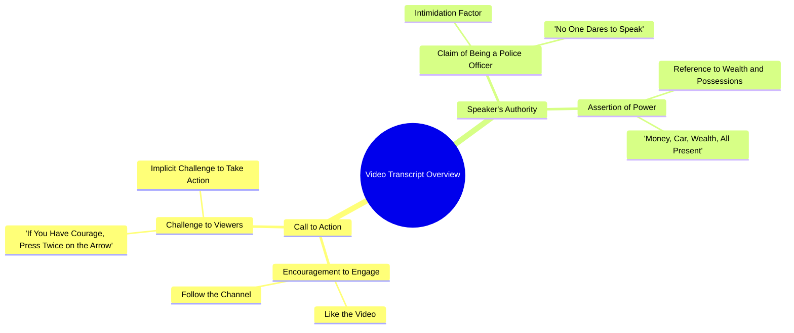

# Woman Police Officer Challenges Viewers to Follow

> 🌐 **Read this in:** [English](../../en/2026-10/tiktok-transcript-6-8m-views-237k-reactions-wafa-world-facebookreelsviral-reel-3db9.md) · **中文**

> **Creator:** [@Saloni Yadav](https://www.tiktok.com/@Saloni Yadav) · **Views:** 2.4M · **Posted:** 2026-10-11 · **Niche:** entertainment
>
> **TL;DR:** The hook leverages the speaker's police identity to assert dominance and challenge viewers, creating immediate intrigue and fear.

[Watch original video →](https://www.facebook.com/share/r/19w73eWKgm/)

## Why This Went Viral

## 钩子（前3秒）
- 逐字开场白：“करना तो सब चाहते हैं, पुलिस वाली हूँ इसलिए किसी की हिम्मत नहीं होती बोलने की”
- 钩子模式：**大胆断言 + 禁忌挑逗 + 权威炫耀**（一个“禁忌告白”式设定）
- 为什么能阻止划走：它暗示了一个人人都想要但没人敢说的秘密——而说话者声称拥有让他们闭嘴的权力（警察）。好奇 + 权威 + 轻微丑闻，一口气全有。

## 情绪节奏
- **第1拍 – 好奇/兴趣：**“人人都想做”——打开一个循环，观众会问*“它”是什么？*
- **第2拍 – 权威/紧张：**“我是女警察，所以没人敢说”——提高赌注，加入恐惧和权力。
- **第3拍 – 地位炫耀（共鸣/向往）：**“钱、车、财富，什么都有”——释放成功信号，激发嫉妒/向往。
- **第4拍 – 挑战/反转（高潮）：**“有胆就关注并双击箭头”——把权力动态翻转给观众；这个挑战*就是*高潮。
- **第5拍 – 回报挑逗：**“然后我们聊聊”——吊着承诺，让他们继续看/评论。
- 高潮落在挑战上：“हिम्मत है तो फॉलो करके... दो बार दबाओ。”

## 关键词密度
- 最强重复/高负载词：**हिम्मत**（勇气）、**पुलिस**（警察）、**पैसा/धन/दौलत**（钱/财富）、**गाड़ी**（车）、**सब**（所有人/全部）、**फॉलो**（关注）、**दो बार दबाओ**（双击）、**बात करते हैं**（我们聊聊）。
- **算法触达驱动词：**“फॉलो”、“दो बार दबाओ”、“बात करते हैं”——直接CTA，会拉高关注、点赞和评论（互动信号）。
- **情绪拉动驱动词：**“हिम्मत”、“पुलिस”、“पैसा/धन/दौलत”——权力、恐惧、向往和禁忌，让人*有感觉*并作出反应。

## 为什么会传播
- **权威 + 禁忌组合：**“पुलिस वाली हूँ... किसी की हिम्मत नहीं होती बोलने की”——一种禁忌发声框架，让片段显得独家、可分享。
- **向往诱饵：**“पैसा, गाड़ी, धन, दौलत सब है”——财富信号吸引广泛追逐地位的受众。
- **挑战式CTA：**“हिम्मत है तो फॉलो करके तीर के निशान पे दो बार दबाओ”——把点赞/关注重新定义为勇气测试，于是互动感觉像在证明自己。
- **开放循环/悬念：**“फिर बात करते हैं”——扣住回报，驱动评论（“聊什么？”）和重复观看。
- **短、狠、零废话：**每一句都在升级——没有填充，所以完播率能一直保持到最后。

## 你可以偷什么
- **用与身份绑定的禁忌/内部人式断言开场**（“我是___，所以没人敢说这个”），制造即时好奇。
- **把CTA变成挑战或身份测试**——“有胆就关注并双击”比“请点赞订阅”转化更好。
- **用开放循环收尾**（“然后我们聊聊”），钓评论，让观众等下一支视频。

## Mind Map

## Full Transcript (Generated by [TokTranscript 转录工具](https://toktranscript.com/?utm_source=github&utm_medium=breakdown&utm_campaign=tool_attribution))

> 📝 Transcripts on this page are auto-generated and show the first 60%. Want to transcribe any TikTok in 30 seconds and get the full version? [Try TokTranscript free →](https://toktranscript.com/?utm_source=github&utm_medium=breakdown&utm_campaign=transcript_cta)

करना तो सब चाहते हैं, पुलिस वाली हूँ इसलिए किसी की हिम्मत नहीं होती बोलने की, पैसा, गाड़ी, धन, दौलत सब है

*[Read the full transcript on TokTranscript →](https://toktranscript.com/plaza/tiktok-transcript-6-8m-views-237k-reactions-wafa-world-facebookreelsviral-reel-3db9?utm_source=github&utm_medium=breakdown&utm_campaign=transcript_full)*

## Browse More

- All [entertainment](../../by-niche/zh-CN/entertainment.md) breakdowns
- All [Authority Challenge](../../by-pattern/zh-CN/hook-authority-challenge.md) examples

## Video Info

| | |
|---|---|
| Creator | [@Saloni Yadav](https://www.tiktok.com/@Saloni Yadav) |
| Original video | [https://www.facebook.com/share/r/19w73eWKgm/](https://www.facebook.com/share/r/19w73eWKgm/) |
| Original title | 6.8M views · 237K reactions | Wafa World 🥀 #facebookreelsviral #reelsfb: #trendingreelsvideo #reelsvideo: #shortvideofbreels #viralvideo: #explore #dostii #friendshipgoals #OnlineDosti #DesiVibe #urdupostdaily #followformore | Saloni Yadav |
| Views | 2.4M (2365552) |
| Posted | 2026-10-11 |
| Duration | 0s |
| Niche | `entertainment` |
| Hook pattern | `Authority Challenge` |
| Original language | `en` (this page translated by AI) |
| Available languages | en, zh-CN |
| Generated | 2026-10-12 by [TokTranscript](https://toktranscript.com/) |

---

*This breakdown is for educational analysis under fair use. Original video © [@Saloni Yadav](https://www.tiktok.com/@Saloni Yadav). All transcripts are auto-generated and may contain errors.*

*Want to analyze your own TikToks like this? [免费 TikTok 文稿生成器 →](https://toktranscript.com/viral-breakdown?utm_source=github&utm_medium=breakdown&utm_campaign=footer_cta)*