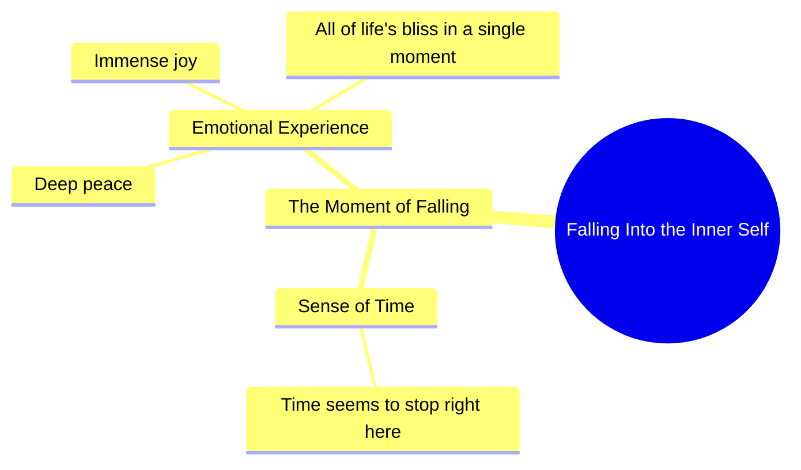

# Quiet Moment of Inner Peace and Joy

> 🌐 **Read this in:** [English](../../en/2026-10/tiktok-transcript-793k-views-16k-reactions-wafa-world-facebookreels-reels-tren-48f6.md) · **中文**

> **Creator:** [@rani ji ](https://www.tiktok.com/@rani ji ) · **Views:** 271.0K · **Posted:** 2026-10-18 · **Niche:** entertainment
>
> **TL;DR:** The hook uses vivid sensory language and a relatable feeling of time stopping to create an emotional connection and curiosity about the experience.

[Watch original video →](https://www.facebook.com/share/r/18Zf92QGWp/)

## Why This Went Viral

## 钩子（前3秒）
- **逐字开场白：** “जब अंदर गिरता है न, तो लगता है समय यहीं पे रुख जाए.”
- **钩子模式：** 感官场景 + 未解明的“它”（好奇心缺口）。“अंदर गिरता है”这个说法刻意隐去了*什么*在坠落——观众的大脑必须留下来才能解开这个模糊之处。
- **为什么能让人停下滚动：** 它从体验中途开始，而非从背景开始。悬置的主语（“它”）加上缓慢、私密的表达方式，制造了一个观众需要闭合的信息缺口，而“समय रुक जाए”（时间停止）的承诺则暗示着情感回报即将到来。

## 情感节奏
- **0–2秒——好奇：** 模糊的“अंदर गिरता है”迫使观众追问*什么在坠落？*
- **2–4秒——期待：** “समय यहीं पे रुक जाए”引入了一个停顿/静止的节拍——节奏本身慢了下来。
- **4–6秒——温暖/共鸣：** “इतना सुकून, इतनी खुशी”叠加了两个积极情感词，释放了先前的张力。
- **6–8秒——高潮：** “जिन्दगी का सारा आनंद एक पल में मिल गया हो”——情感峰值，将单一瞬间普遍化为定义人生的时刻。
- **反转/悬念：** 没有反转——这个视频的力量在于*持续的共鸣*，而非逆转。悬念完全前置在被隐去的主语中。
- **高潮时刻：** 最后一句，将一种私密感受重新定义为“一生所有的欢乐在一瞬间”。

## 关键词密度
- **अंदर**（里面）——情感牵引；亲密感
- **गिरता**（坠落）——好奇心锚点；驱动反复观看以解码
- **समय / पल**（时间/瞬间）——情感牵引；视频的核心主题
- **सुकून**（平静）——情感牵引；高收藏触发词
- **खुशी**（快乐）——情感牵引
- **जिन्दगी / आनंद**（生活/欢乐）——情感牵引；拓宽共鸣面
- **算法驱动因素：** “सुकून”“खुशी”“जिन्दगी”是印地语短视频中高搜索、高分享的情绪词——它们将视频推入平静/共鸣/励志类信息流。
- **情感驱动因素：** “अंदर गिरता”和“एक पल”——神秘感与亲密感才是让人们*感受*而非仅仅*找到*视频的原因。

## 为什么它会传播
- **第一句中的刻意模糊**（“जब अंदर गिरता है न”）——观众评论“क्या गिरता है?”，这助推了评论区互动和反复观看循环。
- **普遍却私密的框架**——“इतना सुकून, इतनी खुशी”让每位观众将自己的记忆投射其上，最大化向特定人群的分享（“这让我想起了你”）。
- **升级到人生尺度的断言**——“जिन्दगी का सारा आनंद एक पल में”将一个小瞬间转化为可分享的哲理，是那种人们会截图转发的句子。
- **口语化节奏与自然停顿**（“गिरता है”之后的“न”）创造了一个模仿真实说话的呼吸感——感觉是在倾诉，而非表演，这降低了信任与分享的门槛。
- **简短、可引用的长度**——整个文稿约30个词；它可以完全作为文字/引语再分享，将传播范围延伸到视频之外。

## 你可以借鉴的
1. **以悬置的主语开场。** 从动作中途开始，用一个未解明的“它/这个”，让前3秒制造一个观众必须留下来回答的问题。
2. **在回报句之前叠加两个情感词。** 将一个平静词与一个欢乐词配对（“सुकून… खुशी”）以释放张力，然后落下一句单一的普遍化断言。
3. **为截图而写。** 精心打造一句（“सारा आनंद एक पल में”）能独立作为引语的句子——它将成为你的免费分发渠道。

## Mind Map

## Full Transcript (Generated by [TikTok 转录工具](https://toktranscript.com/?utm_source=github&utm_medium=breakdown&utm_campaign=tool_attribution))

> 📝 Transcripts on this page are auto-generated and show the first 60%. Want to transcribe any TikTok in 30 seconds and get the full version? [Try TokTranscript free →](https://toktranscript.com/?utm_source=github&utm_medium=breakdown&utm_campaign=transcript_cta)

जब अंदर गिरता है न, तो लगता है समय यहीं पे रुख जाए. इतना सुकून, इतनी खुशी

*[Read the full transcript on TokTranscript →](https://toktranscript.com/plaza/tiktok-transcript-793k-views-16k-reactions-wafa-world-facebookreels-reels-tren-48f6?utm_source=github&utm_medium=breakdown&utm_campaign=transcript_full)*

## Browse More

- All [entertainment](../../by-niche/zh-CN/entertainment.md) breakdowns
- All [Sensory Immersion + Time-Stop Promise](../../by-pattern/zh-CN/hook-sensory-immersion-time-stop-promise.md) examples

## Video Info

| | |
|---|---|
| Creator | [@rani ji ](https://www.tiktok.com/@rani ji ) |
| Original video | [https://www.facebook.com/share/r/18Zf92QGWp/](https://www.facebook.com/share/r/18Zf92QGWp/) |
| Original title | 793K views · 16K reactions | Wafa World 🥀 #FacebookReels #Reels #TrendingReels #ReelsVideo #ShortVideo #ViralVideo #Explore #ForYou #Dosti #Friendship #OnlineDosti #DesiVibes #UrduPosts #FollowForMore | rani ji |
| Views | 271.0K (270958) |
| Posted | 2026-10-18 |
| Duration | 0s |
| Niche | `entertainment` |
| Hook pattern | `Sensory Immersion + Time-Stop Promise` |
| Original language | `en` (this page translated by AI) |
| Available languages | en, zh-CN |
| Generated | 2026-10-21 by [TokTranscript](https://toktranscript.com/) |

---

*This breakdown is for educational analysis under fair use. Original video © [@rani ji ](https://www.tiktok.com/@rani ji ). All transcripts are auto-generated and may contain errors.*

*Want to analyze your own TikToks like this? [免费 TikTok 文稿生成器 →](https://toktranscript.com/viral-breakdown?utm_source=github&utm_medium=breakdown&utm_campaign=footer_cta)*