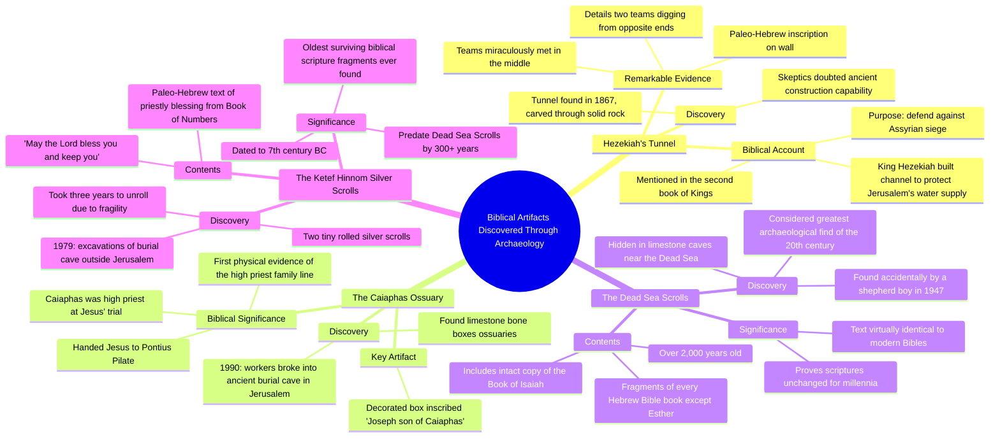

# Biblical Artifacts Actually Found: Hezekiah's Tunnel

> 🌐 **Read this in:** [English](../../en/2026-10/tiktok-transcript-796k-views-48k-reactions-things-from-the-bible-that-have-act-b181.md) · **中文**

> **Creator:** [@History Decoded](https://www.tiktok.com/@History Decoded) · **Views:** 448.7K · **Posted:** 2026-10-17 · **Niche:** entertainment
>
> **TL;DR:** The hook creates a strong curiosity gap by teasing a record-breaking discovery while promising a list of tangible biblical artifacts.

[Watch original video →](https://www.facebook.com/share/v/1LrZMuCrBE/)

## Why This Went Viral

## 钩子（前3秒）
- “圣经中真实被发现的物品。最后一项发现给了我们有史以来现存最古老的圣经残片。”
- **清单+开放式循环钩子**（用最高级预告制造好奇心缺口）
- 它为一个高风险主张（“真实被发现”）承诺可验证的证据，并立即扣住最好的项目（“最后一项发现”），迫使观众留下来看到回报。

## 情绪节奏
- **好奇**——“真实被发现”将视频框定为证据与怀疑的对决。
- **怀疑→验证**——希西家隧道：“怀疑者曾质疑……然而在1867年，探险者发现了实际的隧道。”反复的怀疑-然后-证明循环。
- **敬畏**——“两队石匠从相反两端开凿，奇迹般地在中间会合。”
- **切实的利害关系**——该亚法骨灰盒：“将一个重要的圣经人物变成历史中切实可触的一部分。”
- **权威/可信度飙升**——死海古卷：“20世纪最伟大的考古发现”，“几乎完全相同。”
- **微张力/留存重置**——“在我揭晓最后一个之前，请务必点一下关注按钮。”（在视频中途重新打开循环）
- **高潮**——银卷轴：“人类历史上发现的最古老的圣经经文残片”，前面有“花了三年才将它们展开”的延迟铺垫。
- **共鸣式收尾**——逐字引用祭司祝福（“愿耶和华赐福给你，保护你”）在情感上落地，然后是一个提问式CTA。

## 关键词密度
- **Bible / biblical**（最高频——核心主题锚点）
- **Discovered / found / uncovered**
- **Ancient**（ancient city、ancient burial cave、ancient manuscripts、ancient Paleo-Hebrew）
- **Oldest / first / ever**（最高级词簇）
- **Inscription / text / scrolls**
- **Jerusalem**
- **Skeptics doubted → proved**
- **History / human history**
- 算法触达驱动词：*Bible、discovered、ancient、oldest、Jerusalem*——高搜索量、高身份认同度的词，同时吸引宗教受众和历史/考古受众。
- 情感拉动驱动词：*miraculously、skeptics doubted、tangible、oldest ever、bless you and keep you*——这些将好奇心转化为分享和评论。

## 为什么它会传播
- **带有具名回报的开放式循环**——“最后一项发现给了我们有史以来现存最古老的圣经残片”制造了一笔观众必须看到结尾才能偿还的债；视频中途的“在我揭晓最后一个之前……”重新收紧了它。
- **怀疑-然后-证明模式重复3次**——“怀疑者曾质疑这样的隧道能否建成……然而在1867年，探险者发现了实际的隧道”——每个循环都带来一次小型多巴胺冲击，保持高留存率。
- **编号清单结构**——“第1个……第2个……第3个……第4个”给观众一个清晰的进度条，减少流失，因为结尾感觉近且可数。
- **为热情细分群体提供身份认同+证据**——“证明圣经经文数千年来保持不变”给宗教受众提供了可分享的弹药；考古学框架也招募了怀疑者和历史爱好者。
- **高潮处的情感载荷**——在“人类历史上发现的最古老残片”之后紧接着引用“愿耶和华赐福给你，保护你”，让结尾感觉个人化，驱动收藏和评论（“这些当中……你觉得哪个最引人入胜？”）。

## 你可以借鉴什么
- **前置一个最高级开放式循环**——以“最后一个是有史以来发现的[最大/最古老/第一个]”开场，并在视频中途明确重新预告它以重置留存。
- **把怀疑→证明节拍当作你的引擎**——陈述怀疑者的反对意见，然后是解决它的发现；每个视频重复3–4次。
- **以可引用的情感句结尾，而不是事实**——在提出一个低摩擦问题来收割评论之前，用一句简短的人性化短语（一句祝福、一句引言、一句金句）收尾。

## Mind Map

## Full Transcript (Generated by [免费 TikTok 文稿生成器](https://toktranscript.com/?utm_source=github&utm_medium=breakdown&utm_campaign=tool_attribution))

> 📝 Transcripts on this page are auto-generated and show the first 60%. Want to transcribe any TikTok in 30 seconds and get the full version? [Try TokTranscript free →](https://toktranscript.com/?utm_source=github&utm_medium=breakdown&utm_campaign=transcript_cta)

Things from the Bible that have actually been found. The last discovery gives us the oldest surviving piece of the Bible ever found. Number 1. Hezekiah's Tunnel. Beneath the ancient city of Jerusalem lies an incredible engineering marvel known as Hezekiah's Tunnel. Mentioned in the second book of Kings, the Bible states that King Hezekiah constructed a massive underground channel to protect Jerusalem's water supply from an impending Assyrian siege. For a long time skeptics doubted whether such a tunnel could be built in ancient times. However in 1867 explorers discovered the actual tunnel carved entirely through solid rock. Even more amazing, an ancient Paleo-Hebrew inscription was found on the wall, detailing exactly how two teams of stonecutters dug from opposite ends and miraculously met in the middle. Number 2, The Caiaphas Ossuary In 1990, workers constructing a park in Jerusalem accidentally broke through the roof of an ancient burial cave. Inside archaeologists discovered a collection of limestone bone boxes, known as ossuaries. One beautifully decorated box immediately caught their attention bearing the inscription Joseph son of Caiaphas. According to the New Testament Caiaphas was the powerful high priest who presided over the trial of Jesus and handed him over to Pontius Pilate. This discovery provided the first direct physical evidence of the high priest family line turning a prominent biblical figure into a tangible part of history Number 3 the Dead Sea Scrolls Discovered entirely by accident by a young shepherd boy in 1947 the Dead Sea Scrolls are widely considered the greatest archaeological find of the 20th century. Hidden away in remote limestone caves near the Dead Sea, these ancient manu

*[Read the full transcript on TokTranscript →](https://toktranscript.com/plaza/tiktok-transcript-796k-views-48k-reactions-things-from-the-bible-that-have-act-b181?utm_source=github&utm_medium=breakdown&utm_campaign=transcript_full)*

## Browse More

- All [entertainment](../../by-niche/zh-CN/entertainment.md) breakdowns
- All [Curiosity Gap + Record-Breaking Tease](../../by-pattern/zh-CN/hook-curiosity-gap-record-breaking-tease.md) examples

## Video Info

| | |
|---|---|
| Creator | [@History Decoded](https://www.tiktok.com/@History Decoded) |
| Original video | [https://www.facebook.com/share/v/1LrZMuCrBE/](https://www.facebook.com/share/v/1LrZMuCrBE/) |
| Original title | 796K views · 48K reactions | Things from the Bible That Have Actually Been Found. . . . #history #DidYouKnow #historylovers #historyfacts #historymatters @followers @top fans #bible | History Decoded |
| Views | 448.7K (448707) |
| Posted | 2026-10-17 |
| Duration | 0s |
| Niche | `entertainment` |
| Hook pattern | `Curiosity Gap + Record-Breaking Tease` |
| Original language | `en` (this page translated by AI) |
| Available languages | en, zh-CN |
| Generated | 2026-10-19 by [TokTranscript](https://toktranscript.com/) |

---

*This breakdown is for educational analysis under fair use. Original video © [@History Decoded](https://www.tiktok.com/@History Decoded). All transcripts are auto-generated and may contain errors.*

*Want to analyze your own TikToks like this? [免费 TikTok 文稿生成器 →](https://toktranscript.com/viral-breakdown?utm_source=github&utm_medium=breakdown&utm_campaign=footer_cta)*