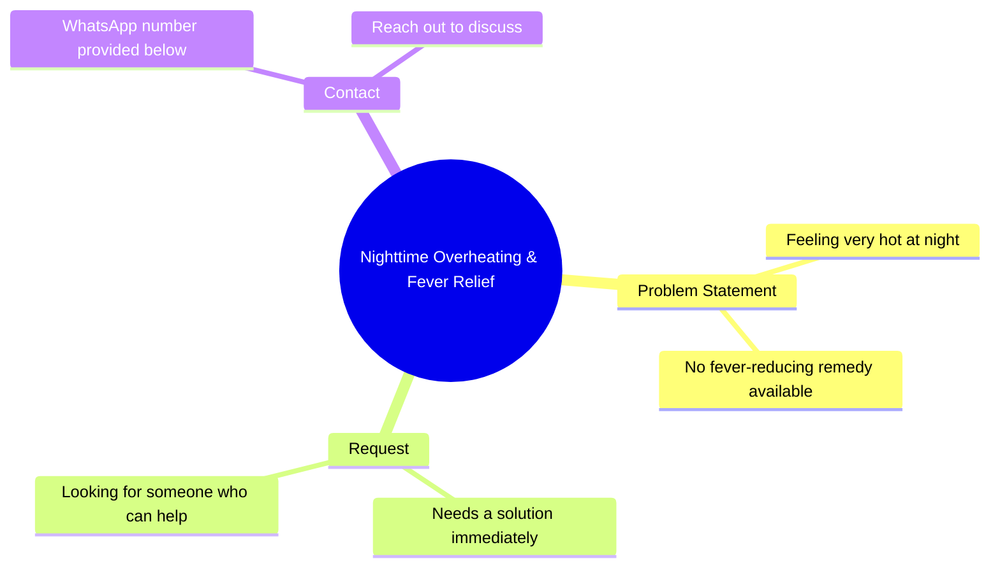

# Bank-Seized Fortuner & Scorpio at Lowest Prices

> 🌐 **Read this in:** [English](../../en/2026-10/tiktok-transcript-898k-views-26k-reactions-whatsapp-https-whatsapp-openinapp-l-b23f.md) · **中文**

> **Creator:** [@REENA DEVI](https://www.tiktok.com/@REENA DEVI) · **Views:** 337.3K · **Posted:** 2026-10-17 · **Niche:** other
>
> **TL;DR:** Opens with an intimate bodily confession that creates curiosity, then pivots to a relatable unmet need for a fix.

[Watch original video →](https://www.facebook.com/share/r/14tCE2Hr3Qi/)

## Why This Went Viral

## 钩子（前3秒）
- 逐字开场：“मैं रात में बहुत गरम हो जाती हूं लेकिन बुखार ठीक करने वाला कोई नहीं मिलता है”（“我夜里浑身发烫，却没有人来退烧”）。
- 钩子模式：**第一人称自白 + 脆弱反差**（把身体/情感需求说成一个无解的问题）。
- 为什么能让人停下滚动：它从亲密感中间切入——一句私人的、略带模糊的抱怨（“我夜里浑身发烫”），既可读作健康求助，也可读作孤独自白。这种模糊性迫使大脑去解开它，而“没有人在”这句瞬间触发共情。观众留下来是为了弄清*她是谁*、*她想要什么*。

## 情绪节奏
- **好奇（0–3秒）：** 模糊的“我夜里浑身发烫”——这是医学问题？情感问题？还是性暗示？大脑需要闭合。
- **张力（3–7秒）：** “没有人来退烧”——孤立、需求未被满足。观众感受到那道缺口。
- **转折/行动号召（7–10秒）：** “我现在就需要一个人——我把WhatsApp放在下面了，来告诉我。”需求转化为公开邀请。
- **共鸣：** 孤独 + 健康脆弱是普遍的深夜感受；直接称呼（“来告诉我”）让观众成为解决方案。
- **高潮：** 抛出WhatsApp——情感恳求坍缩成交易性CTA。这种突兀转变就是可分享的“等等，什么？”时刻。
- **反转：** 铺垫暗示的是医学/情感自白；回报却是联系方式招揽。这种错位正是人们截图转发的东西。

## 关键词密度
- **रात में**（“在夜里”）——情感牵引；设定亲密、孤独的框架。
- **बहुत गरम**（“非常烫”）——好奇驱动；模糊、高评论诱饵。
- **बुखार**（“发烧”）——算法触达；健康相关关键词拉来广泛的搜索/诊断受众。
- **कोई नहीं**（“没有人”）——情感牵引；孤立信号。
- **एक साथ ही चाहिए**（“现在就需要”）——紧迫感；驱动私信/评论行动。
- **वाटसप**（“WhatsApp”）——转化关键词；站外漏斗信号。
- **आके बताओ**（“来告诉我”）——互动驱动；明确CTA。
- 算法触达：*बुखार、रात、वाटसप*（健康 + 时间 + 平台 = 广泛主题匹配）。情感牵引：*गरम、कोई नहीं、चाहिए*（脆弱 + 紧迫）。

## 为什么会传播
- **模糊性作为评论引擎：** “रात में बहुत गरम हो जाती हूं”可被读作疾病、孤独或调情——观众评论问“你什么意思？”，而评论速度喂养分发。
- **共情 + 关切式分享：** “बुखार ठीक करने वाला कोई नहीं मिलता”让人标记朋友或配文“有人去看看她”分享——分享被框定为关心，降低了传播的社会成本。
- **直接称呼CTA：** “नीचे वाटसप दी हूं आके बताओ”把被动观众转化为私信/评论行动者，而每条回复都是新的互动信号。
- **破模式回报：** 从自白到CTA的转折违背了预期叙事（健康恳求 → 销售/联系推销），产生“等等，什么？”反应，驱动重看和引用分享。
- **夜间框架：** “रात में”瞄准特定观看窗口，此时孤独内容达到峰值，增强共鸣和保存/分享行为。

## 你可以借鉴什么
- **用一句未解决的第一人称台词开场**，让它有两种读法——模糊性为你多买3秒和评论量。
- **把情绪转化为一个明确行动**（“在下面来告诉我”）——一个单一、低摩擦的CTA胜过三个模糊的。
- **在结尾附近使用破模式转折**（自白 → 邀请），让视频可重看、值得截图；错位就是分享触发器。

## Mind Map

## Full Transcript (Generated by [TokTranscript](https://toktranscript.com/?utm_source=github&utm_medium=breakdown&utm_campaign=tool_attribution))

> 📝 Transcripts on this page are auto-generated and show the first 60%. Want to transcribe any TikTok in 30 seconds and get the full version? [Try TokTranscript free →](https://toktranscript.com/?utm_source=github&utm_medium=breakdown&utm_campaign=transcript_cta)

मैं रात में बहुत गरम हो जाती हूं लेकिन बुखार ठीक करने वाला कोई नहीं मिलता है 

*[Read the full transcript on TokTranscript →](https://toktranscript.com/plaza/tiktok-transcript-898k-views-26k-reactions-whatsapp-https-whatsapp-openinapp-l-b23f?utm_source=github&utm_medium=breakdown&utm_campaign=transcript_full)*

## Browse More

- All [other](../../by-niche/zh-CN/other.md) breakdowns
- All [Personal Confession + Unmet Need](../../by-pattern/zh-CN/hook-personal-confession-unmet-need.md) examples

## Video Info

| | |
|---|---|
| Creator | [@REENA DEVI](https://www.tiktok.com/@REENA DEVI) |
| Original video | [https://www.facebook.com/share/r/14tCE2Hr3Qi/](https://www.facebook.com/share/r/14tCE2Hr3Qi/) |
| Original title | 898K views · 26K reactions | WhatsApp👉https://WhatsApp.openinapp.link/dj8cw . . . . 🚘Bank-Seized Fortuner & Scorpio at the Lowest Prices | Bank Auction 2026 #auction #BankAuction #Fortuner #Scorpio #CarsForSale #Auction2026 #viralreels | REENA DEVI |
| Views | 337.3K (337311) |
| Posted | 2026-10-17 |
| Duration | 0s |
| Niche | `other` |
| Hook pattern | `Personal Confession + Unmet Need` |
| Original language | `en` (this page translated by AI) |
| Available languages | en, zh-CN |
| Generated | 2026-10-20 by [TokTranscript](https://toktranscript.com/) |

---

*This breakdown is for educational analysis under fair use. Original video © [@REENA DEVI](https://www.tiktok.com/@REENA DEVI). All transcripts are auto-generated and may contain errors.*

*Want to analyze your own TikToks like this? [TokTranscript 转录工具 →](https://toktranscript.com/viral-breakdown?utm_source=github&utm_medium=breakdown&utm_campaign=footer_cta)*