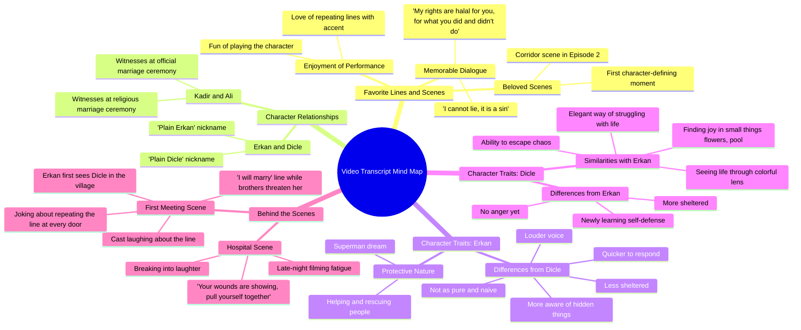

# Aytaç Şaşmaz and Helin Kandemir Q&A Interview

> 🌐 **Read this in:** [English](../../en/2026-10/tiktok-transcript-ayta-a-maz-ve-helinkandemir-ile-bol-kahkahal-bir-soru-cevap-b456.md) · **中文**

> **Creator:** [@sevdigimsensindizi](https://www.tiktok.com/@sevdigimsensindizi) · **Views:** 805.2K · **Posted:** 2026-10-20 · **Niche:** entertainment
>
> **TL;DR:** Opens with a heartfelt, culturally resonant phrase that immediately evokes curiosity about the relationship and context.

[Watch original video →](https://vt.tiktok.com/ZSgS6C7xN/)

## Why This Went Viral

## 钩子（前3秒）
- 以快速的双重问候开场——“merhabalar merhabalar”——然后立即转向一句引用的情感台词：“sen cevaplancan daha geçen gün konuştuk orda hakkını helal et diyodu”（引用最近一场戏中角色请求原谅的场景）。
- **钩子模式：** 场景/台词抛出 + 情感回响（从对话中途开始，仿佛观众走进了一场重逢）。
- 为什么能让人停下滚动：感觉像是在偷听两位深受喜爱的搭档重聚，而“hakkını helal et”（原谅我/请赐我你的祝福）这句台词是剧迷一眼就能认出的高情感短语——识别触发暂停。

## 情感节奏
- **好奇**（0–5秒）：谁在说话，他们在引用哪场戏？
- **紧张/怀旧**（5–20秒）：“yaptıklarına da yapmadıklarına da”（为你做过的和没做过的）的重复——一句沉重而苦甜交织的原谅台词说了两遍，层层累积出酸楚。
- **共鸣**（20–45秒）：最爱台词排名（“ben yalan konuşamam günah”）——粉丝得到回报，听到演员自己最喜欢的时刻。
- **俏皮的释然**（45–75秒）：“dümdüz Erkan / dümdüz Dicle”那段——笑声打破紧张。
- **温暖的回顾**（75–110秒）：角色分析——“koruyucu olması”、“superman olmak”、Dicle在混乱中找到快乐的能力。
- **高潮：** 医院场景的故事——“eline bak dedim yaraların var dedim toparlan artık”——一句诞生于深夜疲惫和笑声中的即兴台词。这是情感巅峰：真实、无剧本、亲密。
- **反转/收尾**（最后几秒）：“ben evlenirim”作为反复出现的笑点被重复——“ben her kapıyı açtığımda ben evlenirim”——以笑声和一句可引用的口头禅结束。

## 关键词密度
- **“yaptıklarına da yapmadıklarına da”**（你做过的和没做过的）——情感牵引；原谅主题。
- **“ben evlenirim”**（我会娶她）——标志性口头禅；通过可识别性实现算法传播。
- **“dümdüz”**（平淡/简单）——可做成梗、可重复、适合剪辑。
- **“Dicle” / “Erkan”**——角色名；驱动搜索和粉丝推荐。
- **“helal olsun”**（祝福/原谅）——情感牵引。
- **“koruyucu”**（保护性的）——角色分析的主题关键词。
- **“yalan konuşamam günah”**（我不能撒谎，那是罪过）——可引用、高回忆度的台词。
- **“hastane sahnesi”**（医院场景）——场景特定搜索词。
- 算法传播：角色名、“ben evlenirim”、“dümdüz”（可重复、可做成梗）。情感牵引：“helal olsun”、“yaptıklarına da yapmadıklarına da”、“koruyucu”。

## 为什么它会传播
- **识别循环：** 开场引用“hakkını helal et”和“yaptıklarına da yapmadıklarına da”被重复了两次——剧迷立刻认出场景，而重复也让这句话对非粉丝同样印象深刻。
- **口头禅回报：** “ben evlenirim”作为反复出现的笑点呈现（“ben her kapıyı açtığımda ben evlenirim”）——一句可引用、可分享的台词，即使没有上下文也能作为独立片段成立。
- **幕后亲密感：** 医院故事（“gece geç saat olunca... gülmeye başlıyosun... eline bak dedim yaraların var dedim”）给观众一种内部视角的感觉——无剧本、真实、有趣。
- **角色分析共鸣：** “Dicle çok kaotik bi ortamda... çiçeğe bakıp mutlu olabiliyo”——观众将自己投射到角色身上，驱动评论和分享（“这就是我”）。
- **笑声作为社会证明：** 转录中充满“ha ha”和重叠的说话——这个片段*听起来*就很有趣，让人感觉像是受邀加入，而不是在看表演。

## 你可以借鉴的
- **从台词中途开场，而非从介绍中途开场：** 从一句可识别的 emotional 台词（“hakkını helal et...”）开始，而不是问候——识别是最快的滚动停止器。
- **把你最好的一句说两遍：** “yaptıklarına da yapmadıklarına da”的双重呈现让这句话令人难忘且适合剪辑引用——每个视频植入一句可重复的短语。
- **以反复出现的笑点收尾，而非总结：** 用口头禅回响（“ben evlenirim”）结束，让最后的情绪是笑声——收尾才是被重播和分享的部分。

## Mind Map

## Full Transcript (Generated by [TokTranscript](https://toktranscript.com/?utm_source=github&utm_medium=breakdown&utm_campaign=tool_attribution))

> 📝 Transcripts on this page are auto-generated and show the first 60%. Want to transcribe any TikTok in 30 seconds and get the full version? [Try TokTranscript free →](https://toktranscript.com/?utm_source=github&utm_medium=breakdown&utm_campaign=transcript_cta)

merhabalar merhabalar sen cevaplancan daha geçen gün konuştuk orda hakkını helal et diyodu Dicle yaptıklarına da yapmadıklarına yaptıklarına da yapmadıklarına da sonra ben de tekrar ediyodum yaptıklarına da yapmadıklarına o benim çok içimi acıtıyodu yani benim hakkım da sana helal olsun bu arada yaptıklarına da yapmadıklarına da benim hakkım da helal olsun yaptıklarına da yapmadıklarına da benim en sevdiğim repliğim ama ben yalan konuşamam günah seviyorum 2. bölümde ilk geldiği zaman koridorda bi sahne çekmiştik ben yalan konuşamam günahdır ilk hani karaktere dair bi şey söylediğimiz yeri seviyorum ben şeyi de çok seviyorum ya yani senin tekrar etmeyi de seviyorum evet şiveyle di mi evet biz de seviyoruz onu oynamayı da ilk aklıma geldiği için bunu söylüyorum Kadir de bizim imam nikahımızın şahidiydi ama sonra gördük neler olduğunu Ali bizim imam nikahımızın şahididir ayıptır ya hee Kadir de bizim resmi nikahımızın şahidiyi gördük sonra olduğunu benim en sevdiğim rap'li dümdüz Erkan sen bundan sonra benim için dümdüz erkansın aynen sen benim için artık sade erkansın sen artık böyle dümdüz erkansın dümdüz Dicle sen de dümdüz dicle'sin benim Erkan'la en belirgin özelliğim benzer özelliğim bence koruyucu olması benim zaten hayal ettiğim hayat böyle superman olmak ha ha bi gün inşallah uçabilicem bunu biliyoruz ya ama onun kurtarma tarafında yani insanlara el uzatma tarafında seviyorum ordan ııı bence birbirimize benziyoruz yani o taraftan böyle hayatı hep böyle rengarenk 1 pencereden görüyo ya Dicle çok kavatik bi ortamda da mesaj atıyorum çiçeğe bakıp mutlu olabiliyo ya da havuzu görünce mutlu olup ordan kopabilme becerisi ha ha ya kaos'tan kendi kendini çıkarabilme yeteneğini kendime benzetiyorum evet hayatla mücadele şeklinin eee zarif olmasını kendime benzetiyorum ya ben erken kadar saf bi adam değilim onun kadar temiz eee yani bazı şeyler oluyo içerden bi gözden o görmüyo ama ben görürdüm ben

*[Read the full transcript on TokTranscript →](https://toktranscript.com/plaza/tiktok-transcript-ayta-a-maz-ve-helinkandemir-ile-bol-kahkahal-bir-soru-cevap-b456?utm_source=github&utm_medium=breakdown&utm_campaign=transcript_full)*

## Browse More

- All [entertainment](../../by-niche/zh-CN/entertainment.md) breakdowns
- All [Emotional Quote Recall](../../by-pattern/zh-CN/hook-emotional-quote-recall.md) examples

## Video Info

| | |
|---|---|
| Creator | [@sevdigimsensindizi](https://www.tiktok.com/@sevdigimsensindizi) |
| Original video | [https://vt.tiktok.com/ZSgS6C7xN/](https://vt.tiktok.com/ZSgS6C7xN/) |
| Original title | #AytaçŞaşmaz ve #HelinKandemir ile bol kahkahalı bir Soru-Cevap! ❤️ 🌼... |
| Views | 805.2K (805200) |
| Posted | 2026-10-20 |
| Duration | 0s |
| Niche | `entertainment` |
| Hook pattern | `Emotional Quote Recall` |
| Original language | `en` (this page translated by AI) |
| Available languages | en, zh-CN |
| Generated | 2026-10-21 by [TokTranscript](https://toktranscript.com/) |

---

*This breakdown is for educational analysis under fair use. Original video © [@sevdigimsensindizi](https://www.tiktok.com/@sevdigimsensindizi). All transcripts are auto-generated and may contain errors.*

*Want to analyze your own TikToks like this? [我们用的转录工具 →](https://toktranscript.com/viral-breakdown?utm_source=github&utm_medium=breakdown&utm_campaign=footer_cta)*