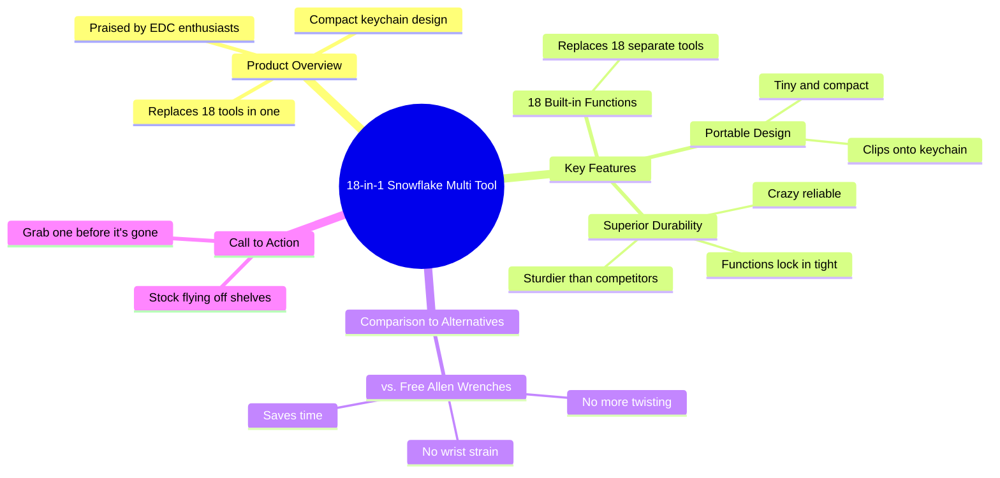

# 18-in-1 Snowflake Multi Tool EDC Wrench Review

> 🌐 **Read this in:** [English](../../en/2026-10/tiktok-transcript-be-sure-to-carry-this-snowflake-wrench-with-you-when-you-re-aeab.md) · **中文**

> **Creator:** [@rodney.owens87](https://www.tiktok.com/@rodney.owens87) · **Views:** 1.2M · **Posted:** 2026-10-16 · **Niche:** tech
>
> **TL;DR:** Opens with strong praise to grab attention, then immediately agitates a common pain point to create urgency.

[Watch original video →](https://www.tiktok.com/@rodney.owens87/video/7637541548686658830?is_from_webapp=1&sender_device=pc&web_id=7695616896544015903)

## Why This Went Viral

## 钩子（前3秒）
- **逐字稿：**“发明这东西的人应该加薪。”
- **钩子模式：**大胆断言 + 好奇心缺口（未说明的“这东西”）。
- **为什么能让人停下滚动：**开场先赞美一个未点名的物品，制造出一个观众必须填补的信息缺口。没有上下文 = 迫使观众做出微小的承诺继续看下去。

## 情绪节奏
- **0–3秒——好奇：**“应该加薪”（是什么东西？）。
- **3–7秒——痛点激化：**“还在用那些免费的内六角扳手拧来拧去，浪费时间还伤手腕”（观众自我代入为受害者）。
- **7–10秒——解脱/揭晓：**“把那堆破烂扔一边，看看这个” + 产品名称点出。
- **10–18秒——权威叠加：**“EDC狂热爱好者都信赖”、“18合1”、“替代18种工具”。
- **18–25秒——欲望升级：**钥匙扣夹、 “秒杀其他所有多功能工具”、“结实得多”、“可靠得离谱”。
- **高潮：**“每个功能都锁得紧紧的，绝不会让你失望”——可靠性承诺化解了开场时伤手腕的恐惧。
- **25–30秒——紧迫感收尾：**“库存正在飞速售罄。趁没了赶紧入手一个。”

## 关键词密度
- **最强的重复词：***工具/多功能工具*（×5）、*18*（×3）、*东西/这个*（×4）、*手腕/伤*、*钥匙扣*、*结实/可靠/锁得紧*、*库存飞速售罄*。
- **算法驱动词：**“多功能工具”、“18合1”、“EDC”、“钥匙扣”——搜索 + 品类信号，将视频推入小工具/装备信息流。
- **情绪拉力：**“伤你的手腕”、“不会让你失望”、“趁没了”——痛点、信任和稀缺感，将观众转化为买家。

## 为什么它会传播
- **痛点优先的框架：**“浪费时间还伤手腕”让观众成为一个他们不知道正在被解决的问题的主角——对“需要这个的人”有很高的分享性。
- **具体性作为证明：**“18合1”、“18种内置功能”、“直接夹到你的钥匙扣上”——具体数字胜过模糊宣称，并能经受评论区审视。
- **圈内人权威：**“EDC狂热爱好者都信赖的那种”借用了小众社区的可信度，让推荐感觉像是同好验证过的，而非广告。
- **最高级叠加：**“秒杀其他所有多功能工具”、“比其他任何东西都结实得多”——制造了一个比较框架，引发讨论和合拍/拼接。
- **稀缺收尾：**“库存正在飞速售罄。趁没了赶紧入手一个”——触发FOMO，将被动观众转化为点击者，提升算法所奖励的互动信号。

## 你可以借鉴的
1. **以赞美一个未点名的东西开场。**“发明这个的人应该加薪”迫使观众留下来看揭晓——直到第7秒才出现产品名称。
2. **在推销之前先激化痛点。**点出具体的烦恼（“用免费的内六角扳手拧来拧去”），让观众在你说出解决方案之前就感到被看见。
3. **叠加一个数字、一个小众群体、一个最高级。**“18合1” + “EDC狂热爱好者” + “秒杀其他一切”给算法一个品类，给观众一个部落，给推销一个值得争论的宣称。

## Mind Map

## Full Transcript (Generated by [免费 TikTok 文稿生成器](https://toktranscript.com/?utm_source=github&utm_medium=breakdown&utm_campaign=tool_attribution))

> 📝 Transcripts on this page are auto-generated and show the first 60%. Want to transcribe any TikTok in 30 seconds and get the full version? [Try TokTranscript free →](https://toktranscript.com/?utm_source=github&utm_medium=breakdown&utm_campaign=transcript_cta)

Whoever invented this thing deserves a raise. Are you still twisting away with those free Allen wrenches, wasting time and wrecking your wrist? Toss that junk aside and check this out. This is an 18 in 1 snowflake multi tool, the kind EDC fanatic swear by. It's packed with 18 built in functions. So it basically replaces 18 tools in one. The best part is tiny enough to clip right onto your keychain. This compact design

*[Read the full transcript on TokTranscript →](https://toktranscript.com/plaza/tiktok-transcript-be-sure-to-carry-this-snowflake-wrench-with-you-when-you-re-aeab?utm_source=github&utm_medium=breakdown&utm_campaign=transcript_full)*

## Browse More

- All [tech](../../by-niche/zh-CN/tech.md) breakdowns
- All [Praise + Problem Agitation](../../by-pattern/zh-CN/hook-praise-problem-agitation.md) examples

## Video Info

| | |
|---|---|
| Creator | [@rodney.owens87](https://www.tiktok.com/@rodney.owens87) |
| Original video | [https://www.tiktok.com/@rodney.owens87/video/7637541548686658830?is_from_webapp=1&sender_device=pc&web_id=7695616896544015903](https://www.tiktok.com/@rodney.owens87/video/7637541548686658830?is_from_webapp=1&sender_device=pc&web_id=7695616896544015903) |
| Original title | Be sure to carry this snowflake wrench with you when you're out.Caugh... |
| Views | 1.2M (1200000) |
| Posted | 2026-10-16 |
| Duration | 0s |
| Niche | `tech` |
| Hook pattern | `Praise + Problem Agitation` |
| Original language | `en` (this page translated by AI) |
| Available languages | en, zh-CN |
| Generated | 2026-10-17 by [TokTranscript](https://toktranscript.com/) |

---

*This breakdown is for educational analysis under fair use. Original video © [@rodney.owens87](https://www.tiktok.com/@rodney.owens87). All transcripts are auto-generated and may contain errors.*

*Want to analyze your own TikToks like this? [TokTranscript →](https://toktranscript.com/viral-breakdown?utm_source=github&utm_medium=breakdown&utm_campaign=footer_cta)*