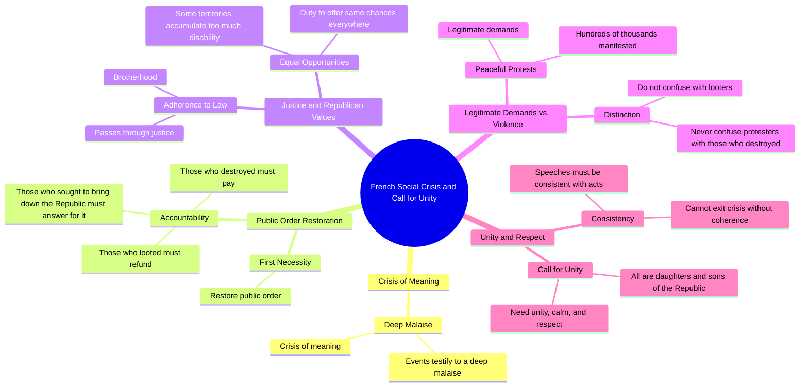

# Jacques Chirac 21 Years Earlier: A Crisis of Meaning

> 🌐 **Read this in:** [English](../../en/2026-10/tiktok-transcript-c-tait-vingt-et-un-ans-plus-t-t-le-pr-sident-jacques-chirac-fa33.md) · **中文**

> **Creator:** [@quotidienofficiel](https://www.tiktok.com/@quotidienofficiel) · **Views:** 438.1K · **Posted:** 2026-10-19 · **Niche:** other
>
> **TL;DR:** The hook immediately identifies a profound societal problem, creating curiosity about the solution.

[Watch original video →](https://vt.tiktok.com/ZSgBJawcH/)

## Why This Went Viral

## 钩子（前3秒）
- **逐字开场：** “这些事件证明了一种深层次的不安，这是一场意义危机”
- **钩子模式：** 大胆断言 + 抽象诊断（“意义危机”的框架在零铺垫下抛出）
- **为何能止住滑动：** 它以半句话开场，用高风险措辞（“深层次的不安”、“意义危机”）听起来像在宣判。没有问候，没有背景——观众直接落在一段严肃的宣告之中，必须留下来弄清楚*哪些事件*和*谁*的危机。高语域信号传递出权威感，为接下来几秒赢得了注意力。

## 情绪节奏
- **节拍1——好奇/凝重：** “意义危机” + “这些画面” → 观众需要知道所指。
- **节拍2——困惑转为好奇：** “他们脑子里在想什么/法国人怎么能对法国做出这种事” → 一个刺耳、近乎指责的问题，提升了利害和身份认同的赌注。
- **节拍3——张力（制度层面）：** “共和国的职责……同样的机会……太多的残疾” → 抽象的政策语言制造了一个低谷；张力被延后，而非释放。
- **节拍4——羞耻/愤怒共鸣：** “今晚我们都感到愤怒……看到街道……被洗劫令人无法忍受” → 第一个真正的情感高峰；集体性的“我们”邀请观众加入。
- **节拍5——硬转向秩序：** “恢复公共秩序……那些破坏者必须付出代价……被抢掠的必须归还……将必须为此负责” → 有节奏的三连句，后果逐步升级。
- **节拍6——转折/软化：** “我们绝不能把他们与那些破坏者混为一谈” → 突然的共情转向；重新定义了“他们”。
- **节拍7——高潮：** “共和国所有的女儿和儿子” → 情感顶峰；包容性语言在这里落地最重。
- **节拍8——收束/呼吁：** “平静与尊重的团结……让言辞与行动保持一致” → 收尾的要求，一种指向内部的批评。
- **高潮时刻：** “他们都是共和国的女儿和儿子”——从惩罚到归属的转折是最可能被剪辑、引用和二次分享的那句话。

## 关键词密度
- **共和国**（重复约5次）——承重词；同时驱动算法主题聚类（政治/法国/公民）和情感吸引力（归属感、合法性）。
- **破坏/抢掠/洗劫/暴力**——冲突集群；算法触达最高（新闻/冲突信号），也是本能张力的来源。
- **危机/不安/困难**——诊断性框架；吸引“解释型”受众。
- **团结/平静/尊重/博爱**——解决集群；驱动分享和收藏（可引用、令人向往）。
- **正义/法律/职责**——权威信号；提升可信度和评论区辩论。
- **“共和国的女儿和儿子”**——标志性短语；情感吸引力最高，最具模因传播力。
- **算法 vs. 情感：** 冲突词（破坏、抢掠、暴力）和实体词“共和国”驱动*触达*（主题分类、新闻邻近性）。“意义危机”、“羞耻”和“女儿和儿子”驱动*情感吸引力*和二次分享。

## 为何会传播
- **它以结论开场，而非铺垫。** “这是一场意义危机”迫使观众逆向推断语境——一个完成感缺口，让他们在3秒流失点之后继续观看。
- **它在一分钟内跑完完整的情感弧线。** 愤怒（“看到街道……被洗劫令人羞耻”）→ 惩罚（“那些破坏者必须付出代价”）→ 共情转折（“我们绝不能把他们混为一谈”）→ 包容（“共和国的女儿和儿子”）。转折是让它可引用而非单调的关键。
- **三连句节奏专为剪辑而生。** “那些破坏者必须付出代价/那些抢掠者必须归还/那些试图推翻共和国的人将必须为此负责”是一个自包含的节奏单元——非常适合字幕、拼接反应和评论诱饵。
- **它邀请观众进入一个“我们”。** “今晚我们都感到愤怒”、“我们都曾想问”——集体框架将被动观众转化为参与者，他们通过分享来表明自己的立场。
- **它以自我批评而非口号收尾。** “让言辞与行动保持一致”将镜头转向说话者自己的一方——一个罕见的举动，能在评论区激发辩论，而评论速度是传播的倍增器。

## 你可以借鉴的
1. **以结论开场，而非背景。** 用你最大胆的诊断性语句（“这是一场意义危机”）打头，让观众留下来弄清楚它指的是什么。删掉所有问候和开场白。
2. **构建一个从惩罚到共情的转折。** 使用有节奏的三连句后果，然后转向一句将“他们”重新定义为“我们”的话（“共和国的女儿和儿子”）。转折是可分享的时刻——每个视频设计一个。
3. **以指向自己一方的要求收尾。** 一个收尾的自我批评（“让言辞与行动保持一致”）胜过泛泛的行动号召，因为它能引发评论并传递正直感。

## Mind Map

## Full Transcript (Generated by [免费 TikTok 文稿生成器](https://toktranscript.com/?utm_source=github&utm_medium=breakdown&utm_campaign=tool_attribution))

> 📝 Transcripts on this page are auto-generated and show the first 60%. Want to transcribe any TikTok in 30 seconds and get the full version? [Try TokTranscript free →](https://toktranscript.com/?utm_source=github&utm_medium=breakdown&utm_campaign=transcript_cta)

these events testify to a deep malaise it's a crisis of meaning 1 benchmark crisis by looking at these images we all wondered what they have in their head how French people can do that to France the duty of the Republic is to offer everywhere and to each his own the same chances but some territories accumulate too much disability we all feel anger tonight of shame to see the streets of our cities thus ransacked is unbearable in the face of the violence of recent weeks in the face of suffering and the difficulties of time of our fellow citizens especially among the most vulnerable the 1st necessity is to restore public order those who destroyed must pay those who have looted must refund those who sought to bring down the Republic will have to answer for it but adherence to the law and t

*[Read the full transcript on TokTranscript →](https://toktranscript.com/plaza/tiktok-transcript-c-tait-vingt-et-un-ans-plus-t-t-le-pr-sident-jacques-chirac-fa33?utm_source=github&utm_medium=breakdown&utm_campaign=transcript_full)*

## Browse More

- All [other](../../by-niche/zh-CN/other.md) breakdowns
- All [Problem Declaration](../../by-pattern/zh-CN/hook-problem-declaration.md) examples

## Video Info

| | |
|---|---|
| Creator | [@quotidienofficiel](https://www.tiktok.com/@quotidienofficiel) |
| Original video | [https://vt.tiktok.com/ZSgBJawcH/](https://vt.tiktok.com/ZSgBJawcH/) |
| Original title | C’était vingt et un ans plus tôt. Le président Jacques Chirac prenait... |
| Views | 438.1K (438100) |
| Posted | 2026-10-19 |
| Duration | 0s |
| Niche | `other` |
| Hook pattern | `Problem Declaration` |
| Original language | `en` (this page translated by AI) |
| Available languages | en, zh-CN |
| Generated | 2026-10-20 by [TokTranscript](https://toktranscript.com/) |

---

*This breakdown is for educational analysis under fair use. Original video © [@quotidienofficiel](https://www.tiktok.com/@quotidienofficiel). All transcripts are auto-generated and may contain errors.*

*Want to analyze your own TikToks like this? [免费 TikTok 文稿生成器 →](https://toktranscript.com/viral-breakdown?utm_source=github&utm_medium=breakdown&utm_campaign=footer_cta)*