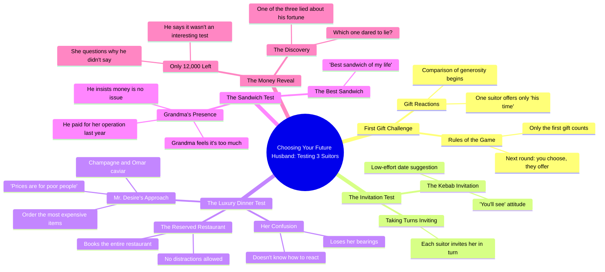

# Girl Must Choose Between 3 Future Husbands

> 🌐 **Read this in:** [English](../../en/2026-10/tiktok-transcript-elle-doit-en-choisir-un-fruitdrama-fruitstory-ai-france-brai-5a9f.md) · **中文**

> **Creator:** [@fruitdramafr6](https://www.tiktok.com/@fruitdramafr6) · **Views:** 3.8M · **Posted:** 2026-10-09 · **Niche:** entertainment
>
> **TL;DR:** Sets up a high-stakes dating test with three men, immediately creating curiosity and tension.

[Watch original video →](https://vm.tiktok.com/ZN8BduEKG//)

## Why This Went Viral

## 钩子（前3秒）
- 逐字开场：“choisis ton futur mari”（“选择你未来的丈夫”）——紧接着立刻是“non je vais tester les 3”（“不，我要把3个都测试一遍”）。
- 钩子模式：**大胆断言 + 前提式提问**的混合体——一个“选一个”的约会游戏设定，被一句叛逆的“其实，我要把三个都测一遍”瞬间翻转。
- 为什么它能让人停下滑动：它在2秒内框定了一个高风险、一眼就懂的博弈（选丈夫），然后颠覆了预期格式。观众需要知道“哪一个会赢？”——一个在他们决定离开之前就被打开的好奇心缺口。

## 情绪节奏
- **第1拍——好奇（0–5秒）：**“测试全部3个”的前提设定了一场比赛。“1ère cadeau seulement”（“只送第一份礼物”）确立了规则。
- **第2拍——喜剧反差（5–15秒）：**烤肉店男 vs.“Monsieur Désir香槟Omar鱼子酱”——笑声与荒诞感。“Les prix c'est pour les pauvres”（“价格是给穷人看的”）激起了对谁在炫耀、谁是真的的好奇。
- **第3拍——张力累积（15–30秒）：**预订餐厅的那个男人、没有音乐的场景、“je sais plus trop où j'en suis”——观众开始感觉到，这些男人中有一个在表演富有。
- **第4拍——情绪反转（30–45秒）：**奶奶场景。“C'est le meilleur sandwich de ma vie” → “il m'a payé mon opération l'année dernière” → “c'est que des sous, moi je me débrouille.” 真实的温暖落在先前的浮华之上。
- **高潮：**“Attends c'est pour ça que t'as que 12.000 ?”——揭示出那个“有钱”人设其实破产了，而那个朴素的人才是真的。台词“l'un des 3 ment sur sa fortune”（“3个人里有1个在谎报自己的财富”）就是收尾重拳。
- **收束：**叙述者宣称这场测试“très intéressant”——把整个视频重新框定为一场社会实验，而不是一次约会。

## 关键词密度
- “test / tester”——驱动格式识别与重看性。
- “choisis / choisis ton futur mari”——前提钩子，高评论诱饵。
- “cadeau / offrir / payé”——锚定金钱主题。
- “champagne / caviar / kebab / sandwich”——阶级反差关键词，情绪拉力强。
- “mamie / opération”——共情触发器；驱动分享。
- “12.000 / sous / fortune / pauvres”——金钱真相轴线。
- “mentir / ment / osé mentir”——揭示关键词；驱动最终提问与评论。
- 算法触达驱动词：“test”“mari”“mentir”（可搜索、贴合趋势）。情绪拉力驱动词：“mamie”“opération”“sandwich de ma vie”。

## 为什么它会传播
- **反转结构就是评论诱饵。**“L'un des 3 ment sur sa fortune, lequel a osé mentir”以一个开放问题收尾——观众涌入评论区猜答案，算法把这解读为互动。
- **阶级反差具有普遍可读性。**“Les prix c'est pour les pauvres” vs.“c'est que des sous, moi je me débrouille”不需要文化翻译——这是一个任何人都能反应的身份 vs. 实质的故事。
- **奶奶这一拍制造了情绪尖峰。**“Il m'a payé mon opération l'année dernière”把视频从喜剧重新框定为走心，这会驱动那些为看笑话而来的观众去收藏和分享。
- **快切、多角色格式奖励重看。**三个男人、快速场景切换，以及最后的“哪一个撒谎了？”提示，让观众重新扫视找线索——提升观看时长和完播率。
- **“测试”框架邀请合拍与拼接。**前提（“我要把3个都测试一遍”）是别人可以复制的模板，催生衍生内容，反过来喂养原视频的触达。

## 你可以偷走的东西
- **先用规则开场，然后打破它。**在前3秒说出格式（“选一个”），并立刻颠覆它（“不，我要把三个都测一遍”）——颠覆才是让人停下滑动的东西。
- **早早埋下反转，晚晚兑现。**金钱主题在前15秒就设好（“价格是给穷人看的”），并在结尾引爆（“你只有12,000？”）。埋下矛盾，不要提前揭晓。
- **用一个观众能回答的问题收尾。**“哪一个撒谎了？”把被动观众转化为评论者——这是短视频算法推送中单点杠杆最高的动作。

## Mind Map

## Full Transcript (Generated by [TokTranscript 转录工具](https://toktranscript.com/?utm_source=github&utm_medium=breakdown&utm_campaign=tool_attribution))

> 📝 Transcripts on this page are auto-generated and show the first 60%. Want to transcribe any TikTok in 30 seconds and get the full version? [Try TokTranscript free →](https://toktranscript.com/?utm_source=github&utm_medium=breakdown&utm_campaign=transcript_cta)

choisis ton futur mari non je vais tester les 3 ah on peut gagner du temps non 1ère cadeau seulement le 1ère le prochain c'est toi qui choisis et toi tu m'offres quoi mon temps ha ha 1ère test vous m'invitez chacun votre tour facile et lui il t'invite où au kebab tu verras j'ai hâte monsieur désir champagne Omar caviar prenez le plus cher tu regardes même pas les prix les prix c'est pour les pauvres plus vite toi t'es sérieux là pardon devant toi j'sais plus comment faire tu as réservé tout le restaurant comme ça personne ne nous dérange tu ne réponds pas rien d'important viens y a même pas de musique on en a pas besoin j'sais plus trop où j'en suis là goû

*[Read the full transcript on TokTranscript →](https://toktranscript.com/plaza/tiktok-transcript-elle-doit-en-choisir-un-fruitdrama-fruitstory-ai-france-brai-5a9f?utm_source=github&utm_medium=breakdown&utm_campaign=transcript_full)*

## Browse More

- All [entertainment](../../by-niche/zh-CN/entertainment.md) breakdowns
- All [Challenge/Test Hook](../../by-pattern/zh-CN/hook-challenge-test-hook.md) examples

## Video Info

| | |
|---|---|
| Creator | [@fruitdramafr6](https://www.tiktok.com/@fruitdramafr6) |
| Original video | [https://vm.tiktok.com/ZN8BduEKG//](https://vm.tiktok.com/ZN8BduEKG//) |
| Original title | Elle Doit En Choisir Un  #fruitdrama #fruitstory #ai  #france  #brainrot |
| Views | 3.8M (3800000) |
| Posted | 2026-10-09 |
| Duration | 0s |
| Niche | `entertainment` |
| Hook pattern | `Challenge/Test Hook` |
| Original language | `en` (this page translated by AI) |
| Available languages | en, zh-CN |
| Generated | 2026-10-11 by [TokTranscript](https://toktranscript.com/) |

---

*This breakdown is for educational analysis under fair use. Original video © [@fruitdramafr6](https://www.tiktok.com/@fruitdramafr6). All transcripts are auto-generated and may contain errors.*

*Want to analyze your own TikToks like this? [TokTranscript →](https://toktranscript.com/viral-breakdown?utm_source=github&utm_medium=breakdown&utm_campaign=footer_cta)*