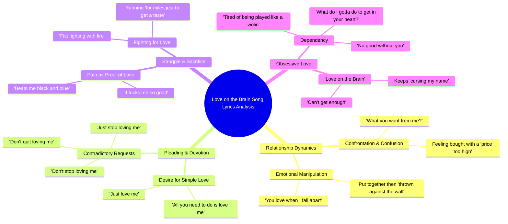

# Polygel With Soft Gel Nail Tip Extensions

> 🌐 **Read this in:** [English](../../en/2026-10/tiktok-transcript-polygel-with-soft-gel-nail-tips-extensions-love-the-results-d190.md) · **中文**

> **Creator:** [@marisolbeauty](https://www.tiktok.com/@marisolbeauty) · **Views:** 953.8K · **Posted:** 2026-10-13 · **Niche:** entertainment
>
> **TL;DR:** Opens with a raw, relatable question that instantly pulls viewers into the emotional conflict.

[Watch original video →](https://www.tiktok.com/@marisolbeauty/video/7691414100663880974)

## Why This Went Viral

## 钩子（前3秒）
- **逐字开场：** “And you got me like, girl, what you want from me? What you want from me?”
- **钩子模式：** 直接称呼式提问——一个重复的、近乎恳求的问题，直指隐含的“你”。
- **为什么能让人停下滑动：** 重复（“What you want from me?”）在没有铺垫的情况下瞬间制造张力。不需要上下文——观众被直接丢进一场争吵中，这迫使大脑去解决未解决的事。提问是你能向滑动者收取的最便宜的注意力税。

## 情绪节奏
- **0–5秒——好奇/对抗：** 开场问题框定了一场权力斗争。观众会问：她是谁，他是谁，发生了什么？
- **5–20秒——推拉张力：** “tried to buy you pretty hard, but a price too high” → “you love when I fall apart / so you can put me together and throw me against the wall.” 有毒爱情动态被明确点名。悬念围绕她*为什么*留下而建立。
- **20–35秒——恳求螺旋：** “Don't you stop loving me / Don't quit loving me / Just stop loving me”——这种矛盾（不要停/就停）是情绪支点。矛盾心理达到顶峰。
- **35–50秒——高潮：** “I'm fist fighting with fire / just to get close to you”以及“It beats me black and blue / but it fucks me so good.” 这就是那个时刻——痛苦与快感融于一句。共鸣最高点。
- **50秒–结束——认命循环：** “Must be love on the brain”作为咒语反复出现。情绪落点不是解脱——而是投降。这种未解决的结尾正是驱动重看和评论的原因。

## 关键词密度
- **“love”**（loving / love on the brain）——频率最高；情绪拉力 + 搜索友好
- **“me” / “you”**——代词密度制造准社会亲密感；每一句都像是在对观众说
- **“stop” / “quit” / “don't”**——否定词簇；驱动那种让钩子更黏的矛盾心理
- **“brain”**——标题短语；搜索和声音复用的算法锚点
- **“fire” / “burning” / “black and blue”**——感官痛苦意象；情绪拉力
- **“enough” / “can't get enough”**——稀缺框架；让听众循环回到开头
- **“baby”**——亲密标记；软化周围每一句尖锐歌词

**算法 vs. 情绪：** “love on the brain”、“baby”和“love”驱动触达（可搜索、可匹配声音、带情绪标签）。“Stop”、“fire”、“black and blue”和“can't get enough”驱动情绪拉力，让人们保存、分享和合拍。

## 为什么会传播
- **矛盾作为钩子引擎。** “Don't you stop loving me / Don't quit loving me / Just stop loving me”是一个自相矛盾的三连句。观众无法一遍就消化，所以他们会重播——而重播是短视频平台上最强的单一排名信号。
- **痛苦-快感融合极具引用性。** “It beats me black and blue / but it fucks me so good”是人们截图、配文和合拍的那一句。一句同时承担双重作用（冲击 + 共鸣）就是分享单元。
- **普遍的有毒爱情脚本。** “Fist fighting with fire just to get close to you”可以映射到任何执迷关系。观众不需要知道艺术家是谁——他们会把自己代入。
- **基于称呼的代词循环。** “You got me like / what you want from me”让观众成为那个“你”。这种第二人称框架把被动聆听变成被指控的感受——这是评论区忏悔式留言的最强驱动因素。
- **标题的咒语式重复。** “Must be love on the brain”出现3次以上。重复把一句歌词同时转化为钩子、配文和搜索词。

## 你可以偷走什么
1. **从冲突中段开场，而不是铺垫中段。** 从问题或指控开始，而不是背景故事。如果你的第一句需要上下文才能成立，就删掉它。
2. **写一个矛盾三连句。** 一个三行序列，其中第3行反转第1–2行（“don't stop / don't quit / just stop”）就是一台重播机器。要有意识地构建它。
3. **把两种相反情绪融进一句话。** 痛苦 + 快感，爱 + 暴力，需要 + 怨恨。一句融合的歌词胜过十句干净的歌词，因为那才是人们会引用的一句。

## Mind Map

## Full Transcript (Generated by [TokTranscript 转录工具](https://toktranscript.com/?utm_source=github&utm_medium=breakdown&utm_campaign=tool_attribution))

> 📝 Transcripts on this page are auto-generated and show the first 60%. Want to transcribe any TikTok in 30 seconds and get the full version? [Try TokTranscript free →](https://toktranscript.com/?utm_source=github&utm_medium=breakdown&utm_campaign=transcript_cta)

And you got me like, girl, what you want from me? What you want from me? And tried to buy you pretty hard, but a price too high. Baby, you got me like gold. You love when I fall apart. So you can put me together and throw me against the wall. Baby, you got me like gold. Don't you stop loving me Don't quit loving me Just stop loving me And babe, I'm fist fighting with fire Just to get close to you And quit burning something for me And I run for miles just to get a taste Must be love on the brain That's got me feeling this way It beats me black and blue But it fucks me so good And I c

*[Read the full transcript on TokTranscript →](https://toktranscript.com/plaza/tiktok-transcript-polygel-with-soft-gel-nail-tips-extensions-love-the-results-d190?utm_source=github&utm_medium=breakdown&utm_campaign=transcript_full)*

## Browse More

- All [entertainment](../../by-niche/zh-CN/entertainment.md) breakdowns
- All [Direct Question Hook](../../by-pattern/zh-CN/hook-direct-question-hook.md) examples

## Video Info

| | |
|---|---|
| Creator | [@marisolbeauty](https://www.tiktok.com/@marisolbeauty) |
| Original video | [https://www.tiktok.com/@marisolbeauty/video/7691414100663880974](https://www.tiktok.com/@marisolbeauty/video/7691414100663880974) |
| Original title | polygel with soft gel nail tips extensions love the results  #nailsar... |
| Views | 953.8K (953800) |
| Posted | 2026-10-13 |
| Duration | 0s |
| Niche | `entertainment` |
| Hook pattern | `Direct Question Hook` |
| Original language | `en` (this page translated by AI) |
| Available languages | en, zh-CN |
| Generated | 2026-10-16 by [TokTranscript](https://toktranscript.com/) |

---

*This breakdown is for educational analysis under fair use. Original video © [@marisolbeauty](https://www.tiktok.com/@marisolbeauty). All transcripts are auto-generated and may contain errors.*

*Want to analyze your own TikToks like this? [TokTranscript 转录工具 →](https://toktranscript.com/viral-breakdown?utm_source=github&utm_medium=breakdown&utm_campaign=footer_cta)*