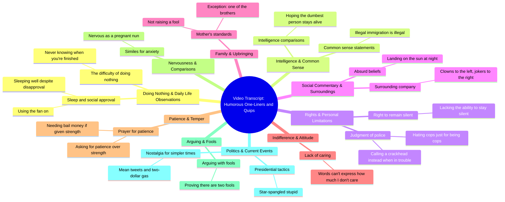

# Senator John Kennedy's Funniest Debate Comebacks

> 🌐 **Read this in:** [English](../../en/2026-10/tiktok-transcript-senator-john-kennedy-iconic-moments-senatorkennedy-politics-fcb6.md) · **中文**

> **Creator:** [@tyusapolitics](https://www.tiktok.com/@tyusapolitics) · **Views:** 940.1K · **Posted:** 2026-10-19 · **Niche:** entertainment
>
> **TL;DR:** The hook presents a counterintuitive idea that immediately grabs attention by challenging common assumptions.

[Watch original video →](https://vt.tiktok.com/ZSghqVcXb/)

## Why This Went Viral

## 钩子（前3秒）
- **逐字开场白：**“什么都不做很难，因为你永远不知道自己什么时候才算做完。”
- **钩子模式：**悖论／反直觉断言（用禅宗公案式的反转，颠覆对懒惰的刻板印象）。
- **为什么能让人停下滚动：**这是一个两秒内就能解开的脑筋急转弯。观众的大脑会标记出“等等，这居然是真的”——这种微小的“啊哈”制造了一个开放循环，而视频的其余部分承诺用更多同样的机智来填满它。

## 情绪节奏
- **0–3秒——好奇：**悖论式开场（“什么都不做很难”）设下一个智力谜题。
- **3–8秒——急转／荒诞式释然：**“你晚上怎么睡得着……”→“开着风扇睡。”先铺垫再泄气。笑点来得快，确立了格式：*期待→包袱*。
- **8–20秒——通过禁忌升级紧张感：**“非法移民是非法的。废话。”和“叫个瘾君子来”推进到边缘地带。轻微不适＋幽默＝高唤醒情绪（那种可分享的类型）。
- **20–30秒——共鸣回落：**“我有权保持沉默。我只是没那个能力。”和“言语无法表达我有多不在乎”——令人共鸣的自嘲，是重拳之间的喘息。
- **30–40秒——紧张峰值＋反转：**“上帝，请赐我耐心。因为如果你赐我力量，我就需要保释金了。”这是**高潮**——最长的铺垫和最大的回报，一个干净的两段式笑话，带着暴力的反转。
- **40秒–结尾——政治共鸣＋收尾点睛：**“星条旗愚蠢”和“一条刻薄的推文和两美元的汽油”转向共同的文化不满，然后以一声令人共鸣的叹息收尾。最后一句起到*身份召唤*的作用，而不只是一个笑话。

## 关键词密度
- **“Dumb／dumbest／fool”**——重复两次；驱动锚定幽默的“愚蠢”主题。
- **“Nothing／don't／not”**——否定词密度异常高；营造出愤世嫉俗、反叛的语调。
- **“God／patience／strength”**——高潮词簇；情绪负载重，算法上黏性强（宗教＋暴力的组合）。
- **“Illegal／cops／president／tweet／gas”**——把评论区争论拉进来的政治关键词。
- **“Right／wrong／prove”**——邀请观众站队的道德框架词。
- **“Sleep／night／patience”**——柔软、人性化的词，与边缘内容形成对比，提升留存。

**算法层面 vs. 情感层面：**“President”“cops”“illegal”和“tweet”驱动**触达**（评论战、分享、搜索）。“Dumb”“fool”“patience”和“sleep”驱动**情感拉力**（共鸣、自我认同）。这个视频的天才之处在于把两者叠加——政治关键词负责分发，自嘲关键词负责共鸣。

## 为什么它会传播
- **连珠炮式笑话堆叠＝留存机器。**每3–5秒就抛出一个新包袱（“开着风扇睡”“叫个瘾君子来”“保释金”）。观众不听到下一个就走不开——完播率反哺算法。
- **可引用、可截图的台词。**“言语无法表达我有多不在乎”和“我有权保持沉默。我只是没那个能力”天生适合做字幕、评论和转发。每一句都是一个可分享的单元。
- **禁忌＋政治＝评论区燃料。**“非法移民是非法的。废话。”和“星条旗愚蠢”是精心设计来分裂受众的。评论区的争议向平台发出互动信号，助推分发。
- **普世身份钩子。**“我母亲没养出个傻瓜。如果她养了，那也是我某个兄弟”——每个有兄弟姐妹的观众都会觉得被说中。令人共鸣的家庭幽默把受众扩展到政治核心之外。
- **高潮位置。**“保释金”笑话位于约70%处——正是流失率峰值所在。那里一个强有力的回报能重新抓住观众并把他们推到结尾，提升平均观看时长。

## 你可以偷师的
1. **用悖论开场，而不是前提。**像“什么都不做很难”这样的一句话，能在两秒内迫使大脑二次反应。把你的第一句写成*观众必须解开的矛盾*——它能为你买下接下来的10秒。
2. **以3–5秒的间隔堆叠笑话。**不要构建一个冗长的铺垫。交替使用铺垫→包袱→铺垫→包袱，这样永远不会出现冷场。使用“期待→泄气”模式（“你晚上怎么睡得着？”→“开着风扇睡”）。
3. **把你最强的笑话放在视频65–75%处。**那是留存下滑的地方。那里一个大的回报（“保释金”）能重新抓住观众并把他们带到结尾——而结尾正是算法所奖励的。

## Mind Map

## Full Transcript (Generated by [TikTok 转录工具](https://toktranscript.com/?utm_source=github&utm_medium=breakdown&utm_campaign=tool_attribution))

> 📝 Transcripts on this page are auto-generated and show the first 60%. Want to transcribe any TikTok in 30 seconds and get the full version? [Try TokTranscript free →](https://toktranscript.com/?utm_source=github&utm_medium=breakdown&utm_campaign=transcript_cta)

Doing nothing is hard because you never know when you're finished. How do you sleep at night knowing that some people don't like you? With the fan on. I'm not saying you're the dumbest person in the world, but you better hope the dumbest person in the world doesn't die. Illegal immigration is illegal. Duh. I have the right to remain silent. I just don't have the ability. You hate cops just because they're cops. The next time you get in trouble, call a crackhead. Clowns to the left of me, jokers to the right. She thinks you can land on the sun if you go at night. My mother did not raise a fool. And if she did

*[Read the full transcript on TokTranscript →](https://toktranscript.com/plaza/tiktok-transcript-senator-john-kennedy-iconic-moments-senatorkennedy-politics-fcb6?utm_source=github&utm_medium=breakdown&utm_campaign=transcript_full)*

## Browse More

- All [entertainment](../../by-niche/zh-CN/entertainment.md) breakdowns
- All [Paradoxical Statement](../../by-pattern/zh-CN/hook-paradoxical-statement.md) examples

## Video Info

| | |
|---|---|
| Creator | [@tyusapolitics](https://www.tiktok.com/@tyusapolitics) |
| Original video | [https://vt.tiktok.com/ZSghqVcXb/](https://vt.tiktok.com/ZSghqVcXb/) |
| Original title | Senator John Kennedy iconic moments #senatorkennedy #politics #usa #t... |
| Views | 940.1K (940100) |
| Posted | 2026-10-19 |
| Duration | 0s |
| Niche | `entertainment` |
| Hook pattern | `Paradoxical Statement` |
| Original language | `en` (this page translated by AI) |
| Available languages | en, zh-CN |
| Generated | 2026-10-20 by [TokTranscript](https://toktranscript.com/) |

---

*This breakdown is for educational analysis under fair use. Original video © [@tyusapolitics](https://www.tiktok.com/@tyusapolitics). All transcripts are auto-generated and may contain errors.*

*Want to analyze your own TikToks like this? [TokTranscript →](https://toktranscript.com/viral-breakdown?utm_source=github&utm_medium=breakdown&utm_campaign=footer_cta)*