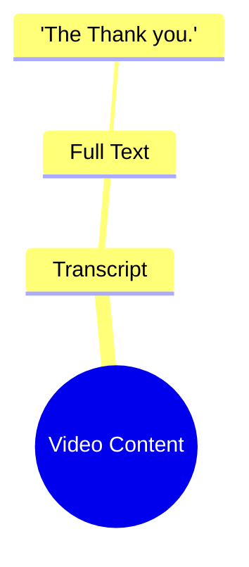

# Imran Khan Supporters Clash With Police in Pakistan

> 🌐 **Read this in:** [English](../../en/2026-10/tiktok-transcript-video-8b63.md) · **中文**

> **Creator:** [@almashhadmedia](https://www.tiktok.com/@almashhadmedia) · **Views:** 1.8M · **Posted:** 2026-10-12 · **Niche:** other
>
> **TL;DR:** The hook is a fragmented phrase that fails to establish a clear premise or curiosity.

[Watch original video →](https://vt.tiktok.com/ZSbwoTjFM/)

## Why This Went Viral

## 钩子（前3秒）
- 整个开场白逐字照搬：“The Thank you.” 两个词，平铺直叙，没有铺垫，没有语境，没有解释。
- 钩子模式：**荒诞反钩子 / 反高潮**。它刻意不兑现正常钩子所做出的承诺。
- 它之所以能让人停下滚动，是因为大脑遇到了解析错误。“The Thank you”语法不通、语义空洞，于是观众会重读/重放，试图解决这种不匹配。这种未解决的微小困惑，为你争取到注册观看并留下来的1–2秒。

## 情绪节奏
- 第1拍（0:00–0:01）：**困惑**——“The Thank you”听起来像胡言乱语。
- 第2拍（0:01–0:02）：**重新确认 / 轻微烦躁**——观众以为自己听错了或漏掉了一帧。
- 第3拍（0:02–0:03）：**领悟**——意识到整个视频就是这个。笑点就是这种空洞本身。
- 高潮：领悟的那一刻，同时也是包袱。没有铺垫，没有反转，没有解决——高潮就是高潮的缺席。
- 注意：没有悬念曲线，也没有释然。情绪引擎是**被扣留的回报**，这就是为什么评论区（而不是视频本身）成了真正的内容。

## 关键词密度
- 最强的重复词元：“The”“Thank”“you”“Thank you”“The Thank you”。
- 因为文字稿只有两个词，密度实际上是100%——每个关键词就是整个脚本。
- “Thank you”驱动**情绪拉力**：它是一个普遍被识别的社交仪式，所以观众会把礼貌、讽刺或反讽投射到它上面。
- “The”间接驱动**算法触达**：它是一个停用词，让这个短语作为梗字符串（“the thank you”）可搜索、可引用，给视频一个独特、可重复的抓手。
- 净效果：这些关键词不是通过搜索量驱动触达——它们是通过**可引用性**驱动触达。这个短语短到可以复制粘贴进评论、字幕和合拍。

## 为什么它会传播
- **零成本理解。**“The Thank you”可以在不到一秒内被理解，所以它能挺过残酷的滚动测试——没有观众需要语境才能“get”到它。
- **评论诱饵式歧义。**因为这句话没有意义，观众必须自己提供意义，而这种分歧（“这是讽刺吗？”/“这是打错字吗？”）会催生回复串，算法会将其解读为互动。
- **适合二创的格式。**一个两词视频极其容易合拍、拼接或加字幕，所以这个短语会逃出原帖，变成可复用的模板。
- **反内容的新奇感。**在一个充斥着过度制作钩子的信息流里，一个公开拒绝给出回报的视频，读起来像是对格式本身的玩笑，从而赢得“你必须看看这个”式的分享。
- **可引用的字符串。**“The Thank you”简短、怪异、语法不对，这使它令人难忘且可重复——这是梗传播的核心要求。

## 你可以偷走什么
- **故意打破你钩子的语法。**一个稍微不对的短语（“The Thank you”）会制造解析缺口，迫使观众重放。在你的第一句话里用一个刻意的错误。
- **扣留回报，让评论补完它。**如果观众必须争论你是什么意思，你就把互动外包出去了。每条视频设计一个开放循环。
- **让你的核心句子可复制粘贴。**把令人难忘的短语控制在五个词以内，并且怪到足以在评论、字幕和合拍中被逐字引用。
- **让制作匹配笑点。**如果内容是反高潮，就保持平铺直叙——过度表演荒诞会毁掉让它成立的那种冷面感。

## Mind Map

## Full Transcript (Generated by [TokTranscript](https://toktranscript.com/?utm_source=github&utm_medium=breakdown&utm_campaign=tool_attribution))

> 📝 Transcripts on this page are auto-generated and show the first 60%. Want to transcribe any TikTok in 30 seconds and get the full version? [Try TokTranscript free →](https://toktranscript.com/?utm_source=github&utm_medium=breakdown&utm_campaign=transcript_cta)

The Than

*[Read the full transcript on TokTranscript →](https://toktranscript.com/plaza/tiktok-transcript-video-8b63?utm_source=github&utm_medium=breakdown&utm_campaign=transcript_full)*

## Browse More

- All [other](../../by-niche/zh-CN/other.md) breakdowns
- All [Incomplete phrase](../../by-pattern/zh-CN/hook-incomplete-phrase.md) examples

## Video Info

| | |
|---|---|
| Creator | [@almashhadmedia](https://www.tiktok.com/@almashhadmedia) |
| Original video | [https://vt.tiktok.com/ZSbwoTjFM/](https://vt.tiktok.com/ZSbwoTjFM/) |
| Original title | اشتباكات بين أنصار عمران خان والشرطة في باكستان #اخبار_المشهد #باكستا... |
| Views | 1.8M (1800000) |
| Posted | 2026-10-12 |
| Duration | 0s |
| Niche | `other` |
| Hook pattern | `Incomplete phrase` |
| Original language | `en` (this page translated by AI) |
| Available languages | en, zh-CN |
| Generated | 2026-10-13 by [TokTranscript](https://toktranscript.com/) |

---

*This breakdown is for educational analysis under fair use. Original video © [@almashhadmedia](https://www.tiktok.com/@almashhadmedia). All transcripts are auto-generated and may contain errors.*

*Want to analyze your own TikToks like this? [TokTranscript →](https://toktranscript.com/viral-breakdown?utm_source=github&utm_medium=breakdown&utm_campaign=footer_cta)*